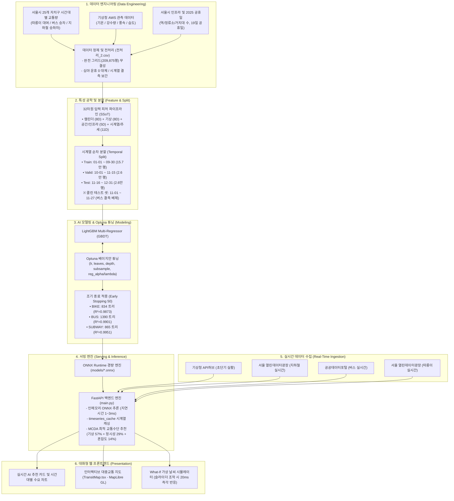

# 🌤️ Weather & Transit Web (날씨 및 대중교통 실시간 안내 서비스)

실시간 날씨 정보(기상청 초단기실황)와 서울시 대중교통(지하철 및 버스 실시간 도착 정보)을 통합 제공하는 웹 서비스 프로젝트입니다.

---

## 📌 주요 기능

1. **기상청 초단기실황 날씨 정보**
   - 현재 위치(격자 좌표) 기준 실시간 기온(T1H), 1시간 강수량(RN1), 강수 형태(PTY), 습도(REH), 풍속(WSD) 조회
   - 기상청 API허브 기준 매시 정각 발표 자료 자동 동기화 (매시 10분 이전 호출 시 전 시간대 데이터 자동 보정)

2. **서울시 지하철 실시간 도착 정보**
   - 지하철역별 실시간 열차 도착 현황 (방면, 도착 메시지, 남은 시간, 급행/일반 여부)
   - 서울 열린데이터광장 OpenAPI 연동

3. **서울시 버스 도착 정보 (공공데이터포털)**
   - **노선 전체 정류소 도착 예정 정보 조회 (`getArrInfoByRouteAll`)**: 노선 ID(`busRouteId`) 기준 전체 경유 정류소별 첫차/막차 도착 예정 메시지(`arrmsg1`, `arrmsg2`) 및 정류소 순번(`staOrd`) 제공
   - **정류소별 저상버스 도착 예정 정보 조회 (`getLowArrInfoByStId`)**: 정류소 고유 ID(`stId`, 9자리) 기준 저상버스 실시간 도착 정보 제공
4. **서울시 따릉이 실시간 대여정보 (서울 열린데이터광장 `bikeList`)**
- **대여소별 잔여 자전거/거치대 수**: 지도 마커 팝업에 실시간 값을 표시하고, 따릉이 필터에서 줌 14.5 이상이면 주변 실제 대여소를 AI 모델 추론 마커와 동일한 UI로 통합 표시 (`/api/v1/transit/bike/stations/{nearby|search|by-number/{no}|{id}}`)
   - `resultType="json"` 응답 처리 및 인증키 이중 인코딩(Double Encoding) 방지 적용

4. **실시간 대화형 대시보드 & MapLibre GL 지도 (React)**
   - OpenStreetMap(OSM) 래스터 타일 기반의 실시간 대화형 웹 지도
   - **수도권 전체 561개 지하철역 정밀 GPS 좌표 완벽 매핑**:
     - 서울 열린데이터광장 역사마스터(`subwayStationMaster`) API 전수 검증을 거친 소수점 6자리 정밀 GPS 좌표 탑재
     - 좌표 불일치 및 특정 위치 뭉침 현상(fallback 좌표) 완전 해결
   - **새로고침 시 탭 상태 유지 (URL Hash & LocalStorage 연동)**:
     - `지도 보기` 탭(#map)이나 `경로 추천` 탭(#route)에서 새로고침(F5)을 해도 기존 탭이 유지되도록 영속화
   - **지하철역 검색 키보드 접근성 완벽 지원**:
     - 지도 탭 및 경로 추천 탭(출발역/도착역) 검색 시 `Enter`, `Tab` + `Enter`, `방향키(↑/↓)`로 역을 선택 가능
     - 하이라이트된 검색 항목 자동 스크롤(Auto Scroll) 및 단축키 안내 툴팁 지원
   - **지도 역 마커 겹침 방지 (화면 충돌 감지 & 확대 시 순차 노출)**:
     - 축소 시 역 마커들이 겹치는 시각적 혼잡을 방지하기 위해 겹치는 구역에서는 핵심 거점 역 1개만 우선 노출
     - 지도를 확대(Zoom-in)하면 인접한 세부 역 및 정류소가 부드럽게 순차적으로 모두 나타남
     - 사용자가 검색하거나 선택한 역은 항상 최우선으로 화면에 100% 표시됨
   - 가상 강수량(0~10mm/h) 조절에 따른 실시간 대중교통 수요 전이 시뮬레이터 제공
   - 📖 **프론트엔드 상세 가이드**: [프론트엔드 README](Weather-Transport%20Recommendation%20UI/README.md)
   - 🧠 **백엔드 AI 추론 모델 사양서**: [AI 추론 모델 개발 가이드](docs/AI_INFERENCE_MODEL_SPEC.md)
   - 📈 **모델 성능 비교 분석 보고서**: [ONNX 모델 성능 비교 분석 보고서 (v2: 실피처 32차원 vs 25차원 배포본)](docs/MODEL_PERFORMANCE_REPORT.md)
   - 🧩 **AI 모델 사양서 (모델 규격 분리본)**: [AI 모델 사양서](docs/AI_MODEL_SPEC.md)
   - 📦 **데이터 전처리 산출물 인수 검수·요청서**: [데이터 전처리 전달 사항](docs/DATA_PREPROCESSING_HANDOFF.md)

---

## 🏛️ 전체 시스템 및 데이터 파이프라인 아키텍처



---

## 🛠️ 기술 스택 및 환경

- **언어**: Python 3.10+
- **주요 라이브러리**: `requests`, `python-dotenv`
- **외부 API**:
  - [기상청 API허브](https://apihub.kma.go.kr/) - 단기예보조회서비스 (초단기실황조회 `getUltraSrtNcst`)
  - [서울 열린데이터광장](https://data.seoul.go.kr/) - 서울시 지하철 실시간 도착 정보 (`realtimeStationArrival`)
  - [공공데이터포털](https://www.data.go.kr/) - 서울특별시 버스도착정보조회 서비스 (`ws.bus.go.kr/api/rest/arrive`)

---

## ⚙️ 환경 변수 설정 (`.env`)

저장소에 포함된 [`.env.example`](.env.example) 템플릿 파일을 복사하여 루트 경로에 `.env` 파일을 생성하고 발급받은 실제 API 키를 설정합니다.

  ```bash
# Windows PowerShell
Copy-Item .env.example .env

# Bash / Linux
cp .env.example .env
```

```env
# 기상청 API허브 (https://apihub.kma.go.kr - 초단기실황조회)
KMA_APIHUB_KEY=your_kma_apihub_key_here

# 서울 열린데이터광장 (https://data.seoul.go.kr - 지하철 실시간 도착 정보)
SEOUL_SUBWAY_API_KEY=your_seoul_subway_key_here

# 공공데이터포털 (https://www.data.go.kr - 서울특별시 버스도착정보조회)
DATA_GO_KR_API_KEY=your_data_go_kr_key_here

# 백엔드 서버 URL (프론트엔드 연동 시)
VITE_API_BASE_URL=http://localhost:8000
```

---

## 🐳 Docker 컨테이너 원클릭 실행 (권장 / 프로덕션 & 미니 PC)

본 프로젝트는 **FastAPI 백엔드 (32차원 ONNX AI 추론 & 공공 API 중계)**와 **Nginx + React 프론트엔드 (MapLibre GL 대화형 지도)**가 완전한 멀티 컨테이너 아키텍처(`docker-compose.yml`)로 패키징되어 있어, OS 환경(Windows, macOS, Linux, 미니 PC 등)에 관계없이 명령어 한 줄로 즉시 빌드 및 실행할 수 있습니다.

### 1. 환경 변수 파일 준비
```bash
# .env 파일 생성 및 공공 API 키 입력
cp .env.example .env
```

### 2. 컨테이너 빌드 및 백그라운드 기동
```bash
docker compose up --build -d
```

### 3. 서비스 접속 안내
| 서비스 | 접속 URL | 설명 |
|---|---|---|
| **🌐 웹 대시보드 (Frontend)** | **`http://localhost:3100`** | Nginx 리버스 프록시 연동 SPA (포트 3100) |
| **⚡ AI 추론 API (Backend)** | **`http://localhost:8100/docs`** | FastAPI Swagger 대화형 API 문서 (포트 8100) |
| **🩺 시스템 헬스체크** | `http://localhost:8100/health` | ONNX 세션 인메모리 웜업 및 서킷 브레이커 상태 |

### 4. 주요 컨테이너 관리 명령어
```bash
# 컨테이너 구동 상태 및 헬스체크 확인
docker compose ps

# 실시간 AI 추론 및 대중교통 도착 로그 모니터링
docker compose logs -f

# 서비스 중지
docker compose down
```

> 💡 **리눅스 미니 PC 및 홈서버(PM2 / Nginx Proxy Manager) 배포 안내**:
> 기존에 다른 서비스(포트 3000, 8000 등)를 구동 중인 Ubuntu 홈서버/미니 PC(Intel N100 등) 환경에서 PM2나 Docker, NPM(Nginx Proxy Manager)으로 배포하는 상세 절차는 **[`docs/SERVER_DEPLOYMENT_GUIDE.md`](docs/SERVER_DEPLOYMENT_GUIDE.md)**를 참조하세요.

---

## 🚀 리눅스 홈서버 / 미니 PC 배포 (PM2 & 호스트 배포)

이미 서버에서 다른 웹 서비스가 구동 중이거나 PM2 프로세스 매니저를 사용하는 경우, 다음 가이드를 통해 초경량으로 즉시 구동할 수 있습니다:
- 📖 **서버 배포 완벽 가이드**: [리눅스 홈서버 / 미니 PC 배포 가이드](docs/SERVER_DEPLOYMENT_GUIDE.md)
- 기본 포트: **프론트엔드 `3100`**, **백엔드 `8100`** (기존 서비스와의 포트 충돌 방지 완비)
- 실행 명령어 한 줄 요약:
  ```bash
  pm2 start ecosystem.config.cjs
  ```

---

## 💻 로컬 개발 환경 직접 실행 (Local Development)

### 1. 가상환경 활성화 및 패키지 설치
  ```bash
# 가상환경 생성 (최초 1회)
python -m venv venv

# 가상환경 활성화 (Windows PowerShell)
.\venv\Scripts\Activate.ps1

# 필수 의존성 패키지 설치
pip install -r requirements.txt
```

### 2. API 연결 테스트 실행
  ```bash
python tests/test_api.py
```

정상 연동 시 터미널에서 다음과 같은 테스트 결과를 확인할 수 있습니다:
```text
==================================================
[1] 기상청 실시간 날씨 API 테스트 (초단기실황)
==================================================
[성공] 기준 시각: 20260926 1800 (격자: nx=61, ny=125)
- 기온(T1H): 24.3 ℃
- 1시간 강수량(RN1): 0 mm
- 강수 형태(PTY): 없음(맑음/흐림) (0)
- 습도(REH): 59 %
- 풍속(WSD): 0.8 m/s

==================================================
[2] 서울 버스 도착 정보 API 테스트
==================================================

[기능 1] get_arrival_by_route_all(busRouteId='100100118') 테스트:
>> 전체 104개 정류소 중 상위 3개 정류소 도착 현황:
- [1] 구산동사거리(111000299): 1번째=출발대기 | 2번째=출발대기
- [2] 한솔아파트입구.선정중학교후문(111000181): 1번째=출발대기 | 2번째=출발대기
- [3] 갈현동미미아파트(111000182): 1번째=출발대기 | 2번째=출발대기

[기능 2] get_low_bus_arrival_by_stid(stId='111000299') 테스트:
>> 저상버스 도착 정보 3건:
- [753번] @ 구산동사거리: 출발대기 | 출발대기
- [7613번] @ 구산동사거리: [차고지출발]  | 출발대기
- [8774번] @ 구산동사거리: 8분11초후[5번째 전] | 52분54초후[34번째 전]

==================================================
[3] 서울 지하철 도착 정보 API 테스트 (역명: 강남)
==================================================
[성공] '강남'역 실시간 도착 정보 (5건):
- [성수행 - 역삼방면] (일반) 현황: 전역 도착 (예정: 90초)
- [신사행 - 신논현방면] (일반) 현황: 전역 진입 (예정: 0초)
- [성수행 - 역삼방면] (일반) 현황: 7분 후 (예정: 420초)
- [신사행 - 신논현방면] (일반) 현황: [4]번째 전역 (판교) (예정: 0초)
- [광교행 - 양재방면] (일반) 현황: 전역 도착 (예정: 0초)
```

### 3. 백엔드 AI 추론 서버 실행 및 검증 (FastAPI & ONNX)
- **통합 검증 테스트 스위트 실행**:
  ```bash
  python tests/test_inference.py
  ```
  *(ONNX 세션 웜업, 32차원 Feature Vector 정합성, 맑은 날/폭우 모달 시프트, 10회 연속 레이턴시 SLA 벤치마크 검증)*

- **FastAPI 백엔드 서버 실행**:
  ```bash
  uvicorn main:app --host 0.0.0.0 --port 8000 --reload
  ```
  - Swagger 대화형 API 문서: http://localhost:8000/docs
  - 서버 헬스체크: http://localhost:8000/health
  - 📖 **상세 엔드포인트 및 서빙 가이드**: [AI 추론 백엔드 서버 구축 가이드](docs/BACKEND_INFERENCE_SERVER.md)

### 4. 프론트엔드 웹 대시보드 실행 (React / Vite)
  ```bash
# 프론트엔드 디렉토리 이동
cd "Weather-Transport Recommendation UI"

# 의존성 패키지 설치
npm install

# 로컬 개발 서버 구동 (포트 8443)
npm run dev
```
- 브라우저 접속: **`http://localhost:8443/`**
- 상단 메뉴에서 **[지도]** 탭을 클릭하여 MapLibre GL JS + OSM 지도와 AI 예측 시뮬레이터를 확인하실 수 있습니다.

---

## 🌿 Git 브랜치 협업 및 동기화 규칙 (이슈 기반 개발 워크플로우)

본 프로젝트는 **GitHub 이슈 생성 ➡️ `dev` 기준 브랜치 분기 ➡️ 작업 중 `git pull origin dev` ➡️ PR(Pull Request) 병합** 흐름으로 협업을 진행합니다. 최신 기능(실시간 버스 추적, 지도 탑뷰, 32차원 AI 모델 등) 누락이나 버전 역행을 방지하기 위해 다음 작업 규칙을 준수해 주세요:

### 1. 깃허브 이슈에서 새 작업 브랜치 생성 시 (⭐ 필수 확인!)
1. **GitHub Issues**에서 새 이슈를 등록합니다.
2. 이슈 페이지 우측 사이드바 **Development** 영역의 **`Create a branch`**를 클릭합니다.
3. ⚠️ **가장 중요한 확인 사항 (Source branch)**:
   - 브랜치 생성 팝업에서 **`Source branch`** 기본값(`main`)을 반드시 **`dev`**로 변경해 주세요!
   - *(기본값인 `main`으로 두면 과거 시점에서 분기되어 다른 팀원이 머지한 최신 기능이 누락됩니다.)*
4. 로컬 터미널에서 새로 생성된 원격 브랜치를 가져와 작업을 시작합니다:
   ```bash
   git fetch origin
   git checkout <생성된-이슈-브랜치명>
   ```

### 2. 작업 도중 수시로 최신 `dev` 동기화 (`git pull origin dev`)
작업 브랜치에서 개발을 진행하는 도중 다른 팀원이 `dev`에 머지한 최신 코드나 신규 기능을 내 작업 브랜치로 가져오려면 아래 명령어를 수시로 실행합니다:
```bash
git pull origin dev
```
- 내 작업 브랜치에 최신 `dev` 내용이 즉시 병합되어 충돌을 사전에 예방할 수 있습니다.

### 3. 작업 완료 후 PR 생성
작업이 완료되면 원격 저장소에 푸시한 후 **`dev` 브랜치를 타깃으로 PR**을 생성합니다:
```bash
git push origin <작업-브랜치명>
# GitHub에서 Pull Request 생성: <작업-브랜치명> ➡️ dev
```

---

## 🔑 API 발급 및 활용 신청 안내

1. **기상청 API허브 (`KMA_APIHUB_KEY`)**
   - [기상청 API허브](https://apihub.kma.go.kr/) 회원가입 후 로그인
   - **[동네예보조회서비스(2.0)]** 검색 후 **초단기실황조회** 활용 신청
   - 마이페이지 > 인증키 복사 후 `.env`의 `KMA_APIHUB_KEY`에 입력

2. **서울 열린데이터광장 (`SEOUL_SUBWAY_API_KEY`)**
   - [서울 열린데이터광장](https://data.seoul.go.kr/) 회원가입 후 인증키 신청
   - **[서울시 지하철 실시간 도착정보]** 데이터셋 검색 후 **활용 신청** (실시간 서비스 사용 권한 획득)
   - 승인된 일반 인증키를 `.env`의 `SEOUL_SUBWAY_API_KEY`에 입력

3. **버스 도착/정류소/노선/위치/환승 정보 (`DATA_GO_KR_API_KEY`)**
   - [공공데이터포털(data.go.kr)](https://www.data.go.kr/)에서 아래 **5개 서비스**를 모두 **[활용신청]**(자동 승인)해야 실시간 버스 및 정류소·노선 기능이 정상 동작합니다:
     1. [서울특별시_버스도착정보조회 서비스](https://www.data.go.kr/data/15000314/openapi.do) (정류소별 버스 도착 예정 시간)
     2. [서울특별시_정류소정보조회 서비스](https://www.data.go.kr/data/15000303/openapi.do) (주변 정류소 및 이름 검색)
     3. [서울특별시_버스위치정보조회 서비스](https://www.data.go.kr/data/15000332/openapi.do) (실시간 버스 차량 GPS 위치)
     4. [서울특별시_노선정보조회 서비스](https://www.data.go.kr/data/15000193/openapi.do) (노선별 경유 정류소 목록 및 경로)
     5. [서울특별시_대중교통환승경로 조회 서비스](https://www.data.go.kr/data/15000414/openapi.do) (대중교통 환승 경로 연계)
   - 발급된 **일반 인증키(Decoding 키)**를 `.env`의 `DATA_GO_KR_API_KEY`에 입력 (공통 인증키 하나로 5개 서비스에 일괄 적용됨)
   - **[주의 사항]**:
     - 신청/발급 직후 서울시 TOPIS 버스 서버 동기화에 약 30분~1시간 소요될 수 있습니다.
     - requests/httpx 라이브러리의 자동 파라미터 인코딩과의 충돌(이중 인코딩 오류) 방지를 위해 반드시 **Decoding 키**를 설정하세요.

---


4. **따릉이 실시간 대여정보 (`SEOUL_DATA_API_KEY`, 선택: `SEOUL_BIKE_API_KEY`)**
- [서울 열린데이터광장](https://data.seoul.go.kr/)의 `서울특별시 공공자전거 실시간 대여정보(bikeList)` 사용 (기존 `SEOUL_DATA_API_KEY` 일반 인증키로 동작)
- 전용 키를 쓰려면 `.env`에 `SEOUL_BIKE_API_KEY`를 지정 (미설정 시 `SEOUL_DATA_API_KEY` 재사용)
## 📁 디렉토리 구조

```text
weather-transit-web/
├── docker-compose.yml                  # 🐳 Docker Compose 멀티 컨테이너 오케스트레이션
├── Dockerfile.backend                  # 🐍 FastAPI 백엔드 (Python 3.11-slim + ONNX) 이미지 빌드 명세
├── Dockerfile.frontend                 # ⚛️ React 프론트엔드 (Node 20 Multi-stage + Nginx) 빌드 명세
├── ecosystem.config.cjs                # ⚡ PM2 프로세스 매니저 설정 (Backend :8100, Frontend :3100)
├── nginx.conf                          # 🌐 Nginx SPA 라우팅 & 백엔드 API 리버스 프록시 설정
├── .env                                # API 키 및 환경 변수 설정 파일 (Git 추적 제외)
├── .env.example                        # 환경 변수 예시 템플릿 (Git 포함, 참고용)
├── .gitignore                          # Git 추적 제외 목록 (.env, venv 등)
├── requirements.txt                    # Python 의존성 라이브러리 목록
├── main.py                             # ⚡ FastAPI 백엔드 AI 추론 서버 (ONNX 인메모리 로딩 & 서빙)
├── timeseries_cache.py                 # ⏱️ 시계열 AI 추론 인메모리 캐싱 레이어
├── scripts/                            # 🛠️ 데이터 빌드 및 역사 좌표 검증 스크립트 모음
│   ├── build_full_subway_data.py       # 수도권 전철 마스터 데이터 빌더
│   └── update_station_coords.py        # 역사 GPS 좌표 전수 캘리브레이션 도구
├── tests/                              # 🧪 테스트 및 검증 스위트 디렉토리
│   ├── __init__.py                     # 테스트 패키지 초기화
│   ├── test_inference.py               # ONNX 모델 및 추천 API 통합 검증 스크립트
│   └── test_api.py                     # 날씨/버스/지하철 외부 공공 API 연동 검증 스크립트
├── README.md                           # 프로젝트 전체 안내 문서
├── models/                             # 🧠 학습 완료된 ONNX 머신러닝 모델 가중치 파일
│   ├── lgb_bike_demand.onnx            # 따릉이 대여 수요 예측 ONNX 모델
│   ├── lgb_bus_demand.onnx             # 버스 승차 수요 예측 ONNX 모델
│   └── lgb_subway_demand.onnx          # 지하철 승하차 수요 예측 ONNX 모델
├── data/                               # 📊 정류장 및 교통 마스터 데이터
│   └── subway_stations.json            # 수도권 전체 지하철역 마스터 데이터셋
├── docs/                               # 📖 시스템 아키텍처 및 요구사항 명세서
│   ├── CHANGELOG.md                    # 통합 변경 이력
│   ├── TODO.md                         # 📋 향후 개발 백로그 (모바일 UI 반응형 최적화 등)
│   ├── SERVER_DEPLOYMENT_GUIDE.md      # 🚀 리눅스 홈서버 / 미니 PC (PM2, Docker, NPM) 배포 가이드
│   ├── AI_INFERENCE_MODEL_SPEC.md      # AI 추론 모델 개발 사양서 및 구축 가이드
│   ├── BACKEND_INFERENCE_SERVER.md     # FastAPI AI 추론 백엔드 서버 구축 및 운영 가이드
│   ├── MODEL_PERFORMANCE_REPORT.md     # ONNX 모델 성능 비교 분석 보고서 (v2: 실피처 32차원 vs 25차원)
│   ├── AI_MODEL_SPEC.md                # AI 모델 사양서 (모델 규격만 분리한 문서)
│   ├── DATA_PREPROCESSING_HANDOFF.md   # 데이터 전처리 산출물 인수 검수·회신 요청서
│   └── REQUIREMENTS.md                 # 프로젝트 요구사항 명세서
└── Weather-Transport Recommendation UI/ # 🌐 프론트엔드 React 웹 대시보드
    ├── README.md                       # 프론트엔드 전용 안내 문서
    └── docs/                           # 📖 프론트엔드 상세 문서
```

---

## 📋 변경 이력 (Changelog)

- **프론트엔드 변경 이력**: 기능별 상세 변경 내역 및 원인 분석은 **[`Weather-Transport Recommendation UI/docs/CHANGELOG.md`](Weather-Transport%20Recommendation%20UI/docs/CHANGELOG.md)**를 참조하세요.

