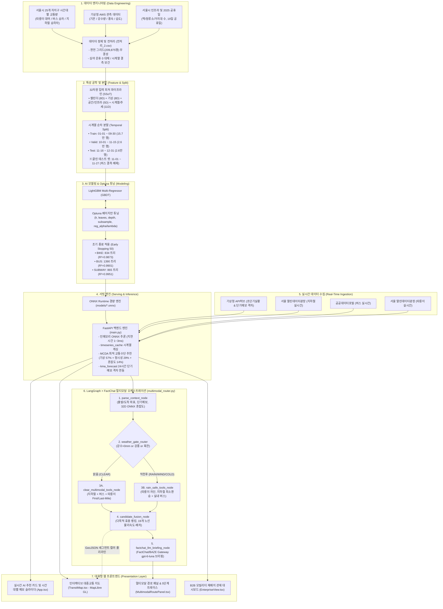

# 🌤️ Weather & Transit Web (날씨 및 대중교통 실시간 안내 서비스)

실시간 날씨 정보(기상청 초단기실황)와 서울시 대중교통(지하철 및 버스 실시간 도착 정보)을 통합 제공하는 웹 서비스 프로젝트입니다.

---

## 💡 작품 개요 (선정 동기, 목적, 필요성)

### 1. 선정 동기 및 배경 (Motivation)
최근 교통수단의 다양화로 전기자전거, 전동킥보드 등 새로운 이동수단의 이용이 급격히 증가하고 있습니다. 이러한 신규 이동수단은 기존 대중교통과 비교했을 때 **기상 상황의 영향을 크게 받는다**는 뚜렷한 특징이 있습니다.
- **기상 및 시공간에 따른 수요 변동**: 비나 눈이 오는 경우 전기자전거나 전동킥보드와 같은 개인형 이동장치(PM)의 이용량은 급감하는 반면, 버스나 지하철, 택시 등 타 교통수단의 이용 수요는 급증합니다. 또한 기상뿐만 아니라 시간대, 요일, 지역적 특성에 따라서도 이용자가 선택하는 교통수단과 수요량이 크게 달라집니다.
- **수급 불균형 문제 발생**: 현재 교통수단의 종류는 다양해지고 있으나, 특정 상황에서 어떤 수단의 수요가 언제 어디서 증감할지 사전에 파악하기는 어렵습니다. 이로 인해 특정 교통수단의 이용자가 한 지역이나 시간대에 집중될 경우 차량 부족이 발생하거나, 반대로 이용량이 적은 지역에 이동수단이 과도하게 방치·배치되는 문제가 지속되고 있습니다.
- **해결 방향**: 따라서 기상과 시간, 지역 등의 빅데이터를 융합 활용하여 교통수단의 이용 수요를 사전에 정밀 예측하고, 이를 실제 이동수단의 최적 배치 및 운영에 활용할 필요성이 대두되었습니다.

### 2. 개발 목적 (Objective)
이에 AI 머신러닝 예측 모델과 기상 관측 데이터, 시간대별 교통량 빅데이터 및 자치구 공간 인프라 데이터를 결합하여 **지역별·시간대별 교통수단 이용 수요를 실시간 예측하는 통합 모빌리티 웹 시스템**을 개발하고자 합니다.
- 수집된 2023~2025 3개년 62.9만 건의 시계열 통합 데이터를 정밀 전처리하고 고성능 머신러닝(LightGBM / ONNX) 기반 예측 모델을 구축하여, 기상 상황과 시간, 지역에 따른 교통수단(따릉이, 버스, 지하철) 이용량의 변화를 정량 분석합니다.
- 예측된 결과와 혼잡도 지수를 웹 시스템에서 대화형 인터랙티브 지도(MapLibre GL JS) 및 직관적인 시계열 차트 형태로 제공하여, 수요 변화를 누구나 쉽게 확인하고 활용할 수 있도록 구현합니다.

### 3. 필요성 및 기대 효과 (Impact)
1. **기업 및 교통수단 운영사 (B2B / B2G)**:
   - **사전 재배치 및 운영 효율화**: 비가 오는 날에는 전기자전거/따릉이의 수요가 급감하므로 해당 지역의 기기 배치 수요를 선제적으로 줄이고, 수요가 집중되는 지하철역·버스 정류소 연계 교통수단을 추가 배치·증차하는 방식으로 탄력적 운영이 가능합니다. 반대로 맑고 온화하여 이용 수요가 급증하는 지역에는 미리 기기를 확충 배치할 수 있습니다.
   - **자원 낭비 최소화**: 이동수단의 공급 부족이나 불필요한 과잉 방치를 원천 차단하고 재배치 물류 비용을 절감합니다.
2. **대중교통 이용 시민 (B2C)**:
   - 특정 지역과 시간대에 예상되는 교통수단별 혼잡도와 수요를 미리 확인하여, 본인에게 가장 안전하고 쾌적한 최적 이동 계획을 수립할 수 있습니다.
   - 원하는 교통수단이 부족하여 이용하지 못하는 불편을 최소화하고 도심 이동성을 극대화합니다.

---

## 📌 주요 기능

1. **기상청 실시간 초단기실황 및 단기예보 동기화**
   - **초단기실황 (`getUltraSrtNcst`)**: 현재 위치(격자 좌표) 기준 실시간 기온(T1H), 1시간 강수량(RN1), 강수 형태(PTY), 습도(REH), 풍속(WSD) 조회 및 10분 캐싱
   - **단기예보 격자자료 (`nph-dfs_shrt_grd`)**: 한반도 149×253 전역 격자 데이터 연동을 통해 서울시 25개 자치구 24시간 매시간별 기온(TMP), 1시간 강수량(PCP), 하늘상태(SKY), 강수형태(PTY) 일괄 추출 및 30분 TTL 인메모리 캐시 (<1ms 초저지연)

2. **시간대별(00시~23시) 날씨 예보 슬라이더 & AI 실시간 재추론**
   - 메인 대시보드 상단에 00시부터 23시까지 탐색 가능한 **인터랙티브 시간대 슬라이더** 탑재
   - 슬라이더 조작 시 해당 시간대의 기상청 실제 예보 날씨(기온·강수량)가 날씨 카드에 즉시 자동 반영
   - 선택된 시간대의 기상 조건에 따라 3대 대중교통(지하철, 버스, 따릉이) AI 추천 점수, 랭킹 및 예측 이용객 수가 실시간 자동 재추론

3. **B2B 기업·운영사용 모빌리티 수요 예측 및 재배치(Fleet Rebalancing) 관제 (`/enterprise`)**
   - 기상 변화 및 시간대별 25개 자치구 32차원 ONNX AI 일괄 추론 기반 수급 불균형(Surplus/Deficit) 자동 분석
   - 우천 및 피크 시간대 따릉이(PM) 잉여 회수(Recall) 및 긴급 추가 배치(Deploy) 권고 수량 산출
   - 시내버스 혼잡 구간 배차 증차 가이드, 상위 5대 긴급 조치 구역 랭킹 및 일일 운영 계획 CSV 다운로드 기능 제공

4. **LangGraph × FactChat LLM 멀티모달(지하철+버스+따릉이) 통합 경로 탐색 엔진 (`POST /api/v1/routes/multimodal-search`)**
   - **5단계 LangGraph `StateGraph` 파이프라인**: `parse_context_node` ➔ `weather_gate_router`(조건부 분기) ➔ `clear_multimodal_tools_node` / `rain_safe_tools_node` ➔ `candidate_fusion_node` ➔ `factchat_llm_briefing_node`
   - **다목적 효용 함수(Multi-Objective Utility Score) 랭킹**: 소요시간(분)·환승횟수·운임(원)·32차원 ONNX 혼잡도·기상 조건을 종합 산출하여 무조건 따릉이를 1순위로 고정하지 않고 실제 최단·최적 수단(직통 지하철 vs 따릉이 환승단축 vs 버스+지하철)을 합리적으로 1순위 추천
   - **기상 안전 게이트 (Weather Gate) & 서울시 따릉이 권역 검증**: 강수(`rain > 0mm`)·강풍(`>= 8m/s`)·혹한(`<= -5°C`) 시 따릉이(PM) 구간을 자동 차단하고, 출발/반납 거점이 서울특별시 행정구역(`is_in_seoul`) 외곽(부천 송내·중동, 인천 부평, 경기 수원·판교 등)일 경우 서울시 전용 따릉이를 자동 배제하며 반경 850m 이내 실제 대여소/정류소만 매칭
   - **19개 노선별 주행속도·배차간격 물리 산식 & 실시간 열차 도착 연동**: 수도권 19개 전철 노선별 실측 표정속도·정차시간(`LINE_OPERATING_SPECS`), 시간대별(첨두/평시/심야) 배차간격(`get_line_headway`), 서울 열린데이터광장 실시간 열차 도착 API(`realtimeStationArrival`) 대기시간을 결합하여 구간 합계 = 총 소요시간 100% 정합성 보장
   - **서울교통공사 실측 환승통로 도보시간·거리(`0.2~8.0분`) 다익스트라 최적화 ([ROUTING-01])**: 서울교통공사 2025 최신 실측 데이터(공공데이터포털 `15044419`, 서울 열린데이터광장 `OA-13290`, 보행속도 1.2 m/s)를 연동하여 수도권 119개 주요 환승역의 실제 환승거리(m)와 소요시간을 다익스트라 가중치에 반영. 동일 환승 횟수 조건에서 막장 환승역(노원 `3.9분`, 종로3가 `4.3분`, 고속터미널 `4.4분`)을 자동 우회하고 개념 환승역(복정 `0.2분`, 충무로 `0.2분`, 김포공항 `0.5분`, 금정 `0.5분`)을 우선 선택하여 경로 세그먼트에 상세 표출
   - **FactChat LLM (`gpt-6-luna`) 자연어 브리핑 & 로컬 캐시 영속화**: 경로별 장단점과 추천 사유를 실시간 브리핑하며, 검색 결과를 메모리 + `localStorage`에 캐싱하여 `지도` ↔ `경로 추천` 탭 전환 시 재로딩 없이 즉시(0ms) 복원 및 브라우저 콘솔(`F12`)에 5단계 노드 트레이스 로깅

5. **서울시 지하철 실시간 도착 정보**
   - 지하철역별 실시간 열차 도착 현황 (방면, 도착 메시지, 남은 시간, 급행/일반 여부)
   - 서울 열린데이터광장 OpenAPI 연동 (`서울`/`서울역` 병렬 쿼리로 1·4·경의중앙·공항철도·GTX-A 전 노선 누락 방지)

6. **서울시 버스 도착 및 실시간 차량 위치 정보 (공공데이터포털)**
   - **노선 전체 정류소 도착 예정 정보 조회 (`getArrInfoByRouteAll`)**: 노선 ID(`busRouteId`) 기준 전체 경유 정류소별 첫차/막차 도착 예정 메시지(`arrmsg1`, `arrmsg2`) 및 정류소 순번(`staOrd`) 제공
   - **정류소별 저상버스 도착 예정 정보 조회 (`getLowArrInfoByStId`)**: 정류소 고유 ID(`stId`, 9자리) 기준 저상버스 실시간 도착 정보 제공
   - **노선 버스 실시간 GPS 추적**: 정류소 도착 목록에서 노선 클릭 시 노선 폴리라인 및 운행 중인 버스 차량 실시간 위치 마커 표시

7. **서울시 따릉이 실시간 대여정보 (서울 열린데이터광장 `bikeList`)**
   - **대여소별 잔여 자전거/거치대 수**: 지도 마커 팝업에 실시간 값을 표시하고, 따릉이 필터에서 줌 14.5 이상이면 주변 실제 대여소를 AI 모델 추론 마커와 동일한 UI로 통합 표시 (`/api/v1/transit/bike/stations/{nearby|search|by-number/{no}|{id}}`)
   - `resultType="json"` 응답 처리 및 인증키 이중 인코딩(Double Encoding) 방지 적용

8. **실시간 대화형 대시보드 & MapLibre GL 지도 (React)**
   - OpenStreetMap(OSM) 래스터 타일 기반의 실시간 대화형 웹 지도
   - **수도권 전체 561개 지하철역 정밀 GPS 좌표 완벽 매핑**:
     - 서울 열린데이터광장 역사마스터(`subwayStationMaster`) API 전수 검증을 거친 소수점 6자리 정밀 GPS 좌표 탑재
     - 좌표 불일치 및 특정 위치 뭉침 현상(fallback 좌표) 완전 해결
   - **새로고침 시 탭 상태 유지 (URL Hash & LocalStorage 연동)**:
     - `지도 보기` 탭(#map)이나 `경로 추천` 탭(#route)에서 새로고침(F5)을 해도 기존 탭이 유지되도록 영속화
   - **지하철역 검색 키보드 접근성 완벽 지원**:
     - 지도 탭 및 경로 추천 탭(출발역/도착역) 검색 시 `Enter`, `Tab` + `Enter`, `방향키(↑/↓)`로 역을 선택 가능
     - 하이라이트된 검색 항목 자동 스크롤(Auto Scroll) 및 단축키 안내 툴팁 지원
   - **지도 역 마커 겹침 방지 (화면 충돌 감지 & 확대 시 순차 노출)**:
     - 축소 시 역 마커들이 겹치는 시각적 혼잡을 방지하기 위해 겹치는 구역에서는 핵심 거점 역 1개만 우선 노출
     - 지도를 확대(Zoom-in)하면 인접한 세부 역 및 정류소가 부드럽게 순차적으로 모두 나타남
     - 사용자가 검색하거나 선택한 역은 항상 최우선으로 화면에 100% 표시됨
   - 기상청 초단기실황 날씨와 연계된 32차원 AI 기반 실시간 대중교통 혼잡도 예측 및 맞춤 추천 제공
---

## 📚 핵심 기술 문서 색인 (Documentation Index)

본 프로젝트의 시스템 아키텍처, 32차원 AI 모델 규격, 벤치마크 보고서, API 테스트 및 배포 가이드는 `docs/` 디렉토리에 모듈화되어 관리됩니다.

| 분류 | 문서명 | 핵심 내용 | 바로가기 |
| :---: | :--- | :--- | :---: |
| **아키텍처** | 🏛️ **시스템 아키텍처 명세서** | 5-Tier 계층형 구조, C4 컨텍스트, 엔드투엔드 파이프라인 플로우차트 | [`SYSTEM_ARCHITECTURE.md`](docs/SYSTEM_ARCHITECTURE.md) |
| **현행 데이터** | 📋 **현행 데이터 규격서 (v2.1)** | 2023~2025 3개년 28열 통합 정제 데이터셋 및 32차원 피처 생성 규격 | [`CURRENT_DATA_SPEC.md`](docs/CURRENT_DATA_SPEC.md) |
| **현행 성능** | 📈 **현행 모델 성능 리포트 (v2.1)** | 2026-10-29 신규 학습 32차원 ONNX 3종 성능($R^2 \ge 0.989$) 및 Optuna 파라미터 | [`CURRENT_MODEL_PERFORMANCE.md`](docs/CURRENT_MODEL_PERFORMANCE.md) |
| **AI 모델** | 🧩 **AI 모델 사양서 (단일 기준)** | 32차원 입력 특성 스키마, AHP 추천 스코어링 공식 및 서빙 규격 | [`AI_MODEL_SPEC.md`](docs/AI_MODEL_SPEC.md) |
| **에이전트** | 🤖 **ONNX 모델 × LangGraph 연동 명세서** | ONNX 실시간 혼잡도 추론 결과의 LangGraph 5단계 노드 및 다목적 효용 연동 규격 | [`ONNX_LANGGRAPH_INTEGRATION.md`](docs/ONNX_LANGGRAPH_INTEGRATION.md) |
| **백엔드** | 🚀 **백엔드 추론 서버 구축 가이드** | FastAPI 인메모리 ONNX 런타임 서빙, 시계열 캐싱 및 REST API 규격 | [`BACKEND_INFERENCE_SERVER.md`](docs/BACKEND_INFERENCE_SERVER.md) |
| **테스트** | 🧪 **공공 API 및 추론 연동 테스트 가이드** | 외부 공공 API 및 AI 추론 통합 테스트 스위트 실행 방법 및 트러블슈팅 | [`API_TEST_GUIDE.md`](docs/API_TEST_GUIDE.md) |
| **인프라** | 🐳 **Docker 컨테이너화 운영 가이드** | 백엔드-프론트엔드 멀티 컨테이너 패키징 및 운영 환경 구성안 | [`DOCKER_CONTAINERIZATION_PLAN.md`](docs/DOCKER_CONTAINERIZATION_PLAN.md) |
| **백로그** | 📋 **기술 부채 및 기능 확장 TODO** | 잔여 기술 과제, 실도로망/급행/버스 환승 API 고도화 로드맵 | [`TODO.md`](docs/TODO.md) |
| **데이터검수** | 🔍 **목업·하드코딩·미검증 데이터 전수 조사** | 정적 상수, 근사 산식, 폴백 데이터 현황 및 실시간 API 전환 방안 | [`TODO_MOCK_AND_UNVERIFIED_DATA.md`](docs/TODO_MOCK_AND_UNVERIFIED_DATA.md) |
| **아카이브** | 📦 **레거시 문서 보관소** | 구버전(v1/v2 단년도) 전처리 인수인계서 및 모델 성능 리포트 아카이브 | [`docs/archive/`](docs/archive/README.md) |
| **이력** | 📋 **프로젝트 변경 이력 (CHANGELOG)** | 버전별·날짜별 주요 신규 기능 구현, 버그 수정 및 인프라 개선 기록 | [`CHANGELOG.md`](docs/CHANGELOG.md) |
| **프론트** | 🖥️ **프론트엔드 대시보드 가이드** | React 18, MapLibre GL JS 인터랙티브 지도 컴포넌트 구조 및 개발 가이드 | [Frontend README](Weather-Transport%20Recommendation%20UI/README.md) |

---

## 🏛️ 전체 시스템 및 데이터 파이프라인 아키텍처



---

## 🛠️ 기술 스택 (Tech Stack)

본 프로젝트는 AI 머신러닝, 지리정보 시각화(GIS), 비동기 백엔드, 멀티 컨테이너 인프라가 유기적으로 결합된 풀스택 모빌리티 플랫폼입니다.

| 영역 (Domain) | 핵심 기술 및 프레임워크 | 역할 및 활용 상세 |
| :--- | :--- | :--- |
| **AI & Machine Learning** | `LightGBM`, `Optuna`, `ONNX Runtime`, `AHP-MCDA` | • 32차원 입력 피처 기반 3개 수단(따릉이/버스/지하철) 다중 회귀 수요 예측<br>• Optuna 베이지안 최적화 기반 자동 하이퍼파라미터 튜닝<br>• C++ 기반 인메모리 **1~3ms 초저지연(Latency SLA 달성) ONNX 추론**<br>• 계층화 분석법(AHP: 기상 57% + 정시성 29% + 혼잡도 14%) 기반 맞춤 추천 스코어링 |
| **Agent & LLM** | `LangGraph`, `FactChat (BAZE Gateway)` | • 상태 기반 멀티모달(지하철+버스+따릉이) 에이전트 경로 오케스트레이션<br>• OpenAI 호환 Gateway를 통한 외부 LLM 실시간 환승 판단 및 자연어 안내 브리핑 |
| **Backend & Data** | `FastAPI`, `Uvicorn`, `Pydantic v2`, `SQLite (WAL)`, `Pandas`, `NumPy` | • 비동기(Async) 고성능 Python RESTful API 서빙<br>• 32차원 데이터 계약(Data Contract) 및 피처 순서 3중 무결성 검증<br>• 시계열 래그(1h Lag, 3h Rolling) 인메모리/디스크 하이브리드 캐싱 (`timeseries_cache`)<br>• 2023~2025 서울시 3개년 62.9만 건 다년도 완전 그리드 데이터 전처리 및 특성 공학 |
| **Frontend & GIS** | `React 18`, `TypeScript`, `MapLibre GL JS`, `Vite`, `Tailwind CSS` | • 수도권 561개 역사 정밀 GPS 매핑 및 실시간 노선도 시각화<br>• 줌 레벨에 따른 마커 겹침 방지 **화면 충돌 감지(Collision Detection)** 알고리즘 탑재<br>• 모던 다크 테마 기반 반응형 대시보드 및 API 모니터링 콘솔 로거 (`apiLogger.ts`) |
| **DevOps & Infra** | `Docker`, `Docker Compose`, `Nginx` | • 백엔드(FastAPI) + 프론트엔드(Nginx 리버스 프록시) 멀티 컨테이너 원클릭 배포<br>• SPA 정적 에셋 고속 서빙, API 라우팅 및 CORS 게이트웨이 제어 |
| **Data Ingestion** | 기상청 API허브, 서울 열린데이터광장, 공공데이터포털 | • [기상청 API허브](https://apihub.kma.go.kr/): 초단기실황(`getUltraSrtNcst`) 및 24시간 단기예보 격자(`nph-dfs_shrt_grd`) 실시간 연동<br>• [서울 열린데이터광장](https://data.seoul.go.kr/): 지하철 실시간 도착 (`realtimeStationArrival`), 따릉이 대여소 실시간 현황 (`bikeList`)<br>• [공공데이터포털](https://www.data.go.kr/): 서울시 버스 실시간 도착정보 5종 (`getArrInfoByRouteAll` 등) |

---

## ⚙️ 환경 변수 설정 (`.env`)

저장소에 포함된 [`.env.example`](.env.example) 템플릿 파일을 복사하여 루트 경로에 `.env` 파일을 생성하고 발급받은 실제 API 키를 설정합니다.

  ```bash
# Windows PowerShell
Copy-Item .env.example .env

# Bash / Linux
cp .env.example .env
```

```env
# 기상청 API허브 (https://apihub.kma.go.kr - 초단기실황조회)
KMA_APIHUB_KEY=your_kma_apihub_key_here

# 서울 열린데이터광장 (https://data.seoul.go.kr - 지하철 실시간 도착 정보)
SEOUL_SUBWAY_API_KEY=your_seoul_subway_key_here
SEOUL_DATA_API_KEY=your_seoul_subway_key_here

# 공공데이터포털 (https://www.data.go.kr - 서울특별시 버스도착정보조회 5종)
DATA_GO_KR_API_KEY=your_data_go_kr_key_here

# FactChat / BAZE API Gateway (https://docs.factchat.kr - 멀티모달 경로 탐색 외부 LLM)
# - OpenAI 호환 ChatCompletions 인터페이스
FACTCHAT_BASE_URL=https://api.baze.co/v1/gateway
FACTCHAT_API_KEY=your_factchat_api_key_here
FACTCHAT_MODEL_NAME=gpt-6-luna

# 백엔드 서버 URL (프론트엔드 연동 시)
VITE_API_BASE_URL=http://localhost:8000
```

---

## 🐳 Docker 컨테이너 원클릭 실행 (권장 / 프로덕션 & 미니 PC)

본 프로젝트는 **FastAPI 백엔드 (32차원 ONNX AI 추론 & 공공 API 중계)**와 **Nginx + React 프론트엔드 (MapLibre GL 대화형 지도)**가 완전한 멀티 컨테이너 아키텍처(`docker-compose.yml`)로 패키징되어 있어, OS 환경(Windows, macOS, Linux, 미니 PC 등)에 관계없이 명령어 한 줄로 즉시 빌드 및 실행할 수 있습니다.

### 1. 환경 변수 파일 준비
```bash
# .env 파일 생성 및 공공 API 키 입력
cp .env.example .env
```

### 2. 컨테이너 빌드 및 백그라운드 기동
```bash
docker compose up --build -d
```

### 3. 서비스 접속 안내
| 서비스 | 접속 URL | 설명 |
|---|---|---|
| **🌐 웹 대시보드 (Frontend)** | **`http://localhost:3100`** | Nginx 리버스 프록시 연동 SPA (포트 3100) |
| **⚡ AI 추론 API (Backend)** | **`http://localhost:8100/docs`** | FastAPI Swagger 대화형 API 문서 (포트 8100) |
| **🩺 시스템 헬스체크** | `http://localhost:8100/health` (또는 `:3100/health`) | ONNX 세션 인메모리 웜업 및 서킷 브레이커 상태 (JSON) |
| **📊 관리자 로그 & 헬스 대시보드** | **`http://localhost:3100/health/dashboard`** | 백엔드 독립형 실시간 시스템 모니터링 & 로그 스트림 콘솔 (HTML) |

### 4. 주요 컨테이너 관리 명령어
```bash
# 컨테이너 구동 상태 및 헬스체크 확인
docker compose ps

# 실시간 AI 추론 및 대중교통 도착 로그 모니터링
docker compose logs -f

# 서비스 중지
docker compose down
```

> 💡 **리눅스 미니 PC 및 홈서버(PM2 / Nginx Proxy Manager) 배포 안내**:
> 기존에 다른 서비스(포트 3000, 8000 등)를 구동 중인 Ubuntu 홈서버/미니 PC(Intel N100 등) 환경에서 PM2나 Docker, NPM(Nginx Proxy Manager)으로 배포하는 상세 절차는 **[`docs/SERVER_DEPLOYMENT_GUIDE.md`](docs/SERVER_DEPLOYMENT_GUIDE.md)**를 참조하세요.

---

## 🚀 리눅스 홈서버 / 미니 PC 배포 (PM2 & 호스트 배포)

이미 서버에서 다른 웹 서비스가 구동 중이거나 PM2 프로세스 매니저를 사용하는 경우, 다음 가이드를 통해 초경량으로 즉시 구동할 수 있습니다:
- 📖 **서버 배포 완벽 가이드**: [리눅스 홈서버 / 미니 PC 배포 가이드](docs/SERVER_DEPLOYMENT_GUIDE.md)
- 기본 포트: **프론트엔드 `3100`**, **백엔드 `8100`** (기존 서비스와의 포트 충돌 방지 완비)
- 실행 명령어 한 줄 요약:
  ```bash
  pm2 start ecosystem.config.cjs
  ```

---

## 💻 로컬 개발 환경 직접 실행 (Local Development)

### 1. 가상환경 활성화 및 패키지 설치
  ```bash
# 가상환경 생성 (최초 1회)
python -m venv venv

# 가상환경 활성화 (Windows PowerShell)
.\venv\Scripts\Activate.ps1

# 필수 의존성 패키지 설치
pip install -r requirements.txt
```

### 2. API 연결 테스트 실행
기상청, 서울 버스, 서울 지하철 실시간 OpenAPI 연동 상태를 터미널에서 즉시 검증합니다:
```bash
python tests/test_api.py
```
> 📖 **실측 터미널 출력 결과 및 트러블슈팅 가이드**: 상세 출력 예시와 공공 API 장애 해결 가이드는 [공공 API 및 백엔드 추론 연동 테스트 가이드](docs/API_TEST_GUIDE.md)를 참조하십시오.

### 3. 백엔드 AI 추론 서버 실행 및 검증 (FastAPI & ONNX)
- **통합 검증 테스트 스위트 실행**:
  ```bash
  python tests/test_inference.py
  ```
  *(ONNX 세션 웜업, 32차원 Feature Vector 정합성, 맑은 날/폭우 모달 시프트, 10회 연속 레이턴시 SLA 벤치마크 검증)*

- **FastAPI 백엔드 서버 실행**:
  ```bash
  uvicorn main:app --host 0.0.0.0 --port 8000 --reload
  ```
  - Swagger 대화형 API 문서: http://localhost:8000/docs
  - 서버 헬스체크: http://localhost:8000/health
  - 📖 **상세 엔드포인트 및 서빙 가이드**: [AI 추론 백엔드 서버 구축 가이드](docs/BACKEND_INFERENCE_SERVER.md)

### 4. 프론트엔드 웹 대시보드 실행 (React / Vite)
  ```bash
# 프론트엔드 디렉토리 이동
cd "Weather-Transport Recommendation UI"

# 의존성 패키지 설치
npm install

# 로컬 개발 서버 구동 (포트 8443)
npm run dev
```
- 브라우저 접속: **`http://localhost:8443/`**
- 상단 메뉴에서 **[지도]** 탭을 클릭하여 MapLibre GL JS + OSM 지도와 AI 예측 시뮬레이터를 확인하실 수 있습니다.

---

## 🌿 Git 브랜치 협업 및 동기화 규칙 (이슈 기반 개발 워크플로우)

본 프로젝트는 **GitHub 이슈 생성 ➡️ `dev` 기준 브랜치 분기 ➡️ 작업 중 `git pull origin dev` ➡️ PR(Pull Request) 병합** 흐름으로 협업을 진행합니다. 최신 기능(실시간 버스 추적, 지도 탑뷰, 32차원 AI 모델 등) 누락이나 버전 역행을 방지하기 위해 다음 작업 규칙을 준수해 주세요:

### 1. 깃허브 이슈에서 새 작업 브랜치 생성 시 (⭐ 필수 확인!)
1. **GitHub Issues**에서 새 이슈를 등록합니다.
2. 이슈 페이지 우측 사이드바 **Development** 영역의 **`Create a branch`**를 클릭합니다.
3. ⚠️ **가장 중요한 확인 사항 (Source branch)**:
   - 브랜치 생성 팝업에서 **`Source branch`** 기본값(`main`)을 반드시 **`dev`**로 변경해 주세요!
   - *(기본값인 `main`으로 두면 과거 시점에서 분기되어 다른 팀원이 머지한 최신 기능이 누락됩니다.)*
4. 로컬 터미널에서 새로 생성된 원격 브랜치를 가져와 작업을 시작합니다:
   ```bash
   git fetch origin
   git checkout <생성된-이슈-브랜치명>
   ```

### 2. 작업 도중 수시로 최신 `dev` 동기화 (`git pull origin dev`)
작업 브랜치에서 개발을 진행하는 도중 다른 팀원이 `dev`에 머지한 최신 코드나 신규 기능을 내 작업 브랜치로 가져오려면 아래 명령어를 수시로 실행합니다:
```bash
git pull origin dev
```
- 내 작업 브랜치에 최신 `dev` 내용이 즉시 병합되어 충돌을 사전에 예방할 수 있습니다.

### 3. 작업 완료 후 PR 생성
작업이 완료되면 원격 저장소에 푸시한 후 **`dev` 브랜치를 타깃으로 PR**을 생성합니다:
```bash
git push origin <작업-브랜치명>
# GitHub에서 Pull Request 생성: <작업-브랜치명> ➡️ dev
```

---

## 🔑 API 발급 및 활용 신청 안내

1. **기상청 API허브 (`KMA_APIHUB_KEY`)**
   - [기상청 API허브](https://apihub.kma.go.kr/) 회원가입 후 로그인
   - **[동네예보조회서비스(2.0)]** 검색 후 **초단기실황조회** 활용 신청
   - 마이페이지 > 인증키 복사 후 `.env`의 `KMA_APIHUB_KEY`에 입력

2. **서울 열린데이터광장 (`SEOUL_SUBWAY_API_KEY`)**
   - [서울 열린데이터광장](https://data.seoul.go.kr/) 회원가입 후 인증키 신청
   - **[서울시 지하철 실시간 도착정보]** 데이터셋 검색 후 **활용 신청** (실시간 서비스 사용 권한 획득)
   - 승인된 일반 인증키를 `.env`의 `SEOUL_SUBWAY_API_KEY`에 입력

3. **버스 도착/정류소/노선/위치/환승 정보 (`DATA_GO_KR_API_KEY`)**
   - [공공데이터포털(data.go.kr)](https://www.data.go.kr/)에서 아래 **5개 서비스**를 모두 **[활용신청]**(자동 승인)해야 실시간 버스 및 정류소·노선 기능이 정상 동작합니다:
     1. [서울특별시_버스도착정보조회 서비스](https://www.data.go.kr/data/15000314/openapi.do) (정류소별 버스 도착 예정 시간)
     2. [서울특별시_정류소정보조회 서비스](https://www.data.go.kr/data/15000303/openapi.do) (주변 정류소 및 이름 검색)
     3. [서울특별시_버스위치정보조회 서비스](https://www.data.go.kr/data/15000332/openapi.do) (실시간 버스 차량 GPS 위치)
     4. [서울특별시_노선정보조회 서비스](https://www.data.go.kr/data/15000193/openapi.do) (노선별 경유 정류소 목록 및 경로)
     5. [서울특별시_대중교통환승경로 조회 서비스](https://www.data.go.kr/data/15000414/openapi.do) (대중교통 환승 경로 연계)
   - 발급된 **일반 인증키(Decoding 키)**를 `.env`의 `DATA_GO_KR_API_KEY`에 입력 (공통 인증키 하나로 5개 서비스에 일괄 적용됨)
   - **[주의 사항]**:
     - 신청/발급 직후 서울시 TOPIS 버스 서버 동기화에 약 30분~1시간 소요될 수 있습니다.
     - requests/httpx 라이브러리의 자동 파라미터 인코딩과의 충돌(이중 인코딩 오류) 방지를 위해 반드시 **Decoding 키**를 설정하세요.

---


4. **따릉이 실시간 대여정보 (`SEOUL_DATA_API_KEY`, 선택: `SEOUL_BIKE_API_KEY`)**
   - [서울 열린데이터광장](https://data.seoul.go.kr/)의 `서울특별시 공공자전거 실시간 대여정보(bikeList)` 사용 (기존 `SEOUL_DATA_API_KEY` 일반 인증키로 동작)
   - 전용 키를 쓰려면 `.env`에 `SEOUL_BIKE_API_KEY`를 지정 (미설정 시 `SEOUL_DATA_API_KEY` 재사용)

5. **FactChat / BAZE API Gateway (`FACTCHAT_API_KEY`, `FACTCHAT_BASE_URL`)**
   - [FactChat 공식 문서](https://docs.factchat.kr) 또는 [BAZE Gateway](https://api.baze.co)에서 API 키 발급
   - LangGraph 5단계 멀티모달 경로 탐색 엔진의 최적 수단 추천 사유, 날씨 조언 및 환승 팁을 자연어 브리핑(`gpt-6-luna`)으로 생성하는 데 활용됩니다.
   - **OpenAI 호환 인터페이스**: `ChatCompletions` 표준 규격을 따르며, 엔드포인트 URL은 기본값인 `https://api.baze.co/v1/gateway`로 설정됩니다.
   - **[Graceful Fallback 내장]**:
     - API 키가 미설정되어 있거나 외부 게이트웨이 지연/장애 발생 시, 서비스가 중단되지 않고 **로컬 규칙 기반 XAI 브리핑 엔진**으로 100% 자동 폴백되어 정상 동작합니다.

6. **수도권 전철 환승거리 및 소요시간 공공데이터 (오픈 데이터셋)**
   - **공공데이터포털**: [서울교통공사_환승역거리 소요시간 정보](https://www.data.go.kr/data/15044419/fileData.do) (데이터셋 ID: `15044419`)
   - **서울 열린데이터광장**: [서울교통공사_환승역거리 소요시간 정보](https://data.seoul.go.kr/dataList/OA-13290/S/1/datasetView.do) (서비스 ID: `OA-13290`)
   - **특징**: 성인 보행속도 `1.2 m/s` 기준 수도권 119개 주요 환승역 최단 환승거리 및 도보시간 실측 데이터셋.
   - **연동 현황**: 시스템 내부(`models/station_transfer_times.json`, 프론트엔드 `src/data/stationTransferTimes.json`)에 최신 실측치가 사전 정규화 탑재되어 있어, 별도 API 키 발급 없이 즉시 다익스트라 최적 경로 탐색 및 세그먼트 타임라인에 반영됩니다. (상세 규격: [`docs/CURRENT_DATA_SPEC.md`](docs/CURRENT_DATA_SPEC.md) §7)

---

## 📁 디렉토리 구조

```text
weather-transit-web/
├── docker-compose.yml                  # 🐳 Docker Compose 멀티 컨테이너 오케스트레이션
├── Dockerfile.backend                  # 🐍 FastAPI 백엔드 (Python 3.11-slim + ONNX) 이미지 빌드 명세
├── Dockerfile.frontend                 # ⚛️ React 프론트엔드 (Node 20 Multi-stage + Nginx) 빌드 명세
├── ecosystem.config.cjs                # ⚡ PM2 프로세스 매니저 설정 (Backend :8100, Frontend :3100)
├── nginx.conf                          # 🌐 Nginx SPA 라우팅 & 백엔드 API 리버스 프록시 설정
├── .env                                # API 키 및 환경 변수 설정 파일 (Git 추적 제외)
├── .env.example                        # 환경 변수 예시 템플릿 (Git 포함, 참고용)
├── .gitignore                          # Git 추적 제외 목록 (.env, venv 등)
├── requirements.txt                    # Python 의존성 라이브러리 목록
├── main.py                             # ⚡ FastAPI 백엔드 AI 추론 서버 (ONNX 인메모리 로딩 & 서빙)
├── multimodal_router.py                # 🧠 LangGraph × FactChat LLM 5단계 멀티모달 경로 탐색 엔진
├── kma_forecast.py                     # 🌦️ 기상청 단기예보 149×253 격자 파서 및 24시간 캐시 매니저
├── timeseries_cache.py                 # ⏱️ 시계열 AI 추론 인메모리 캐싱 레이어
├── scripts/                            # 🛠️ 데이터 빌드 및 역사 좌표 검증 스크립트 모음
│   ├── build_full_subway_data.py       # 수도권 전철 마스터 데이터 빌더
│   └── update_station_coords.py        # 역사 GPS 좌표 전수 캘리브레이션 도구
├── tests/                              # 🧪 테스트 및 검증 스위트 디렉토리
│   ├── __init__.py                     # 테스트 패키지 초기화
│   ├── test_inference.py               # ONNX 모델 및 추천 API 통합 검증 스크립트
│   ├── test_multimodal_routing.py      # LangGraph 멀티모달 경로 탐색·권역 제한·배차간격 검증 스위트
│   ├── test_kma_forecast.py            # 기상청 단기예보 24시간 시계열 검증 스위트
│   └── test_api.py                     # 날씨/버스/지하철 외부 공공 API 연동 검증 스크립트
├── README.md                           # 프로젝트 전체 안내 문서
├── models/                             # 🧠 학습 완료된 ONNX 머신러닝 모델 가중치 및 네트워크 그래프
│   ├── lgb_bike_demand.onnx            # 따릉이 대여 수요 예측 ONNX 모델
│   ├── lgb_bus_demand.onnx             # 버스 승차 수요 예측 ONNX 모델
│   ├── lgb_subway_demand.onnx          # 지하철 승하차 수요 예측 ONNX 모델
│   ├── transit_network.json            # 수도권 561개 지하철역 그래프 및 버스/따릉이 거점 마스터
│   └── station_transfer_times.json     # 서울교통공사 주요 환승역 실측 도보시간 및 환승거리 마스터
├── data/                               # 📊 정류장 및 교통 마스터 데이터
│   └── subway_stations.json            # 수도권 전체 지하철역 마스터 데이터셋
├── docs/                               # 📖 시스템 아키텍처 및 요구사항 명세서
│   ├── PROJECT_PROGRESS_REPORT.md      # 📊 프로젝트 분야별 진행상황 및 정형 테스트(QA/UAT) 종합 보고서
│   ├── CHANGELOG.md                    # 통합 변경 이력
│   ├── TODO.md                         # 📋 향후 개발 백로그 및 고도화 과제
│   ├── TODO_MOCK_AND_UNVERIFIED_DATA.md # 🔍 하드코딩·목업·미검증 데이터 전수 조사 및 수정 방안
│   ├── SERVER_DEPLOYMENT_GUIDE.md      # 🚀 리눅스 홈서버 / 미니 PC (PM2, Docker, NPM) 배포 가이드
│   ├── AI_INFERENCE_MODEL_SPEC.md      # AI 추론 모델 개발 사양서 및 구축 가이드
│   ├── BACKEND_INFERENCE_SERVER.md     # FastAPI AI 추론 백엔드 서버 구축 및 운영 가이드
│   ├── MODEL_PERFORMANCE_REPORT.md     # ONNX 모델 성능 비교 분석 보고서 (v2: 실피처 32차원 vs 25차원)
│   ├── AI_MODEL_SPEC.md                # AI 모델 사양서 (모델 규격만 분리한 문서)
│   ├── DATA_PREPROCESSING_HANDOFF.md   # 데이터 전처리 산출물 인수 검수·회신 요청서
│   └── REQUIREMENTS.md                 # 프로젝트 요구사항 명세서
└── Weather-Transport Recommendation UI/ # 🌐 프론트엔드 React 웹 대시보드
    ├── README.md                       # 프론트엔드 전용 안내 문서
    └── docs/                           # 📖 프론트엔드 상세 문서
```

---

## 📋 변경 이력 (Changelog)

- **프론트엔드 변경 이력**: 기능별 상세 변경 내역 및 원인 분석은 **[`Weather-Transport Recommendation UI/docs/CHANGELOG.md`](Weather-Transport%20Recommendation%20UI/docs/CHANGELOG.md)**를 참조하세요.

