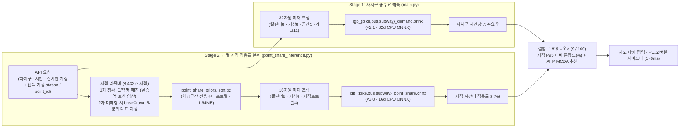

# 📘 AI 모델 통합 상위 가이드 (Master Model Overview)

> **최종 수정일**: 2026-11-18  
> **운영 모델 구성**: **Stage 1** `v2.1-multiyear-32d` (자치구 총수요, `32차원` ONNX) × **Stage 2** `v3.0-point-share-16d` (개별 지점 점유율, `16차원` ONNX)  
> **이 문서의 역할**: 본 프로젝트 AI 모델의 **진화 배경(`v1 ➔ v2.1 ➔ v3.0`), 2단계 아키텍처, 데이터셋, 피처 계약, CPU 학습 근거, 6대 평가 지표 및 2025년 전수 검증 성적표, 실서비스 서빙 구조**를 한곳에서 조망할 수 있는 **최상위 마스터 가이드**입니다.

---

## 🗺️ 하위 상세 문서 네비게이션 맵 (Quick Navigation Map)

특정 주제를 깊이 확인하려면 아래 전문 문서로 바로 이동하세요:

| 궁금한 주제 | 바로가기 문서 | 다룬 핵심 내용 |
| :--- | :--- | :--- |
| **32d/16d 모델 사양 · 피처 정의 · AHP 스코어링** | [`docs/AI_MODEL_SPEC.md`](./AI_MODEL_SPEC.md) | 32차원 피처 상세 공식, LightGBM 알고리즘 원리, AHP 추천 점수 산식, 배포 파일 해시 |
| **v2.1 vs v3.0 정량 성능표 · 벤치마크** | [`docs/CURRENT_MODEL_PERFORMANCE.md`](./CURRENT_MODEL_PERFORMANCE.md) | 세대별(`v1~v3.0`) 비교, Optuna 하이퍼파라미터, 2025년 `6,713만 셀` 전수 성적표 |
| **2단계 지점 모델 설계 · 누수 차단 · Gate G0~G4** | [`docs/MODEL_RETRAINING_PLAN.md`](./MODEL_RETRAINING_PLAN.md) | 지점 점유율 분해 설계, 데이터 리스크(`R1~R9`), CPU 학습 4대 근거, Phase `0~5` 체크리스트 |
| **3개년 원천 데이터셋 규격** | [`docs/CURRENT_DATA_SPEC.md`](./CURRENT_DATA_SPEC.md) | 28열 자치구 통합 데이터셋 및 전처리 컬럼 정의 |
| **FastAPI 서빙 엔진 · API 명세** | [`docs/BACKEND_INFERENCE_SERVER.md`](./BACKEND_INFERENCE_SERVER.md) | `main.py` × `point_share_inference.py`, `/api/v1/predict/recommendation`, `/health` 응답 규격 |
| **멀티모달 길찾기 AI 연동** | [`docs/ONNX_LANGGRAPH_INTEGRATION.md`](./ONNX_LANGGRAPH_INTEGRATION.md) | ONNX 혼잡도의 LangGraph `StateGraph` 및 기상 안전 게이트 연동 |
| **학습 스크립트 · Colab 노트북 · 리포트** | [`benchmarks/README.md`](../benchmarks/README.md) | `CastTransit_PointShare_v3.ipynb`, `run_point_share_v3.py`, 원천 벤치마크 JSON/MD |

---

## 1. 30초 핵심 요약 및 모델 진화 (`v1` ➔ `v2.1` ➔ `v3.0`)

본 서비스는 **기상 조건(기온·강수·습도·풍속)과 시공간 패턴에 따른 서울시 대중교통(지하철·버스·따릉이) 수요와 혼잡도를 실시간 예측**해 최적 수단 추천·멀티모달 길찾기·B2B 차량 재배치에 활용합니다.

| 세대 | 버전 (시기) | 핵심 특징 및 해상도 | 한계 및 해결 과제 |
| :---: | :--- | :--- | :--- |
| **1세대** | `v1` (`2026-10 초기`) | `2025` 단년도, `25차원` 자치구 모델 | 다년도 이상기후 일반화 부족, 인프라/전주 래그 7개 미포함 |
| **2세대** | `v2.1-multiyear-32d` (`2026-10-29`) | **`2023~2025` (`62.9만 행`), `32차원` 실피처**로 고도화 ($R^2 \ge 0.989$) | 자치구 전체 수요만 예측해 **같은 구 내 모든 역·정류소가 동일한 구 점수에 묶임** |
| **3세대 (현행)** | **`v2.1` × `v3.0-point-share-16d`** (`2026-11-16`, 이슈 `#116`) | **`2억 1,791만 행` (`18.69 GB`) 지점 점유율 추가 학습** **2단계 계층형 구조로 개별 `8,432`개 지점 독립 예측** | 구 내 서열 변별력 `0.0000 ➔ 0.9860`, 지점 WAPE 최대 **`-85.7%` 절감** 및 실서비스 배포 완료 |

---

## 2. 2단계 계층형 예측 아키텍처 (`Stage 1` × `Stage 2`)

기존 자치구 모델의 높은 총량 정확도($R^2 \ge 0.989$)를 보존하면서 개별 정류소·대여소·역 단위로 수요를 정밀 분해하기 위해 **Two-Stage Disaggregation(2단계 점유율 분해)** 구조를 채택했습니다.

$$\hat{y}_{i,t} = \underbrace{\hat{Y}_{d,m,t}}_{\text{Stage 1: 자치구 총수요 (32차원 ONNX)}} \times \frac{\overbrace{\hat{s}_{i,t}}^{\text{Stage 2: 지점 점유율 \% (16차원 ONNX)}}}{100}$$

- **왜 수천 개 지점을 직접 회귀하지 않고 2단계로 나누었는가?**
  - 개별 정류소·따릉이 대여소는 이용량이 `0~5`명 수준인 희소 셀이 많아 직접 회귀 시 분산과 과적합이 크게 증가하며, 구 전체 수량 합 보존(`Σ 지점 예측 ≈ 자치구 예측`)이 깨집니다.
  - 반면 **자치구 총량(`Stage 1`)과 구 내 상대 점유율(`Stage 2`)을 분리**하면 검증된 `v2.1` 자치구 모델을 그대로 재사용하면서, 오차 원천을 분리·검증하고 지점 추가/결측에도 안정적으로 대처할 수 있습니다.

---

## 3. 학습 데이터셋 총괄 (`2023~2025` 3개년) 및 누수 차단 원칙

| 구분 | Stage 1 원천 (자치구 통합) | Stage 2 원천 (`정류장_대여소_역_별_퍼센트데이터`) |
| :--- | :--- | :--- |
| **데이터 기간** | `2023-01-01~2025-12-31` (3개년) | `2023-01-01~2025-12-31` (3개년) |
| **행 수 / 용량** | `629,625`행 (`28`열 정제 그리드) | **`217,912,809`행** (`75`개 CSV, **`18.69 GB`**) |
| **커버리지** | 서울 `25`개 자치구 × 시간 × 3수단 | 지하철 **`259`개역** · 버스 **`5,967`정류장** · 따릉이 **`2,206`대여소** (총 `8,432`개 지점, `K95` 기준 + 기타 버킷) |
| **시계열 분할** | Train `2023-01-01~2024-09-30` · Valid `2024-10-01~2024-12-31` · Test `2025-01-01~2025-12-31` | **동일한 시계열 분할** (미래 테스트 연도 전수 평가) |
| **품질 보정** | — | `2023~2025` 버스 미관측 `40`일 명시적 마스킹 (`v3` 버스 MAE `175.64 → 169.86명` 개선 확인) |
| **누수 차단** | 과거 시점 래그만 투입 | 원천 CSV 내 `연간_점유율(%)`, `지점_연간총이용량` 등 **미래 정보 포함 컬럼 6종 `assert` 차단** + 사전 프로필은 **오직 Train 구간(`<= 2024-09-30`)만으로 계산** |

---

## 4. 입력 피처 규격 비교 (`Stage 1: 32차원` vs `Stage 2: 16차원`)

두 모델 모두 기동 시 **단일 진실 공급원(SSoT) JSON 스키마**([`models/feature_schema.json`](../models/feature_schema.json), [`models/point_share_schema.json`](../models/point_share_schema.json))와 코드 상수를 대조 검증하여 학습↔서빙 피처 순서 불일치(Drift)를 원천 차단합니다.

| 피처 그룹 | Stage 1 (`32차원` · 자치구 모델) | Stage 2 (`16차원` · 지점 점유율 모델) |
| :--- | :--- | :--- |
| **1. 캘린더·시간 (공통 8)** | `month_sin`, `month_cos`, `hour_sin`, `hour_cos`, `dayofweek`, `is_weekend`, `is_holiday`(56일 법정 공휴일 캘린더), `is_rush_hour`(`8,9,18,19`시) | **동일 8개** |
| **2. 기상 관측·파생** | **8개**: `temperature`, `wind_speed`, `humidity`, `precipitation`, `is_raining`, `rain_intensity`, `sensible_temp`, `discomfort_index` | **4개**: `temperature`, `precipitation`, `wind_speed`, `humidity` *(스키마 순서 엄수)* |
| **3. 공간 / 지점 프로필** | **5개 (구 인프라)**: `district_code`, `district_subway_stations`, `district_bus_stops`, `district_bike_racks`, `commercial_density` | **4개 (학습구간 지점 프로필)**: ① `point_prior_base_share` (평시 구 내 평균 점유율 `%`) ② `point_prior_dow_hour_share` (평일/주말×시간대 기대 점유율 `%`) ③ `point_prior_rush_ratio` (비첨두 대비 출퇴근 집중도) ④ `point_prior_rain_elasticity` (비 올 때 점유율 변화 탄력계수) |
| **4. 시계열 래그 (11)** | **11개**: 3수단 `lag_1h`, `roll_3h`, `same_day_last_week_*`, `temp_diff_1h`, `rain_diff_1h` (SQLite WAL 동적 캐시) | *(없음 — Stage 1 자치구 총수요가 시계열 변동 흡수)* |

---

## 5. 알고리즘 및 학습 환경 (왜 LightGBM + ONNX & CPU인가?)

### 5.1 왜 딥러닝 대신 LightGBM + ONNX를 선택했는가?
1. **정형 시계열 최고 적합성**: 기온·강수·시간대·지점 프로필 같은 표(Tabular) 데이터에서는 Leaf-wise GBDT(LightGBM)가 딥러닝 대비 과적합 없이 높은 정확도와 설명력($R^2 \ge 0.989$)을 발휘합니다.
2. **비선형 임계점 분기**: `"강수량 > 0mm 순간 따릉이 급감 및 지하철 모달 시프트"` 같은 계단형 임계 반응을 결정 트리가 가장 명확히 포착합니다.
3. **CPU 초저지연 ONNX 서빙**: 모델 크기 `2~13 MB`, 단건 추론 `0.05ms`·엔드투엔드 `1~6ms` 응답으로 고가 GPU 서버 없이 Docker CPU 컨테이너만으로 쾌적한 실시간 서빙이 가능합니다.

### 5.2 로컬 학습 환경 및 보유 GPU(`RTX 4060`) 대신 멀티코어 CPU로 학습한 이유
- **실측 환경**: `Windows 11 Home (64-bit)` · **`AMD Ryzen 5 5600` (6코어 12스레드, `n_jobs=-1`)** · `15.9 GB RAM` (보유 GPU: `RTX 4060`) · `Python 3.10.11` · `LightGBM 4.7.0` · `Optuna 5.1.0` · `PyArrow 25.0.1`
- **CPU 학습을 선택한 4대 기술적 이유**:
  1. **연산 특성**: LightGBM은 대규모 행렬 곱셈(GEMM)이 아니라 `256`-빈 히스토그램 탐색과 `if-else` 분기 위주라, 강력한 **분기 예측과 L3 캐시를 갖춘 멀티코어 CPU**에 적합합니다.
  2. **저차원(`16~32차원`) PCIe 병목 회피**: 피처 수가 적은 정형 데이터에서는 `RAM ↔ VRAM` 복사 및 GPU 커널 호출 오버헤드가 연산 이득을 상쇄해 12스레드 CPU가 동등 이상으로 빠릅니다.
  3. **결정론적 재현성**: GPU `atomicAdd` 부동소수점 비결정성 없이 `random_state=42` 기준 로컬·Colab·Docker 동일 결과를 보장합니다.
  4. **학습–서빙 환경 일치**: 별도 CUDA 런타임 없이 운영 Docker 서버(`ONNX Runtime CPUExecutionProvider`)와 동일한 실행 경로를 유지합니다.

---

## 6. 평가 지표 해석, 세대·단계별 지표 변화 & 2025 전수 검증 성적표

### 6.1 평가 지표 해석 가이드 ("어떤 숫자가 좋은 건가?")

오차 지표(`WAPE`, `MAE`, `RMSE`, `MAPE`)는 **0에 가까울수록(`⬇️` 낮을수록) 좋고**, 정확도·상관·설명력 지표(`Spearman ρ`, `등급 일치율`, `R²`)는 **1 또는 100%에 가까울수록(`⬆️` 높을수록) 좋습니다**.

| 지표 | 좋은 방향 | 직관적 의미 (쉽게 읽기) | 우수 기준치 | 왜 이 지표를 함께 보는가? |
| :--- | :---: | :--- | :---: | :--- |
| **`WAPE`** *(가중 절대 백분율 오차)* | **`⬇️ 낮을수록 좋음`** (`0%` 이상적) | 전체 실제 수송량 중 예측이 빗나간 비중 *(예: `7.88%` = 100명 중 약 92명 정확 예측)* | `≤ 10%` (지하철) `≤ 20%` (버스) | 소형 정류소(`0~5`명)에서 일반 `MAPE`가 분모 왜곡으로 수백 `%` 폭증하는 문제를 해결해 **실무 수송량 정확도**를 정직하게 측정 |
| **`MAE`** *(평균 절대 오차)* | **`⬇️ 낮을수록 좋음`** (`0` 이상적) | 정류소·역 1곳당 시간당 평균 오차(`명/시` 또는 `%p`) | 수단 규모 대비 소수 | 이상치(폭우·행사)에 과민한 `RMSE`와 달리 **평소 일상 시간대의 체감 오차**를 원래 단위 그대로 해석 |
| **`RMSE`** *(평균 제곱근 오차)* | **`⬇️ 낮을수록 좋음`** (`0` 이상적) | 큰 오차에 가중 제곱 페널티를 준 오차(`명/시`) | 낮고 `MAE`와 격차 축소 | **강남역·환승센터 등 대용량 핵심 거점에서 발생하는 큰 오차**를 집중 감시 |
| **`MAPE`** *(평균 절대 백분율 오차)* | **`⬇️ 낮을수록 좋음`** (`0%` 이상적) | 자치구별 시간당 상대 오차율(`%`) | `≤ 15%` | Stage 1 자치구 총량 예측처럼 분모가 충분히 클 때(`수백~수만 명`) 세대 간 상대 오차 비교용 |
| **`Spearman ρ`** *(순위 상관계수)* | **`⬆️ 높을수록 좋음`** (`1.0` 완벽, `0` 무작위) | **"같은 구 안에서 어느 역·정류소가 더 붐비는가"** 순위 일치도 | **`≥ 0.90`** (매우 우수) | 기존 구 일괄 모델(`0.0000`)과 달리 **개별 정류소 간 혼잡 서열 변별력**을 직접 입증 |
| **`혼잡도 3등급 일치율`** | **`⬆️ 높을수록 좋음`** (`100%` 완벽) | 화면에 뜨는 `여유(<45%)`·`보통(45~75%)`·`혼잡(>75%)` 맞춤 비율 | **`≥ 85%`** (매우 우수) | 지도·카드 UI에 표출되는 **실제 사용자 체감 신호등 정확도** 검증 |
| **`R²`** *(결정계수)* | **`⬆️ 높을수록 좋음`** (`1.0` 완벽) | 시간·기상·지점에 따른 수요 변동을 모델이 설명하는 비율 | **`≥ 0.98`** (Stage 1) | `v1 ➔ v2.1 ➔ v3.0` 세대 간 분산 설명력 연속 비교 지표 |

---

### 6.2 Stage 1 (자치구 총수요) 세대별 지표 변화 (`v1 ➔ v2 ➔ v2.1`)

`2025` 단년도 구버전(`v1`, 25d)에서 `2025` 정제 32d(`v2`), 그리고 `2023~2025` 3개년 다년도(`v2.1`, 62.9만 행)로 발전하면서 전 수단 오차가 단계적으로 감소했습니다 (`n = 209,875` 기준):

| 수단 | 세대 (`v1 ➔ v2 ➔ v2.1`) | `R²` (`⬆️ 높을수록`) | `RMSE` (`⬇️ 낮을수록`) | `MAE` (`⬇️ 낮을수록`) | `MAPE` (`⬇️ 낮을수록`) | **`v1 ➔ v2.1` 최종 개선폭** |
| :---: | :--- | :---: | :---: | :---: | :---: | :--- |
| 🚲 **따릉이** | `v1` (`25d` 단년도) `v2` (`32d` 단년도) **`v2.1` (`32d` 3개년 · 현행)** | `0.9521` `0.9842` **`0.9894`** | `32.41` `18.25` **`15.882`** | `19.82` `10.15` **`8.706`** | `35.40%` `18.22%` **`16.08%`** | `R² +0.0373` `⬆️` · `RMSE -51.0%` `⬇️` `MAE -56.1%` `⬇️` · `MAPE -19.3%p` `⬇️` |
| 🚌 **버스** | `v1` (`25d` 단년도) `v2` (`32d` 단년도) **`v2.1` (`32d` 3개년 · 현행)** | `0.9682` `0.9880` **`0.9928`** | `1,024.5` `612.3` **`476.172`** | `512.4` `312.8` **`224.281`** | `24.12%` `18.09%` **`13.81%`** | `R² +0.0246` `⬆️` · `RMSE -53.5%` `⬇️` `MAE -56.2%` `⬇️` · `MAPE -10.3%p` `⬇️` *(참고: 마스킹 v3 `MAE 169.86` 별도 보관)* |
| 🚇 **지하철** | `v1` (`25d` 단년도) `v2` (`32d` 단년도) **`v2.1` (`32d` 3개년 · 현행)** | `0.9710` `0.9915` **`0.9950`** | `1,480.2` `892.4` **`674.222`** | `680.1` `410.5` **`284.435`** | `21.80%` `14.65%` **`11.23%`** | `R² +0.0240` `⬆️` · `RMSE -54.5%` `⬇️` `MAE -58.2%` `⬇️` · `MAPE -10.6%p` `⬇️` |

---

### 6.3 Stage 2 (지점 점유율 분해) 단계별 지표 변화 (`B0 ➔ B1 ➔ B2 ➔ M2`)

`2025`년 25개 자치구 전체 테스트(`6,713만 셀`)에서 **기존 자치구 일괄 배분(`B0`)** 부터 단순 통계 단계(`B1`, `B2`)를 거쳐 **신규 16차원 LightGBM(`M2`, v3.0)** 까지 지표가 어떻게 변화했는지 1:1 추적한 결과입니다:

| 수단 (Test 규모) | 단계 (`B0 ➔ B1 ➔ B2 ➔ M2`) | `WAPE` (`⬇️`) | `MAE` (`⬇️`, 명/대) | 점유율 `MAE` (`⬇️`, `%p`) | `RMSE` (`⬇️`) | `Spearman ρ` (`⬆️`) | 3등급 일치율 (`⬆️`) | `R²` (`⬆️`) | **`B0 ➔ M2` 최종 변화량** |
| :---: | :--- | :---: | :---: | :---: | :---: | :---: | :---: | :---: | :--- |
| 🚇 **지하철** (`1,701,630`셀) | `B0` (기존 구 일괄) `B1` (평소 점유율) `B2` (요일×시간 프로필) **`M2` (LightGBM 16d · 현행)** | `55.12%` `25.11%` `8.93%` **`7.88%`** | `500.41` `227.96` `81.09` **`71.54`** | `4.7473` `2.1675` `0.8129` **`0.6983`** | `879.62` `449.72` `185.46` **`165.57`** | `0.0000` `0.8951` `0.9833` **`0.9860`** | `61.07%` `80.47%` `92.46%` **`93.11%`** | `0.3978` `0.8426` `0.9732` **`0.9787`** | **`WAPE -85.7%` `⬇️`** · `MAE -428.9명` `⬇️` `ρ +0.9860` `⬆️` · **`일치율 +32.0%p` `⬆️`** · **`✅ G2 PASS`** |
| 🚌 **버스** (`46,711,827`셀) | `B0` (기존 구 일괄) `B1` (평소 점유율) `B2` (요일×시간 프로필) **`M2` (LightGBM 16d · 현행)** | `82.64%` `43.06%` `19.22%` **`19.08%`** | `26.55` `13.83` `6.17` **`6.13`** | `0.4027` `0.2379` `0.1233` **`0.1060`** | `63.39` `41.02` **`26.93`** `27.06` | `0.0000` `0.8392` `0.9381` **`0.9382`** | `51.90%` `71.25%` `82.67%` **`82.69%`** | `0.1193` `0.6313` **`0.8411`** `0.8395` | **`WAPE -76.9%` `⬇️`** · `MAE -20.4명` `⬇️` `ρ +0.9382` `⬆️` · **`일치율 +30.8%p` `⬆️`** |
| 🚲 **따릉이** (`18,720,850`셀) | `B0` (기존 구 일괄) `B1` (평소 점유율) `B2` (요일×시간 프로필) **`M2` (LightGBM 16d · 현행)** | `84.00%` `67.04%` `59.85%` **`59.71%`** | `1.63` `1.30` `1.16` **`1.16`** | `1.1938` `1.0373` `0.9710` **`0.9679`** | `3.61` `2.63` `2.33` **`2.32`** | `0.0000` `0.4469` `0.5433` **`0.5443`** | `80.38%` `85.69%` `87.27%` **`87.29%`** | `0.2235` `0.5871` `0.6761` **`0.6802`** | **`WAPE -28.9%` `⬇️`** · `MAE -0.47대` `⬇️` `ρ +0.5443` `⬆️` · **`일치율 +6.9%p` `⬆️`** |

---

### 6.4 기존 모델(`v2.1`) vs 새 모델(`v3.0`) 한눈에 보기 및 실서비스 추론 예시

| 비교 항목 | 기존 모델 (`v2.1-multiyear-32d`) | **새 모델 (`v2.1` × `v3.0-point-share-16d`)** |
| :--- | :--- | :--- |
| **예측 해상도** | 서울시 `25`개 자치구 일괄 | **개별 역·정류소·대여소 `8,432`개 지점** |
| **모델 파이프라인** | Stage 1 단독 (`32차원` × 3수단) | **Stage 1 (`32차원`) × Stage 2 (`16차원`) 계층 결합** |
| **학습 데이터** | 자치구 `62.9만 행` | 자치구 `62.9만 행` + **지점별 `2억 1,791만 행` (`18.69 GB`)** |
| **구 내 서열 변별력 (`Spearman ρ`)** | `0.0000` (구 내 전 지점 동점) | **지하철 `0.9860` · 버스 `0.9382` · 따릉이 `0.5443`** |
| **컨테이너 응답 지연** | `1~3ms` | **`1.08~6.43ms`** (SLA `15ms` 이하) |

- **실서비스 라이브 추론 비교 (동일 `강남구` `18시` 퇴근 피크)**:
  - **강남역 (`2호선_222`)**: 구 전체 `48,716명/시` 중 **`13.88%`** 점유 ➔ **`6,760명/시` (`91% 혼잡`, `6.43ms`)**
  - **학여울역 (`3호선_336`)**: 구 전체 `48,716명/시` 중 **`0.31%`** 점유 ➔ **`149명/시` (`29% 여유`, `3.09ms`)**

---

## 7. 프로덕션 서빙 자산 (`models/`) 및 UI 연동 요약

1. **배포 자산 (`models/`)**:
   - Stage 1 (`32d`): `lgb_bike_demand.onnx` (`6.61 MB`), `lgb_bus_demand.onnx` (`10.58 MB`), `lgb_subway_demand.onnx` (`12.73 MB`), `feature_schema.json`
   - Stage 2 (`16d`): `lgb_bike_point_share.onnx` (`1.98 MB`), `lgb_bus_point_share.onnx` (`1.92 MB`), `lgb_subway_point_share.onnx` (`13.06 MB`), `point_share_schema.json`, `point_share_priors.json.gz` (`1.64 MB`, `8,432`개 지점 사전통계, 기동 로드 `527.0 ms`)
2. **백엔드 & 프론트엔드 연동**:
   - `main.py` + `point_share_inference.py` (`POST /api/v1/predict/recommendation`, `/health.point_share_models`)
   - `TransitMap.tsx`, `App.tsx`, `AppM.tsx`: 지도 마커 팝업·PC/모바일 사이드바 AI 카드에 `🎯 지점 AI · 구 내 X.XX%` 및 구 전체 대비 지점 수요·피크(P95) 표출
   - 전체 검증 스위트(`test_point_share_inference.py`, `test_feature_schema.py` 등 9종) 및 Docker 컨테이너 실기동 헬스체크 PASS
