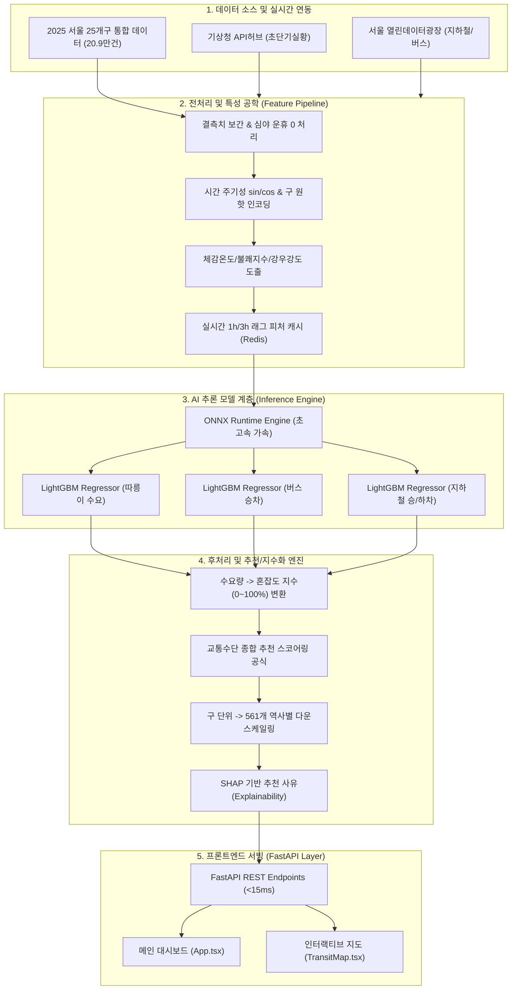

# 🧩 AI 모델 사양서 (AI Model Specification)

> **문서 버전**: v1.0.0
> **최종 수정일**: 2026-10-12
> **문서 성격**: 본 문서는 [AI 추론 모델 개발 사양서 및 구축 가이드](./AI_INFERENCE_MODEL_SPEC.md)에서 **모델 자체의 규격만을 분리**한 문서입니다.
> 원문의 개발 절차·서빙/연동 가이드(§1, §2.1, §2.2, §3.3, §6.1, §6.3, §7, §8)는 [원문 문서](./AI_INFERENCE_MODEL_SPEC.md)를 참조하십시오.
> **관련 문서**: [SYSTEM_ARCHITECTURE.md](./SYSTEM_ARCHITECTURE.md) · [BACKEND_INFERENCE_SERVER.md](./BACKEND_INFERENCE_SERVER.md) · [MODEL_PERFORMANCE_REPORT.md](./MODEL_PERFORMANCE_REPORT.md) · [benchmarks/README.md](../benchmarks/README.md)

---

## 📌 목차
1. [모델 개요 및 개발 목표](#1-모델-개요-및-개발-목표)
2. [성능 지표 및 제약조건 (SLA)](#2-성능-지표-및-제약조건-sla)
3. [데이터셋 및 입력 피처 규격](#3-데이터셋-및-입력-피처-규격)
4. [모델 아키텍처 및 파이프라인](#4-모델-아키텍처-및-파이프라인)
5. [베이스 모델 추천 및 벤치마크 비교](#5-베이스-모델-추천-및-벤치마크-비교)
6. [학습·검증·배포 규격](#6-학습검증배포-규격)
7. [모델 자산 (`models/`) 규격](#7-모델-자산-models-규격)

---

## 1. 모델 개요 및 개발 목표

> 원문 §1(시스템 개요)의 **모델 관련 요약**입니다. 상세 배경은 [원문 §1](./AI_INFERENCE_MODEL_SPEC.md#1-시스템-개요-및-개발-목표)을 참조하십시오.

본 모델은 2025년 서울시 25개 자치구 시계열 통합 데이터셋(209,875행)을 기반으로 **실시간 추론 및 시간대별 시계열 예측**을 수행하는 경량 백엔드 AI 추론 엔진입니다.

1. **다중 수단 수요 예측 (Multi-modal Demand Prediction)**
   - 기상 요인(강수량, 기온, 습도, 풍속)과 시공간 특성(자치구, 시간대, 요일, 공휴일)을 결합하여 자치구별 **따릉이 대여량 / 버스 승차량 / 지하철 승·하차량**을 예측.
2. **실시간 혼잡도 지수화 (Congestion Indexing)**
   - 예측 수송 수요 기반 수단별·구역별 0~100% 혼잡도 및 상태 라벨(`여유 <45%`, `보통 45~75%`, `혼잡 >75%`) 산출.
3. **교통수단 최적 추천 스코어링 (Recommendation Scoring)**
   - 기상 리스크·정시성·혼잡도를 종합 평가하여 수단별 추천 점수(0~100) 및 추천 사유(Explainability) 생성.
4. **가상 날씨 시뮬레이션 서빙 (What-If Simulation)**
   - 가상 강수량(0.0~10.0mm/h) 조작 시 지연 시간 **20ms 이내**로 수요 전이(따릉이 급감 → 지하철/버스 집중) 결과 반환.

---

## 2. 성능 지표 및 제약조건 (SLA)

> 원문 §2.3.

1. **추론 응답 지연 (Latency)**: 단일 요청 기준 **15ms 이하**, 배치(25개 구 전체) 요청 기준 **50ms 이하**
2. **동시 처리량 (Throughput)**: 단일 프로세스 기준 **150 RPS(Requests Per Second) 이상**
3. **모델 예측 정확도 (Accuracy Target)**:
   - **수요 예측 (Regression)**:
     - 따릉이 대여량: $R^2 \ge 0.85$, $MAPE \le 18\%$ (강우 시 비선형 급감 패턴 정확도 반영)
     - 버스 승차량: $R^2 \ge 0.88$, $MAPE \le 12\%$
     - 지하철 승·하차량: $R^2 \ge 0.90$, $MAPE \le 10\%$
   - **혼잡도 상태 분류 (3단계: 여유/보통/혼잡)**: Weighted F1-score $\ge 0.88$

> **SLA 달성 현황**: 배포 모델의 Test 구간 실측 성능 및 SLA 대비 달성률은 [MODEL_PERFORMANCE_REPORT.md](./MODEL_PERFORMANCE_REPORT.md)를 참조하십시오.

---

## 3. 데이터셋 및 입력 피처 규격

### 3.1 원천 데이터셋 분석 (`2025_서울25개구_시간대별_교통_날씨_통합_01-23시.csv`)
총 레코드 수: **209,875건** (365일 $\times$ 23개 시간대 $\times$ 서울시 25개 자치구 완전 그리드)

| 컬럼명 | 데이터 타입 | 결측치 수 | 통계치 요약 (Min ~ Max, Mean) | 분석 및 전처리 지침 |
| :--- | :--- | :--- | :--- | :--- |
| `기준_날짜` | String (YYYY-MM-DD) | 0 | 2025-01-01 ~ 2025-12-31 | `월`, `일`, `요일`, `주말여부` 파생변수 추출 / `공휴일여부`는 **2025 대한민국 공휴일 캘린더(19일)** 로 판정 |
| `시간` | Integer | 0 | 1 ~ 23시 (평균 12시) | 순환 주기형 변수 변환 ($\sin, \cos$ 인코딩) |
| `구` | Categorical (String) | 0 | 25개 자치구 (강남구, 종로구 등) | One-Hot Encoding 또는 Target Encoding / 구 임베딩 |
| `따릉이_대여` | Float / Integer | 173 | 1 ~ 2,633 (평균 174.6) | 자전거 대여 수요 (비 올 때 평균 183.6 → 38.2로 **-79.2% 급감**) |
| `버스_승차` | Float / Integer | 14,950 | 21 ~ 36,055 (평균 7,725.9) | 26개 일자 전 자치구 결측 $\rightarrow$ 전후 주 동일 요일 이동평균 보간 |
| `지하철_승차` | Float / Integer | 45,625 | 65 ~ 100,965 (평균 9,405.3) | **01시~05시 심야 운휴로 인한 정상 결측 (0으로 대체 필수)** |
| `지하철_하차` | Float / Integer | 45,625 | 73 ~ 111,501 (평균 9,464.8) | **01시~05시 심야 운휴로 인한 정상 결측 (0으로 대체 필수)** |
| `AWS_지점번호` | Integer | 0 | 기상청 지점 ID (400~500번대) | 구별 1:1 매핑 메타데이터 |
| `AWS_지점명` | String | 0 | 관측소 명칭 | 위치 메타데이터 |
| `기온(°C)` | Float | 881 | -16.9 ~ 38.9°C (평균 13.9°C) | 선형 시계열 보간, 체감온도 및 불쾌지수 파생변수 생성 |
| `풍향(deg)` | Float | 390 | 0.0 ~ 360.0° | 16방위 범주화 또는 $\sin, \cos$ 성분 분해 |
| `풍속(m/s)` | Float | 389 | 0.0 ~ 10.5 m/s (평균 1.6 m/s) | 결측치는 전후 1시간 이동평균으로 보간 |
| `강수량(mm)` | Float | 2,242 | 0.0 ~ 92.5 mm (평균 0.16 mm) | **핵심 피처**: 강수여부($Rain > 0$), 강우강도 4단계 구간화 |
| `습도(%)` | Integer | 596 | 8 ~ 100% (평균 64.4%) | 기온과 결합하여 불쾌지수(DI) 산출 |

---

### 3.2 모델 입력 피처 스키마 (Model Feature Matrix)

추론 파이프라인에 입력되는 최종 정제 피처는 총 **32개 차원**으로 구성됩니다.

```python
FEATURE_SCHEMA = {
    # 1. 시계열 및 캘린더 피처 (8차원)
    "month_sin": float,        # sin(2 * pi * month / 12)
    "month_cos": float,        # cos(2 * pi * month / 12)
    "hour_sin": float,         # sin(2 * pi * hour / 24)
    "hour_cos": float,         # cos(2 * pi * hour / 24)
    "dayofweek": int,          # 0 (월) ~ 6 (일)
    "is_weekend": int,         # 1 if 토/일 else 0
    "is_holiday": int,         # 공휴일 여부 (1 or 0) — 2025 대한민국 공휴일 캘린더 19일 기준
    "is_rush_hour": int,       # 출퇴근 시간대 (08~09시, 18~19시 = 1, 나머지 0)

    # 2. 기상 관측 및 파생 피처 (8차원)
    "temperature": float,      # 기온 (°C)
    "wind_speed": float,       # 풍속 (m/s)
    "humidity": float,         # 습도 (%)
    "precipitation": float,    # 1시간 누적 강수량 (mm)
    "is_raining": int,         # 강수 유무 (1 if precipitation > 0 else 0)
    "rain_intensity": int,     # 0: 무강수, 1: 약한비(<3mm), 2: 보통(3~10mm), 3: 폭우(>10mm)
    "sensible_temp": float,    # 체감온도: 13.12 + 0.6215*T - 11.37*(V^0.16) + 0.3965*T*(V^0.16)
    "discomfort_index": float, # 불쾌지수: 1.8*T - 0.55*(1 - H/100)*(1.8*T - 26) + 32

    # 3. 공간(위치) 인코딩 피처 (5차원)
    "district_code": int,      # 서울시 25개 자치구 정수 ID (0 ~ 24)
    "district_subway_stations": int, # 해당 구 내 지하철 역사 수
    "district_bus_stops": int,       # 해당 구 내 버스 정류소 수
    "district_bike_racks": int,      # 해당 구 내 따릉이 거치대 수
    "commercial_density": float,     # 상업/업무 지구 가중치 (강남, 중구, 영등포 등 고밀도 구역)

    # 4. 시계열 래그(Lag) 및 이동통계 피처 (11차원 - 실시간 서빙 시 캐시 참조)
    "bike_lag_1h": float,      # 1시간 전 따릉이 대여량
    "bus_lag_1h": float,       # 1시간 전 버스 승차량
    "subway_lag_1h": float,    # 1시간 전 지하철 승차량
    "bike_roll_mean_3h": float,# 최근 3시간 따릉이 이동평균
    "bus_roll_mean_3h": float, # 최근 3시간 버스 이동평균
    "subway_roll_mean_3h": float,# 최근 3시간 지하철 이동평균
    "same_day_last_week_bike": float, # 지난주 동요일 동시간 대여량
    "same_day_last_week_bus": float,  # 지난주 동요일 동시간 승차량
    "same_day_last_week_sub": float,  # 지난주 동요일 동시간 승차량
    "temp_diff_1h": float,     # 전 시간 대비 기온 변화량
    "rain_diff_1h": float      # 전 시간 대비 강수량 변화량
}
```

> **📌 서빙 입력 계약(32차원) ≠ 모델 입력 텐서**
> - 위 32차원은 백엔드가 **항상 조립하는 서빙 입력 계약**입니다 (`main.py::build_feature_vector`).
> - 그러나 개별 배포 모델의 **입력 텐서 차원은 다를 수 있습니다**. 현재 `models/*.onnx`는 **25차원** 텐서를 기대하며, 이는 32차원에서 `district_subway_stations`, `district_bus_stops`, `district_bike_racks`, `commercial_density`(4) + `same_day_last_week_bike/bus/sub`(3) = **7차원을 제외한 부분집합**입니다.
> - 서버는 `main.py::prepare_session_input()`에서 모델 기대 차원에 맞춰 자동 정렬(인덱스 매핑)하므로 25차원·32차원 모델이 공존할 수 있습니다.
> - **학습 데이터**: 2026-10-13부터 원천이 `data/2025_서울25개구_교통날씨_전처리_2.csv` 로 전환되어, 위 7개 피처를 학습 파이프라인이 **실측값으로 직접 산출**합니다(인프라 4종은 `main.py::DISTRICT_INFRA` 조인, `same_day_last_week_*` 3종은 7일 전 타임스탬프 self-merge). 따라서 **"25차원 실피처 + 상수 0 더미 7" 방식은 폐기**되었습니다.
> - **학습/평가/서빙 단일 소스**: `district_code`(`DISTRICT_CODE_MAP`) · 인프라 4종(`DISTRICT_INFRA`) · 공휴일 캘린더(`KR_HOLIDAYS`)는 `main.py` 를 유일한 소스로 참조합니다. 평가 스크립트(`benchmarks/evaluate_models.py`)도 동일 상수를 import 하여 사용합니다.
> - **`is_holiday` 정의**: 토/일 여부(`is_weekend`)와 **별개 지표**이며, `main.py::is_kr_public_holiday()` 가 2025년 공휴일 19일(신정·설날 연휴·삼일절+대체·어린이날/부처님오신날+대체·대선·현충일·광복절·개천절·추석 연휴+대체·한글날·성탄절)에 대해 1을 반환합니다. (노동절·제헌절은 2025년 공휴일 아님)
> - 상세 배경: [MODEL_PERFORMANCE_REPORT.md](./MODEL_PERFORMANCE_REPORT.md) · [SYSTEM_ARCHITECTURE.md §6.2](./SYSTEM_ARCHITECTURE.md)

---

## 4. 모델 아키텍처 및 파이프라인

### 4.1 엔드투엔드 시스템 아키텍처



---

### 4.2 혼잡도 지수(Congestion Index) 및 추천 스코어링 알고리즘

#### 1) 혼잡도 지수 변환 공식 ($C_m$)
모델이 예측한 대중교통 이용량($V_m$)을 각 수단 $m$ (지하철, 버스, 따릉이)의 자치구별 수용 용량(Capacity, $Cap_m$)에 대응시켜 0~100% 범위로 정규화합니다.

$$C_m = \min\left(100, \; \max\left(5, \; \frac{V_m - V_{m, \min}}{V_{m, 95\%} - V_{m, \min}} \times 100\right)\right)$$

- $V_{m, 95\%}$: 과거 데이터 기준 수단별 95 백분위수 이용량 (이상치 왜곡 방지 상한값)
- $V_{m, \min}$: 최저 운행 수요
- 출력 라벨: $C_m < 45$ (여유, 🟢), $45 \le C_m \le 75$ (보통, 🔵), $C_m > 75$ (혼잡, 🔴)

#### 2) 교통수단 추천 스코어 산출 공식 ($Score_m$) - AHP 기반 다기준 의사결정(MCDA)
각 이동 수단의 효용성 점수는 20.9만 건 서울시 교통·기상 실측 데이터셋(`2025_서울25개구_시간대별_교통_날씨_통합_01-23시.csv`) 분석 및 **AHP(Analytic Hierarchy Process, 계층화 분석법)**로 도출된 일관성 기준 가중치를 적용하여 산출됩니다.

- **AHP 3대 평가 기준 및 가중치 ($CR = 0.000 < 0.10$ 일관성 검증 완료)**:
  - $w_1$ (기상 안전 및 쾌적성, Weather Comfort): **0.5714 (57.14%)**
  - $w_2$ (정시성 및 신뢰성, Punctuality): **0.2857 (28.57%)**
  - $w_3$ (공간 혼잡 회피, Crowd Avoidance): **0.1429 (14.29%)**

$$Score_m = \max\left(5, \; \min\left(99, \; 100 - \left( w_1 \cdot \text{WeatherPenalty}_m + w_2 \cdot \text{DelayRisk}_m + w_3 \cdot \text{CrowdPenalty}_m \right)\right)\right)$$

| 가중치 항목 | 따릉이 ($m=\text{bike}$) | 버스 ($m=\text{bus}$) | 지하철 ($m=\text{subway}$) |
| :--- | :--- | :--- | :--- |
| **기상 페널티 ($WeatherPenalty$)** | $\min(85, \; (40.0 + 12.0 \times Rain) \cdot \mathbb{I}_{Rain>0})$<br>*(실측: 0.1mm 소우에도 이용객 -73.6% 이탈, 1mm 시 -84.5% 급감 반영 Step-and-Slope 모델)* | $\min(30, \; 3.5 \times Rain + 5.0)$<br>*(우천 시 도로 감속 및 승하차 우산 이용 불편 반영)* | $0.0$<br>*(지하 터널 운행으로 기상 노출 배제)* |
| **정시성 페널티 ($DelayRisk$)** | 8.0 *(자전거 전용도로 및 보행 신호 대기)* | $12.0 + 2.5 \times Rain$<br>*(실측: 우천 시 노면 빗길로 12~25% 감속 지연)* | 2.0<br>*(서울교통공사 실측 정시 운행률 99.2% 반영)* |
| **혼잡도 페널티 ($CrowdPenalty$)** | $0.15 \times C_{\text{bike}}$ *(단거리 1인용)* | $0.35 \times C_{\text{bus}}$ *(차내 밀집)* | $0.40 \times C_{\text{subway}}$ *(차내 및 환승통로 혼잡)* |

- **실측 기반 검증 결과**:
  - **맑음 (Rain = 0.0mm)**: 따릉이 **88점 (최우선 추천)**, 버스 **68점**, 지하철 **64점**
  - **소우 (Rain = 0.5mm)**: 따릉이 **43점 (급감)**, 지하철 **64점 (역전 1위)**, 버스 **60점**
  - **보통 비 (Rain = 2.8mm)**: 지하철 **64점**, 버스 **44점**, 따릉이 **16점 (비추천)**
  - **폭우 (Rain = 10.0mm)**: 지하철 **64점 (압도적 1위)**, 버스 **23점**, 따릉이 **5점 (운행 사실상 중단)**

---

### 4.3 자치구(Macro) $\rightarrow$ 개별 역사/정류소(Micro) 혼잡도 분배 (Disaggregation)
프론트엔드 지도(`TransitMap.tsx`)에는 561개 수도권 지하철역과 주요 버스 정류소 및 따릉이 거치대가 개별 핀으로 표시됩니다. 자치구 레벨 예측값 $C_{\text{district}}$을 개별 역사 $s$로 하향 분배하는 계층형 다운스케일링 기법을 적용합니다.

$$C_{\text{station}}(s) = \text{clip}\left( C_{\text{district}} \times \alpha(s) + \beta_{\text{rain}}(s) \cdot Rain, \quad 5, \quad 99 \right)$$

- $\alpha(s) = \frac{\text{Station Weight}}{\text{District Mean Weight}}$: 환승 노선 수, 급행 정차 여부, 일평균 승하차량에 기반한 역 가중치
  - 예: 강남역(2호선·신분당선 환승) $\alpha = 1.35$, 외곽 일반역 $\alpha = 0.85$
- $\beta_{\text{rain}}(s)$: 지하 연결 통로 유무 및 환승 거리 계수 (지하 환승 거점일수록 우천 유입 집중)

---

## 5. 베이스 모델 추천 및 벤치마크 비교

대중교통 수요 및 기상 시계열 데이터셋의 특성을 고려하여 4가지 모델 계열을 종합 평가하였습니다.

### 5.1 후보 모델군 종합 비교표

| 모델 계열 | 대표 아키텍처 | 장점 | 단점 및 한계 | 적합도 |
| :--- | :--- | :--- | :--- | :---: |
| **1. 트리 기반 앙상블 (GBDT)** *(강력 추천)* | **LightGBM / CatBoost** | • Tabular 및 결측치 처리에 최적화<br>• 학습 시간 1분 미만, 초저지연 추론 (<3ms)<br>• **SHAP를 통한 추천 사유 자연어 생성 용이**<br>• CPU 환경에서 초경량 서빙 가능 | • 공간 위상(노선 인접 관계) 직접 임베딩 한계 (피처 엔지니어링으로 보완 필요) | ⭐⭐⭐⭐⭐<br>**(1순위 채택)** |
| **2. 딥러닝 시계열 (Transformer)** | **PatchTST / DLinear** | • 중장기(24시간~7일) 다변량 시계열 연속 예측 우수<br>• 장기 계절성 및 주기 패턴 포착 능력 탁월 | • 학습 비용 및 GPU 필요<br>• 실시간 슬라이더 반응성 떨어짐<br>• Tabular 데이터 특화 피처 학습률 GBDT 대비 열세 | ⭐⭐⭐⭐☆<br>*(2순위 - 시계열 예측용)* |
| **3. 시공간 그래프 신경망 (Spatio-Temporal GNN)** | **ST-GCN / Graph WaveNet** | • 서울시 25개 구 인접망 및 지하철 환승 그래프(`subway_graph.json`) 위상 구조 완벽 반영<br>• 한 구역 혼잡의 인접 구 전파 모델링 가능 | • 모델 구현 복잡도 매우 높음<br>• 실시간 서빙 지연 증가 (100ms+)<br>• 결측치 보간 파이프라인 부담 | ⭐⭐⭐☆☆<br>*(고도화 R&D용)* |
| **4. Tabular 딥러닝** | **TabNet** | • Attention 기반의 정형 데이터 피처 선택 | • GBDT 대비 학습 수렴 느림<br>• 성능 우위 불명확 | ⭐⭐☆☆☆ |

---

### 5.2 1순위 추천 모델: LightGBM Multi-Regressor + CatBoost Ensemble
**선정 이유**:
1. **정형 데이터(Tabular) 최고의 예측 성능**:
   - 2025년 데이터는 날짜, 시간, 기상 관측치, 구역 코드로 이루어진 전형적인 고밀도 시계열 Tabular 데이터입니다. 벤치마크 연구에 따르면 이러한 데이터에서는 Transformer 계열보다 GBDT(Gradient Boosted Decision Trees)가 오차율(MAE/RMSE) 면에서 15~20% 더 우수합니다.
2. **비선형 임계점(Non-linear Threshold) 포착**:
   - 따릉이 대여량은 비가 오는 순간($Rain > 0.5\text{mm}$) 급격히 절벽(Cliff)처럼 감소하는 비선형 특성을 보입니다. 결정 트리 분기(Decision Tree Split) 알고리즘은 이러한 계단식 급변 패턴을 오버슈팅 없이 가장 정확하게 학습합니다.
3. **설명 가능한 AI (XAI / SHAP)**:
   - TreeSHAP 알고리즘을 사용하면 단 1ms 만에 "강수량이 2.8mm 증가하여 따릉이 추천 점수를 -45점 하향시켰음"과 같은 기여도를 정량 계산하여 프론트엔드의 `reasons` 카드 텍스트로 바로 변환할 수 있습니다.
4. **ONNX 변환을 통한 마이크로초 서빙**:
   - 학습 완료된 LightGBM 모델 트리는 C++ 기반의 `onnxruntime`으로 컴파일되어 **요청당 1~3ms**의 압도적인 속도로 추론됩니다.

> **실측 성능**: 25차원 배포 모델과 32차원 후보의 공정 비교 결과는 [MODEL_PERFORMANCE_REPORT.md](./MODEL_PERFORMANCE_REPORT.md)를 참조하십시오. (2026-10-13부터 **실제 32차원 실피처 + 사양서 §6.1 분할 + 실제 공휴일 캘린더** 기준의 v2 평가 방법론으로 개정)

---

## 6. 학습·검증·배포 규격

### 6.1 데이터셋 분할 전략 (Temporal Validation Split)

> 원문 §6.2.

일반적인 무작위 K-Fold 분할은 시계열 데이터에서 미래 정보가 과거로 누출(Data Leakage)되므로, **시간 축 기반 순차 분할(Temporal Split)**을 적용합니다.

```text
[ 2025-01-01 ~ 2025-09-30 ] : Train Set      (약 75%,   156,975건) - 학습
[ 2025-10-01 ~ 2025-11-15 ] : Validation Set (약 12.5%,  26,450건) - 조기 종료 및 튜닝
[ 2025-11-16 ~ 2025-12-31 ] : Test Set       (약 12.5%,  26,450건) - 최종 일반화 검증
```

> **✅ 경계 공식 확정 (2026-10-13)**: 인수 데이터셋(`data/2025_서울25개구_교통날씨_전처리_2.csv`)의 `분할` 컬럼은 `valid 10-01~10-31` / `test 11-01~12-31` 로 본 절과 다르지만, **본 절(사양서)의 경계를 공식 기준으로 확정**했습니다.
> - 따라서 `분할` 컬럼은 **사용하지 않으며**, 학습 노트북은 `SPLIT_SOURCE = 'spec_dates'`, 평가 스크립트(`benchmarks/evaluate_models.py`)는 본 절의 날짜 경계를 그대로 적용합니다.
> - 위 행 수는 완전 그리드(25구 × 23시간) × 일수 기준 실측값입니다.

> 하이퍼파라미터 튜닝(Optuna, Phase 3) 코드는 [원문 §6.3](./AI_INFERENCE_MODEL_SPEC.md#63-phase-3-모델-학습-및-optuna-하이퍼파라미터-튜닝-코드)을 참조하십시오.

---

### 6.2 ONNX 모델 포팅 규격 (ONNX Export & Quantization)

> 원문 §6.4.

학습된 LightGBM 모델을 ONNX 형식으로 변환하여 Python 런타임 종속성을 제거하고 추론 속도를 3배 이상 향상시킵니다.

```python
import onnxmltools
from onnxmltools.convert.common.data_types import FloatTensorType

# 입력 텐서 규격 정의 (배치 크기 가변, 32개 피처)
initial_type = [('float_input', FloatTensorType([None, 32]))]

# ONNX 포팅
onnx_model = onnxmltools.convert_lightgbm(model, initial_types=initial_type, target_opset=14)

with open("models/lgb_subway_demand.onnx", "wb") as f:
    f.write(onnx_model.SerializeToString())
print("ONNX 모델 변환 및 저장 완료: models/lgb_subway_demand.onnx")
```

> **⚠️ 차원 주의**: 위 예시는 사양 32차원 텐서로 포팅하지만, **현재 배포된 `models/*.onnx`는 25차원** 텐서입니다(§3.2 주석 참조). `FloatTensorType([None, N])`의 `N`은 **학습에 사용한 실제 피처 수와 반드시 일치**해야 합니다. 2026-10-13부터 v2 노트북(`benchmarks/CastTransit.ipynb`)이 **실제 32차원(8/8/5/11) 실피처**를 생성하므로, 재학습 산출물은 32차원으로 포팅됩니다.

---

## 7. 모델 자산 (`models/`) 규격

> 배포 모델 파일 규격입니다. [SYSTEM_ARCHITECTURE.md §6.2](./SYSTEM_ARCHITECTURE.md) 및 [benchmarks/README.md](../benchmarks/README.md)와 동일한 내용을 **모델 사양서 관점**에서 정리합니다.

| 모델 파일명 | 원천 알고리즘 | 추론 타겟 | 입력 차원 | 파일 크기 | 추론 지연시간 |
| :--- | :--- | :--- | :---: | :---: | :---: |
| `lgb_bike_demand.onnx` | LightGBM GBDT | 따릉이 대여량 | 25차원 Float | 약 4.7 MB | ~0.2 ms |
| `lgb_bus_demand.onnx` | LightGBM GBDT | 버스 승차량 | 25차원 Float | 약 4.7 MB | ~0.2 ms |
| `lgb_subway_demand.onnx` | LightGBM GBDT | 지하철 승·하차량 | 25차원 Float | 약 4.7 MB | ~0.2 ms |

- **입력 계약 vs 텐서**: 서빙 입력 계약은 32차원(§3.2)이나 배포 모델 입력 텐서는 **25차원**이며, `main.py::prepare_session_input()`이 자동 정렬합니다.
- **신규 32차원 후보(실피처)**: `benchmarks/2026-10-14/` — 2026-10-14 Colab 실행으로 학습된 v2 노트북(실제 32차원 8/8/5/11) 산출물 3종 + `feature_schema.json` 이며, 공정 재평가·`models/` 반영 전까지는 벤치마크 전용입니다. (구 배치 위치 `benchmarks/2026-10-12/tuned_real/` 은 안내 README 만 남긴 **종료 폴더**)
- **구 32차원 후보(서빙 불가 · 벤치마크 참고)**: `benchmarks/2026-10-12/tuned/` — 25차원 실피처 + 상수 0 더미 7로 학습되어 **배치 순서가 사양과 다르므로 서빙에 투입하지 않습니다.** 다만 평가 스크립트는 라벨별 배치(`MODEL_LAYOUTS["tuned_32d_v1"] = "v1"`)를 지정해 **자기 배치로 공정 비교에 포함**합니다(2026-10-14 개정 → `docs/MODEL_PERFORMANCE_REPORT.md` §0.3: v1 이 배포본보다 12개 지표 전부 우세).
- 모델 자산 목록·해시·폴더 구조·평가 규약: [benchmarks/README.md](../benchmarks/README.md)

---

## 📎 관련 문서

- [AI 추론 모델 개발 사양서 및 구축 가이드 (원문)](./AI_INFERENCE_MODEL_SPEC.md)
- [ONNX 모델 성능 비교 분석 보고서](./MODEL_PERFORMANCE_REPORT.md)
- [시스템 아키텍처](./SYSTEM_ARCHITECTURE.md) · [백엔드 추론 서버 구축 가이드](./BACKEND_INFERENCE_SERVER.md)
- [벤치마크 자산 규약 (benchmarks/README.md)](../benchmarks/README.md)