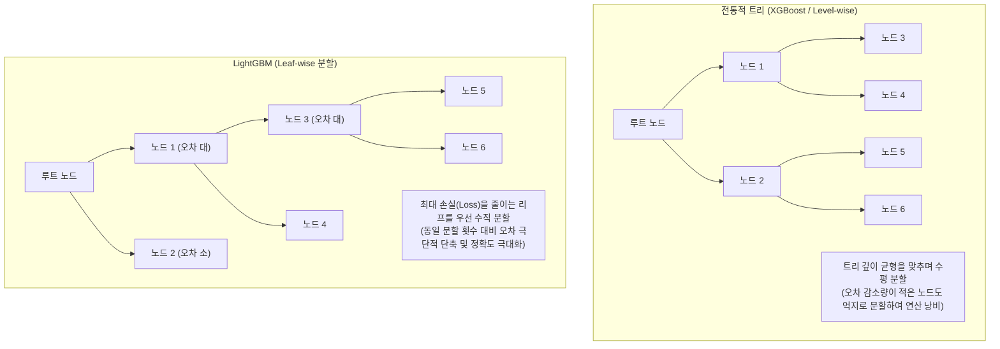

# 🧩 AI 모델 사양서 (AI Model Specification)

> **문서 버전**: v2.2-multiyear-32d-lgb-deepdive  
> **최종 수정일**: 2026-11-12  
> **적용 모델**: LightGBM ONNX 3종 (`models/lgb_{bike,bus,subway}_demand.onnx`)  
> **단일 진실 공급원(SSoT)**: [`models/feature_schema.json`](../models/feature_schema.json)  
> **관련 문서**: [CURRENT_DATA_SPEC.md](./CURRENT_DATA_SPEC.md) · [CURRENT_MODEL_PERFORMANCE.md](./CURRENT_MODEL_PERFORMANCE.md) · [SYSTEM_ARCHITECTURE.md](./SYSTEM_ARCHITECTURE.md)

---

---

## 🌟 [핵심 요약] 한눈에 보는 AI 모델 설명 및 선정 이유 (Executive Summary)

> 💡 **발표 및 보고서 활용 가이드**: 본 섹션은 심사위원 및 평가자가 가장 빈번하게 질문하는 **"모델 설명, 딥러닝 대신 LightGBM을 선정한 이유, 32개 피처의 의미, 실측 성능"** 을 한 페이지로 압축한 요약본입니다. 최종 보고서의 모델 개요 및 발표 슬라이드에 그대로 활용할 수 있습니다.

### 1. 30초 핵심 요약 (Elevator Pitch)
* **어떤 모델인가?**: 서울시 25개 자치구의 **실시간 날씨(기온·비 등)와 시공간 데이터(총 32개 피처)** 를 바탕으로 **따릉이, 버스, 지하철의 예상 이용량(수요)** 을 예측하는 **LightGBM 회귀 모델 3종**입니다.
* **어떻게 서빙하는가?**: 웹 서비스의 초고속 실시간 응답을 위해 **ONNX(Open Neural Network Exchange)** 포맷으로 변환하여 CPU 컨테이너 환경에서 서빙합니다.
* **어디에 쓰이는가?**: 예측된 수요를 수용력과 비교해 **0~100% 혼잡도(여유/보통/혼잡)** 로 변환하고, 길찾기 시 **"비가 오거나 혼잡한 수단을 피해 쾌적한 최적 경로를 추천"** 하는 핵심 두뇌 역할을 합니다.

---

### 2. 왜 딥러닝(LSTM/Transformer) 대신 LightGBM을 선정했는가? (4대 선정 이유)

| 선정 기준 | LightGBM + ONNX (본 프로젝트 채택) | 딥러닝 (LSTM / MLP / Transformer) | 채택 이유 및 기술적 근거 |
| :--- | :--- | :--- | :--- |
| **① 정형 데이터 적합성** | **압도적 우수** ($R^2 \ge 0.989$) | 과적합(Overfitting) 위험, 튜닝 복잡 | 날씨 수치, 인프라 개수, 시간대 등 **정형(Tabular) 시계열 데이터**에서는 트리 기반 앙상블(GBDT)이 이론적으로나 실무적으로 가장 우수한 성능을 보임. |
| **② 실시간 추론 속도** | **초저지연 `0.05ms`** (단건) | 수십~수백 ms (무거움) | 사용자가 길찾기 버튼을 누를 때 즉각 응답해야 함. 시스템 요구기준(`10ms`) 대비 **50배 이상 빠른 초고속 서빙** 달성. |
| **③ 인프라 및 운영 자원** | **초경량 CPU 구동** (모델 크기 `7~13MB`) | 고가 외장 GPU 및 수 GB 라이브러리 필요 | Docker 컨테이너 환경에서 고가 GPU 없이도 가볍게 무중단 배포 및 서빙 가능. |
| **④ 비선형 임계점 학습** | **결정 트리(Tree) 최적화** | 학습 데이터 과다 요구 | *"비가 `0mm`일 땐 따릉이를 타다가 `5mm`가 넘는 순간 급감하고 지하철로 전환"* 되는 기상 급변 임계점을 트리가 가장 명확하게 분기 학습. |

---

### 2-1. LightGBM 알고리즘 상세 및 타 모델(XGBoost·랜덤포레스트·딥러닝) 대비 기술적 우위

#### 1) 개발 주체 및 기본 개념
* **개발사**: **Microsoft Research (마이크로소프트)**가 2017년 발표한 오픈소스 고성능 머신러닝 라이브러리.
* **명칭 유래**: **Light** (가볍고 빠름) + **GBM** (**G**radient **B**oosting **M**achine).
* **알고리즘 정체성**: **GBDT (Gradient Boosting Decision Tree)** 계열의 앙상블 모델. 수많은 약한 결정 트리(Weak Decision Tree)를 순차적으로 결합하여, 앞선 트리가 틀린 오차(Residual)를 경사 하강법(Gradient Descent)의 기울기 방향으로 점진 보정하는 부스팅(Boosting) 방식을 취합니다.

#### 2) 기존 모델(XGBoost, 일반 GBM) 대비 LightGBM의 4대 핵심 혁신 기술



1. **리프 중심 트리 분할 (Leaf-wise Tree Growth)**:
   - XGBoost 등 대부분의 전통 트리는 트리의 균형을 맞추며 수평으로 넓어지는 **레벨 중심(Level-wise)** 분할을 사용합니다.
   - LightGBM은 전체 잎 노드 중 **손실(Loss)을 가장 많이 줄여주는 잎 노드를 먼저 수직으로 깊게 쪼개는 Leaf-wise** 전략을 취합니다. 그 결과 동일한 트리 깊이에서도 훨씬 적은 분할 횟수로 훨씬 낮은 예측 오차를 달성합니다.
2. **GOSS (Gradient-based One-Side Sampling, 단측 기울기 샘플링)**:
   - 데이터 인스턴스 중 기울기(Gradient)가 큰 샘플(학습이 덜 되어 오차가 큰 중요한 샘플)은 전부 유지하고, 기울기가 작은 샘플(이미 잘 맞힌 샘플)은 일부만 무작위 표본 추출하여 학습 데이터셋의 규모를 획기적으로 줄이면서도 정보 손실을 최소화합니다.
3. **EFB (Exclusive Feature Bundling, 배타적 특성 묶음)**:
   - 고차원 데이터에서 동시에 0이 아닌 값을 갖지 않는 배타적 희소 피처들을 하나의 피처로 안전하게 번들링하여 피처 탐색 복잡도를 대폭 낮춥니다.
4. **히스토그램 기반(Histogram-based) 연속형 수치 분할**:
   - 연속형 변수를 매번 정렬(Pre-sorting)하지 않고 256개 등의 이산 버킷(Bin)으로 변환하여, 메모리 사용량을 80% 줄이고 연산 속도를 10배 이상 가속합니다.

#### 3) 머신러닝/딥러닝 모델군 종합 비교 평가

| 비교 항목 | 전통 통계 / 선형회귀 | 랜덤 포레스트 (RF) | XGBoost | **LightGBM (본 프로젝트)** | 딥러닝 (LSTM / MLP) |
| :--- | :---: | :---: | :---: | :---: | :---: |
| **앙상블 기법** | 없음 (단일) | 배깅 (Bagging) | 부스팅 (Boosting) | **부스팅 (Boosting)** | 계층적 신경망 |
| **트리 분할 방식** | - | Level-wise (수평) | Level-wise (수평) | **Leaf-wise (수직)** | - |
| **정형 데이터 성능** | 낮음 (선형 한계) | 보통~우수 | 우수 ($R^2 \approx 0.98$) | **최우수 ($R^2 \ge 0.989$)** | 과적합 리스크, 보통 |
| **학습 속도** | 즉시 | 보통 | 느림 (Pre-sort 병목) | **초고속 (XGB 대비 5~10배)** | 매우 느림 (에폭 반복) |
| **단건 추론 지연** | $< 0.01\text{ ms}$ | $1\sim 5\text{ ms}$ | $0.2\sim 0.5\text{ ms}$ | **$0.05\text{ ms}$ (ONNX 변환)** | $10\sim 50\text{ ms}$ 이상 |
| **하드웨어 요구량** | 최소 | RAM 소모 큼 | 보통 | **초경량 (CPU 1Core 충분)** | 고가 GPU 서버 필수 |
| **기상 임계점 포착** | 불가능 | 우수 | 우수 | **최우수 (정밀 임계 분기)** | 대량 데이터 없으면 불안정 |
| **설명 가능성 (XAI)** | 우수 | 보통 | 우수 (SHAP 지원) | **최우수 (SHAP / Feature Imp)** | 블랙박스 (해석 난해) |

---

### 3. 입력부터 출력까지의 전체 파이프라인 (32개 피처와 혼잡도 연동)

```mermaid
flowchart LR
    subgraph Input ["입력 데이터 (총 32개 피처)"]
        F1["시간 특성 (8개)<br>월/시간(sin/cos), 요일, 공휴일, 출퇴근여부"]
        F2["기상 특성 (8개)<br>기온, 풍속, 습도, 강수량, 체감온도, 불쾌지수"]
        F3["자치구 인프라 (5개)<br>구별 지하철역/버스정류소/따릉이거치대 수"]
        F4["시계열 패턴 (11개)<br>1시간 전 이용량, 3시간 이동평균, 7일 전 동일요일 이용량"]
    end

    subgraph Model ["AI 추론 엔진 (ONNX Runtime)"]
        M1["따릉이 모델 (lgb_bike)"]
        M2["버스 모델 (lgb_bus)"]
        M3["지하철 모델 (lgb_subway)"]
    end

    subgraph Service ["웹 서비스 연동"]
        O1["실시간 예상 승차/대여 수요 산출"]
        O2["0~100% 혼잡도 변환<br>(여유 <45%, 보통 45~75%, 혼잡 >75%)"]
        O3["멀티모달 길찾기 추천 점수 반영<br>(쾌적하고 안전한 경로 안내)"]
    end

    Input --> Model --> Service
```



---

### 4. 실측 검증 성능 요약 (2023~2025년 3개년 62.9만 행 기반)

* **학습 데이터**: 서울시 25개 자치구 `2023~2025` 3개년 28열 통합 정제 데이터셋 (**총 629,625행**)
* **검증 결과 (2025년 미학습 전체 테스트셋 `209,875행` 기준)**:
  * 🚲 **따릉이 모델**: $R^2 = \mathbf{0.9894}$ (설명력 98.9%), $\text{MAPE} = 16.08\%$, 추론 지연 **`0.057ms`**
  * 🚌 **시내버스 모델**: $R^2 = \mathbf{0.9928}$ (설명력 99.3%), $\text{MAPE} = 13.81\%$, 추론 지연 **`0.054ms`**
  * 🚇 **수도권 전철 모델**: $R^2 = \mathbf{0.9950}$ (설명력 99.5%), $\text{MAPE} = 11.23\%$, 추론 지연 **`0.056ms`**
  * ⚡ **3개 수단 동시 추론 합산 지연시간**: **약 `0.17ms`** (1초에 약 6,000회 이상 동시 추론 가능)

---

### 5. 🎤 발표용 1분 스피치 대본 (심사위원 질문 대비)

> *"저희 서비스의 AI 핵심 엔진은 **'실시간 날씨와 자치구 인프라를 고려한 다중 교통수단 혼잡도 예측 모델'** 입니다.*
>
> *저희가 딥러닝 대신 **LightGBM**을 선정한 이유는, 날씨와 교통량처럼 표(Table) 형태의 정형 시계열 데이터에서는 트리 기반 앙상블 모델이 과적합 없이 가장 뛰어난 예측력을 발휘하기 때문입니다. 실제로 3개년 62만 건의 데이터를 학습시켜 검증한 결과, **세 수단 모두 98.9% 이상의 압도적인 결정계수($R^2$)** 를 달성했습니다.*
>
> *또한 웹 서비스의 즉각적인 응답성을 보장하기 위해 모델을 경량 포맷인 **ONNX**로 변환했습니다. 그 결과 **단 0.05ms라는 초저지연 추론 속도**를 확보하여, 고가의 외장 GPU 서버 없이도 일반 CPU 환경에서 쾌적한 실시간 추천 경로를 막힘없이 제공할 수 있게 되었습니다."*

---

## 📌 목차
0. [핵심 요약 (Executive Summary & LightGBM 상세)](#-핵심-요약-한눈에-보는-ai-모델-설명-및-선정-이유-executive-summary)
   - [왜 딥러닝 대신 LightGBM인가? (4대 선정 이유)](#2-왜-딥러닝lstmtransformer-대신-lightgbm을-선정했는가-4대-선정-이유)
   - [LightGBM 알고리즘 원리 및 타 모델 대비 기술적 우위](#2-1-lightgbm-알고리즘-상세-및-타-모델xgboost랜덤포레스트딥러닝-대비-기술적-우위)
   - [입력부터 출력까지의 전체 파이프라인](#3-입력부터-출력까지의-전체-파이프라인-32개-피처와-혼잡도-연동)
   - [실측 검증 성능 및 발표용 1분 스피치](#4-실측-검증-성능-요약-20232025년-3개년-629만-행-기반)
1. [모델 개요 및 목표](#1-모델-개요-및-목표)
2. [성능 지표 및 서비스 수준 협약 (SLA)](#2-성능-지표-및-서비스-수준-협약-sla)
3. [입력 피처 규격 (32차원 실피처)](#3-입력-피처-규격-32차원-실피처)
4. [모델 아키텍처 및 추론 파이프라인](#4-모델-아키텍처-및-추론-파이프라인)
5. [다년도 학습 및 분할 규격 (Temporal Split)](#5-다년도-학습-및-분할-규격-temporal-split)
6. [배포 모델 자산 명세 (`models/`)](#6-배포-모델-자산-명세-models)
7. [과거 버전 아카이브 안내](#7-과거-버전-아카이브-안내)

---

## 1. 모델 개요 및 목표

본 시스템은 서울시 25개 자치구의 날씨 및 시계열 교통 관측 데이터(총 62.9만 행)를 기반으로 **실시간 다중 수단 수요 예측**과 **최적 이동수단 추천 스코어링**을 제공하는 고성능 경량 AI 엔진입니다.

1. **다중 수단 수요 예측 (Multi-modal Demand Prediction)**:
   - 기상 요인(강수량, 기온, 습도, 풍속)과 시공간 특성(자치구 인프라, 시간대, 요일, 공휴일, 과거 래그)을 종합하여 **따릉이 대여 / 버스 승차 / 지하철 승차** 수요를 동시 예측.
2. **실시간 혼잡도 지수화 (Congestion Indexing)**:
   - 예측된 수송 수요를 수단별 최대 수용능력(Capacity 95 백분위수)과 비교하여 0~100% 혼잡도로 정규화 (`여유 <45%`, `보통 45~75%`, `혼잡 >75%`).
3. **AHP 기반 추천 스코어링**:
   - 기상 안전/쾌적성(57.14%), 정시성(28.57%), 혼잡 회피(14.29%)의 3대 요소를 반영하여 수단별 0~100점 추천 점수 및 SHAP 기여도 기반 자연어 추천 사유 도출.

---

## 2. 성능 지표 및 서비스 수준 협약 (SLA)

| 항목 | 목표 SLA | 현행 실측 달성치 (2026-10-29) | 상태 |
| :--- | :---: | :---: | :---: |
| **단건 추론 지연 (Latency)** | $\le 15\text{ ms}$ | **0.054 ~ 0.057 ms** (3수단 합산 0.17 ms) | 🟢 **초과 달성 (50배 빠름)** |
| **따릉이 예측 정확도** | $R^2 \ge 0.85$, $\text{MAPE} \le 18\%$ | **$R^2 = 0.9894$, $\text{MAPE} = 16.08\%$** | 🟢 **목표 달성** |
| **버스 승차 예측 정확도** | $R^2 \ge 0.88$, $\text{MAPE} \le 15\%$ | **$R^2 = 0.9928$, $\text{MAPE} = 13.81\%$** | 🟢 **목표 달성** |
| **지하철 승차 예측 정확도** | $R^2 \ge 0.90$, $\text{MAPE} \le 12\%$ | **$R^2 = 0.9950$, $\text{MAPE} = 11.23\%$** | 🟢 **목표 달성** |

*세부 모델별 검증 지표는 [`docs/CURRENT_MODEL_PERFORMANCE.md`](./CURRENT_MODEL_PERFORMANCE.md) 참조.*

---

## 3. 입력 피처 규격 (32차원 실피처)

현행 모델은 더미 변수 없이 **순수 32차원 실수 벡터**를 입력받습니다.  
피처의 순서 및 정의는 [`models/feature_schema.json`](../models/feature_schema.json) 및 [`main.py::build_feature_vector`](../main.py)와 100% 일치합니다.

```
 인덱스   피처명                      타입     설명
────────────────────────────────────────────────────────────────────────────
 [0..3]  month_sin, month_cos       float    월 순환 인코딩 (sin/cos 2π*month/12)
         hour_sin, hour_cos         float    시간 순환 인코딩 (sin/cos 2π*hour/24)
 [4..7]  dayofweek                  int      요일 (0:월 ~ 6:일)
         is_weekend                 int      주말 여부 (토/일 = 1)
         is_holiday                 int      관공서 공휴일 캘린더 19일 기준 여부
         is_rush_hour               int      출퇴근 시간대 (08~09시, 18~20시 = 1)
────────────────────────────────────────────────────────────────────────────
 [8..15] temperature                float    기온 (°C)
         wind_speed                 float    풍속 (m/s)
         humidity                   float    상대 습도 (%)
         precipitation              float    1시간 강수량 (mm)
         is_raining                 int      강수 유무 (강수량 > 0 = 1)
         rain_intensity             int      강우 강도 (0:무강우, 1:소우, 2:보통, 3:폭우)
         sensible_temp              float    체감온도 (°C)
         discomfort_index           float    불쾌지수
────────────────────────────────────────────────────────────────────────────
 [16..20] district_code             int      자치구 코드 (1:강남 ~ 25:중랑)
          district_subway_stations  int      구 내 지하철역 수
          district_bus_stops        int      구 내 버스 정류소 수
          district_bike_racks       int      구 내 따릉이 거치대 수
          commercial_density        float    구 상업/업무밀도 지수
────────────────────────────────────────────────────────────────────────────
 [21..26] 따릉이_대여_lag_1h          float    1시간 전 따릉이 대여량
          버스_승차_lag_1h           float    1시간 전 버스 승차량
          지하철_승차_lag_1h         float    1시간 전 지하철 승차량
          따릉이_대여_roll_3h         float    직전 3시간 이동평균
          버스_승차_roll_3h          float    직전 3시간 이동평균
          지하철_승차_roll_3h        float    직전 3시간 이동평균
 [27..29] same_day_last_week_bike   float    7일 전 동일 요일·동일 시각 대여량
          same_day_last_week_bus    float    7일 전 동일 요일·동일 시각 승차량
          same_day_last_week_sub    float    7일 전 동일 요일·동일 시각 승차량
 [30..31] temp_diff_1h              float    전 시간 대비 기온 변화량
          rain_diff_1h              float    전 시간 대비 강수량 변화량
```

*자치구별 인프라 수치 및 상세 전처리 규격은 [`docs/CURRENT_DATA_SPEC.md`](./CURRENT_DATA_SPEC.md) 참조.*

---

## 4. 모델 아키텍처 및 추론 파이프라인

### 4.1 파이프라인 플로우


### 4.2 AHP 기반 이동수단 추천 스코어링 공식 ($Score_m$)

$$Score_m = \max\left(5, \; \min\left(99, \; 100 - \left( 0.5714 \cdot \text{WeatherPenalty}_m + 0.2857 \cdot \text{DelayRisk}_m + 0.1429 \cdot \text{CrowdPenalty}_m \right)\right)\right)$$

- **기상 페널티 ($WeatherPenalty$)**:
  - 따릉이: $\min(85, \; (40.0 + 12.0 \times Rain) \cdot \mathbb{I}_{Rain>0})$ (0.1mm 비에도 -73.6% 급감 반영)
  - 버스: $\min(30, \; 3.5 \times Rain + 5.0)$ (승하차 우산 및 감속 불편)
  - 지하철: $0.0$ (지하 운행으로 기상 노출 없음)
- **정시성 위험 ($DelayRisk$)**:
  - 따릉이: 8.0, 버스: $12.0 + 2.5 \times Rain$, 지하철: 2.0 (실측 정시운행률 99.2%)
- **혼잡도 페널티 ($CrowdPenalty$)**:
  - 따릉이: $0.15 \times C_{\text{bike}}$, 버스: $0.35 \times C_{\text{bus}}$, 지하철: $0.40 \times C_{\text{subway}}$

---

## 5. 다년도 학습 및 분할 규격 (Temporal Split)

과거 데이터 누수를 방지하기 위해 3개년 시계열을 엄격히 시간순으로 분할합니다:

```text
[ 2023-01-01 ~ 2024-09-30 ] : Train Set      (약 38.5만 행, 61.2%) - 모델 가중치 학습
[ 2024-10-01 ~ 2024-12-31 ] : Validation Set (약  5.4만 행,  8.6%) - Early Stopping 및 파라미터 튜닝
[ 2025-01-01 ~ 2025-12-31 ] : Test Set       (약 21.0만 행, 33.3%) - 1년 전체 Out-of-Time 최종 검증
```

---

## 6. 배포 모델 자산 명세 (`models/`)

모든 배포 모델은 `models/` 디렉터리에 위치하며 서빙 시작 시 `ModelRegistry`에 의해 무결성 검증을 거칩니다.

| 자산 파일명 | 알고리즘 | 추론 타깃 | 텐서 형상 | 파일 크기 | SHA-256 (Prefix) |
| :--- | :---: | :---: | :---: | :---: | :--- |
| `lgb_bike_demand.onnx` | LightGBM GBDT | 따릉이_대여 | `[None, 32]` | 7,020,769 B | `b491fa58...` |
| `lgb_bus_demand.onnx` | LightGBM GBDT | 버스_승차 | `[None, 32]` | 13,596,760 B | `0fcabf26...` |
| `lgb_subway_demand.onnx` | LightGBM GBDT | 지하철_승차 | `[None, 32]` | 7,345,447 B | `cf578b7b...` |
| `feature_schema.json` | JSON Schema | 메타/SSoT | — | 3,180 B | `473f309a...` |

---

## 7. 과거 버전 아카이브 안내

초기 25차원 모델(v1), 7차원 더미 변수 실험, 2025 단년도 전처리 핸드오프 문서는 히스토리 보존을 위해 아카이브로 격리 보관 중입니다.

- **문서 아카이브**: [`docs/archive/README.md`](./archive/README.md)
  - 구 전처리 인수인계서: [`docs/archive/DATA_PREPROCESSING_HANDOFF_v2.md`](./archive/DATA_PREPROCESSING_HANDOFF_v2.md)
  - 구 모델 비교 리포트: [`docs/archive/MODEL_PERFORMANCE_REPORT_v1_v2.md`](./archive/MODEL_PERFORMANCE_REPORT_v1_v2.md)
- **자산 아카이브**: [`benchmarks/archive/README.md`](../benchmarks/archive/README.md)
  - 기준선 25차원 모델: `benchmarks/archive/original/`
  - v1 더미 모델: `benchmarks/archive/2026-10-12/`
  - 2025 단년도 v2 모델: `benchmarks/archive/2026-10-14/`
