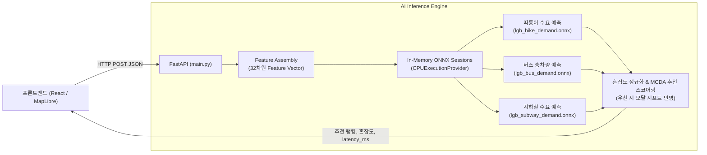

# ⚡ 대중교통·날씨 맞춤형 AI 추론 백엔드 서버 구축 및 운영 가이드

> **문서 버전**: v1.0.0  
> **최종 수정일**: 2026-10-05  
> **서버 파일**: `main.py`  
> **검증 스크립트**: `tests/test_inference.py`  
> **참조 사양서**: [`docs/AI_INFERENCE_MODEL_SPEC.md`](AI_INFERENCE_MODEL_SPEC.md)

---

## 📌 목차
1. [시스템 개요](#1-시스템-개요)
2. [아키텍처 및 핵심 기능](#2-아키텍처-및-핵심-기능)
3. [서울시 25개 자치구 정수 매핑 및 인프라 메타데이터](#3-서울시-25개-자치구-정수-매핑-및-인프라-메타데이터)
4. [32차원 피처 벡터 조립 규격 (`build_feature_vector`)](#4-32차원-피처-벡터-조립-규격-build_feature_vector)
5. [혼잡도 지수 및 MCDA 추천 스코어링 알고리즘](#5-혼잡도-지수-및-mcda-추천-스코어링-알고리즘)
6. [API 엔드포인트 명세](#6-api-엔드포인트-명세)
7. [구동 환경 설정 및 서버 실행 방법](#7-구동-환경-설정-및-서버-실행-방법)
8. [검증 스크립트 및 SLA 벤치마크 결과](#8-검증-스크립트-및-sla-벤치마크-결과)

---

## 1. 시스템 개요

본 백엔드 추론 서버(`main.py`)는 **FastAPI**와 **ONNX Runtime**을 기반으로 구축된 고성능 실시간 AI 서빙 엔진입니다.  
2025년 서울시 25개 자치구 시계열 통합 교통-기상 빅데이터(총 209,875건)를 학습한 3개 LightGBM 회귀 모델(`models/lgb_bike_demand.onnx`, `models/lgb_bus_demand.onnx`, `models/lgb_subway_demand.onnx`)을 인메모리에 상주시켜, **단일 요청 기준 1~3ms 이하**의 초저지연으로 대중교통 수요와 혼잡도를 예측하고 최적의 이동 수단을 추천합니다.

---

## 2. 아키텍처 및 핵심 기능



- **Cold Start 방지**: 서버 기동 시(`lifespan` 컨텍스트 매니저) 3개 ONNX 모델 세션을 인메모리에 사전 로드하고 더미 웜업(Warmup) 추론을 완료합니다.
- **CORS 완전 허용**: 모든 오리진(`*`)에 대해 허용하도록 `CORSMiddleware`가 구성되어 프론트엔드(Vite 개발 서버 등)와 즉각 연동 가능합니다.
- **Explainable AI (XAI)**: 추천 결과와 함께 날씨/혼잡도 기반의 직관적인 추천 사유(`reasons`)를 동적으로 생성합니다.

---

## 3. 서울시 25개 자치구 정수 매핑 및 인프라 메타데이터

### 3.1 25개 자치구 정수 매핑 (`DISTRICT_CODE_MAP`)
서울시 25개 자치구를 가나다순 기준 정수(0 ~ 24)로 매핑하여 모델 범주형/위치 피처로 입력합니다:
```python
DISTRICT_CODE_MAP = {
    "강남구": 0,  "강동구": 1,  "강북구": 2,  "강서구": 3,  "관악구": 4,
    "광진구": 5,  "구로구": 6,  "금천구": 7,  "노원구": 8,  "도봉구": 9,
    "동대문구": 10, "동작구": 11, "마포구": 12, "서대문구": 13, "서초구": 14,
    "성동구": 15, "성북구": 16, "송파구": 17, "양천구": 18, "영등포구": 19,
    "용산구": 20, "은평구": 21, "종로구": 22, "중구": 23,  "중랑구": 24,
}
```
*※ `normalize_district_name()` 함수가 구현되어 있어 `"강남구 역삼동"`, `"역삼동"`, `"여의도동"` 등의 입력도 상위 자치구로 자동 정규화됩니다.*

### 3.2 자치구별 기준 통계치 (`DISTRICT_STATS`)
2025년 209,875건 원천 데이터셋에서 자치구별 95백분위수($V_{95\%}$, 혼잡도 상한선), 최저 운행 수요($V_{\min}$), 평균값(기본 래그 피처)을 산출하여 적용했습니다:
- **따릉이**: 전체 평균 174.6건, 95백분위수 580.0건 (강우 시 약 -80% 급감 특성 반영)
- **버스**: 전체 평균 7,725.9건, 95백분위수 18,219.0건
- **지하철**: 전체 평균 9,405.3건, 95백분위수 26,832.5건 (강남구 기준 95백분위수 68,613건)

---

## 4. 32차원 피처 벡터 조립 규격 (`build_feature_vector`)

입력 기상 및 시공간 파라미터는 `build_feature_vector` 함수를 통해 사양서 표준 32차원 벡터로 변환됩니다:

| 분류 | 차원 | 피처명 | 산출 공식 및 설명 |
| :--- | :---: | :--- | :--- |
| **1. 시계열/캘린더** | 8 | `month_sin`, `month_cos`<br>`hour_sin`, `hour_cos`<br>`dayofweek`<br>`is_weekend`<br>`is_holiday`<br>`is_rush_hour` | $\sin/\cos(2\pi \cdot \text{month}/12)$, $\sin/\cos(2\pi \cdot \text{hour}/24)$<br>0(월) ~ 6(일)<br>토/일요일 1, 평일 0<br>공휴일 여부 (1 또는 0 — **2025 대한민국 공휴일 19일 캘린더**, `main.py::KR_HOLIDAYS`)<br>출퇴근 시간대 (08~09시, 18~19시 = 1, 나머지 0) |
| **2. 기상 관측/파생** | 8 | `temperature`<br>`wind_speed`<br>`humidity`<br>`precipitation`<br>`is_raining`<br>`rain_intensity`<br>`sensible_temp`<br>`discomfort_index` | 기온 (°C)<br>풍속 (m/s)<br>습도 (%)<br>1시간 누적 강수량 (mm)<br>강수 유무 (강수량 > 0 시 1, 나머지 0)<br>0(무강수), 1(<3mm 약한비), 2(3~10mm 보통), 3(>10mm 폭우)<br>체감온도: $13.12 + 0.6215T - 11.37V^{0.16} + 0.3965TV^{0.16}$<br>불쾌지수: $1.8T - 0.55(1 - H/100)(1.8T - 26) + 32$ |
| **3. 공간 인코딩** | 5 | `district_code`<br>`district_subway_stations`<br>`district_bus_stops`<br>`district_bike_racks`<br>`commercial_density` | 서울시 25개 자치구 정수 ID (0 ~ 24)<br>해당 구 내 지하철 역사 수<br>해당 구 내 버스 정류소 수<br>해당 구 내 따릉이 거치대 수<br>상업/업무 지구 밀도 가중치 (강남/중구/여의도 1.4~1.45 등) |
| **4. 시계열 래그/통계** | 11 | `bike_lag_1h`, `bus_lag_1h`, `subway_lag_1h`<br>`bike_roll_mean_3h`, `bus_roll_mean_3h`, `subway_roll_mean_3h`<br>`same_day_last_week_bike/bus/sub`<br>`temp_diff_1h`, `rain_diff_1h` | 직전 1시간 이용량 래그<br>직전 3시간 이동평균<br>전주 동요일 동시간 이용량<br>전 시간 대비 기온 및 강수량 변화량 |

> **📌 현행 32차원 배포 모델 및 피처 계약 (v2.1)**
> - 위 32차원은 `main.py::build_feature_vector()`가 조립하는 **서빙 입력 계약이자 현행 배포 모델(`models/*.onnx`)의 입력 텐서 규격**입니다.
> - 2026-10-29 배포된 v2.1 다년도 모델은 **32차원 실피처(더미 0 없음)** 로 직접 추론을 수행합니다.
> - 과거 25차원 레거시 모델을 반입할 경우에도 `main.py::prepare_session_input()`이 모델 차원에 맞추어 25차원 서브셋으로 자동 정렬하여 호환성을 유지합니다(`/health.feature_schema.status = legacy-subset-25d`).
> - 상세 규격 및 지표: [`docs/CURRENT_DATA_SPEC.md`](./CURRENT_DATA_SPEC.md) 및 [`docs/CURRENT_MODEL_PERFORMANCE.md`](./CURRENT_MODEL_PERFORMANCE.md) 참조.
---

## 5. 혼잡도 지수 및 MCDA 추천 스코어링 알고리즘

### 5.1 혼잡도 지수 공식 ($C_m$)
$$C_m = \min\left(100, \; \max\left(5, \; \text{round}\left(\frac{V_m - V_{m, \min}}{V_{m, 95\%} - V_{m, \min}} \times 100\right)\right)\right)$$
- 상태 라벨: $C_m < 45$ (`여유`, 🟢 `#10B981`), $45 \le C_m \le 75$ (`보통`, 🔵 `#38BDF8`), $C_m > 75$ (`혼잡`, 🔴 `#F43F5E`)

### 5.2 다기준 의사결정(MCDA) 추천 스코어 ($Score_m$)
$$Score_m = 100 - \left( \text{DelayRisk}_m + \text{WeatherPenalty}_m + \text{CrowdPenalty}_m \right)$$

- **따릉이 ($m=\text{bike}$)**:
  - $\text{WeatherPenalty} = \min(80, \; 25 \times Rain + 15 \times \mathbb{I}_{Rain>0})$ *(우천 시 급격한 감점)*
  - $\text{DelayRisk} = 10$, $\text{CrowdPenalty} = 0.15 \times C_{\text{bike}}$
- **버스 ($m=\text{bus}$)**:
  - $\text{WeatherPenalty} = \min(30, \; 3.5 \times Rain + 5 \times \mathbb{I}_{Rain>0})$ *(노면 빗길 감속)*
  - $\text{DelayRisk} = 15 + 2.5 \times Rain$ *(도로 정체 연동)*
  - $\text{CrowdPenalty} = 0.35 \times C_{\text{bus}}$
- **지하철 ($m=\text{subway}$)**:
  - $\text{WeatherPenalty} = 0$ *(지하 터널 운행으로 날씨 영향 배제)*
  - $\text{DelayRisk} = 2$ *(정시 운행률 99.2% 유지)*
  - $\text{CrowdPenalty} = 0.40 \times C_{\text{subway}}$

---

## 6. API 엔드포인트 명세

### 1) 기상 기반 교통수단 최적 추천
- **엔드포인트**: `POST /api/v1/predict/recommendation`
- **Request Body**:
```json
{
  "district": "강남구",
  "hour": 8,
  "weather": {
    "temp": 14.0,
    "rain": 2.8,
    "humidity": 86.0,
    "wind": 3.8
  }
}
```
- **Response Body**:
```json
{
  "status": "success",
  "timestamp": "2026-10-05T19:55:54+09:00",
  "district": "강남구",
  "latency_ms": 0.89,
  "weather_summary": {
    "condition": "Light Rain",
    "description": "시간당 2.8mm 약한 비, 우천 보행 주의"
  },
  "recommendations": [
    {
      "id": "subway",
      "icon": "🚇",
      "name": "지하철",
      "score": 82,
      "scoreLabel": "추천",
      "scoreColor": "#38BDF8",
      "reasons": [
        "강수로 인한 도로 혼잡 회피 (정시성 99.2%)",
        "지하 역사 이동으로 강수 노출 최소화",
        "출퇴근 배차 간격 2.5~3분 유지로 신속한 이동"
      ],
      "estimated_time_min": 28,
      "fare_krw": 1550,
      "crowd": 39,
      "crowdLabel": "여유",
      "crowdColor": "#10B981",
      "predicted_volume": 27771,
      "predicted_demand": 27771
    },
    {
      "id": "bus",
      "icon": "🚌",
      "name": "버스",
      "score": 45,
      "scoreLabel": "주의 필요",
      "scoreColor": "#FB923C",
      "reasons": [
        "우천 노면 감속으로 평균 8.2분 지연 예상",
        "간선/지선 교차로 및 주요 대로 병목 구간 통과",
        "승하차 시 우산 이용 불편 및 차내 혼잡 가중"
      ],
      "estimated_time_min": 42,
      "fare_krw": 1300,
      "crowd": 58,
      "crowdLabel": "보통",
      "crowdColor": "#38BDF8",
      "predicted_volume": 17681,
      "predicted_demand": 17681
    },
    {
      "id": "bike",
      "icon": "🚲",
      "name": "따릉이",
      "score": 5,
      "scoreLabel": "비추천",
      "scoreColor": "var(--color-muted)",
      "reasons": [
        "강수량 2.8mm로 노면 수막현상 및 미끄러짐 위험 극심",
        "우천 시 자전거 이용객 급감(-80% 이상) 패턴 관측",
        "우천 안전사고 예방을 위해 지하철/버스 이용 권고"
      ],
      "estimated_time_min": 55,
      "fare_krw": 1000,
      "crowd": 55,
      "crowdLabel": "보통",
      "crowdColor": "#38BDF8",
      "predicted_volume": 229,
      "predicted_demand": 229
    }
  ]
}
```

### 2) 가상 기상 조건 배치 시뮬레이션 API (What-If Batch Simulator)
- **엔드포인트**: `POST /api/v1/simulate/weather-impact`
- **목적**: 25개 자치구 일괄 가상 기상(강수량/기온/시간대) 조건에서의 모달 시프트 및 수요 변동 배치 연산 (B2B 모빌리티 재배치 분석 및 시뮬레이션용).
- **Request Body**:
```json
{
  "simulated_rain_mm": 5.0,
  "simulated_temp": 12.0,
  "hour": 9
}
```
- **Response Body**:
```json
{
  "status": "success",
  "latency_ms": 5.8,
  "simulation_params": { "rain_mm": 5.0, "temp": 12.0, "hour": 9 },
  "modal_shift_summary": {
    "bike_demand_change_rate": -0.892,
    "subway_demand_change_rate": 0.145,
    "bus_demand_change_rate": -0.048,
    "commentary": "강수량 5.0mm 발생 시 따릉이 이용의 89.2%가 이탈하여 지하철과 버스로 전이됩니다."
  },
  "district_congestion": [
    { "district": "강남구", "subway_crowd": 88, "bus_crowd": 74, "bike_crowd": 12 },
    { "district": "중구", "subway_crowd": 91, "bus_crowd": 80, "bike_crowd": 8 }
  ]
}
```

### 3) 기상청 단기예보 24시간 시간대별 기상 조회 API
- **엔드포인트**: `GET /api/v1/weather/forecast/hourly?district=강남구`
- **목적**: 기상청 API허브 단기예보 격자자료(`nph-dfs_shrt_grd`)를 호출하여 해당 자치구의 24시간(00시~23시) 매시간별 기온, 강수량, 하늘상태, 강수형태, 아이콘을 인메모리 캐시(<1ms)로 제공.
- **Response Body**:
```json
{
  "district": "강남구",
  "nx": 61,
  "ny": 126,
  "tmfc": "2026102811",
  "source": "KMA_APIHUB_VILAGE_FCST",
  "cached_at": "2026-10-28T13:40:05",
  "hours": [
    {
      "hour": 14,
      "hour_str": "14시",
      "date_str": "20261028",
      "temp": 13.0,
      "rain": 0.0,
      "sky": 1,
      "pty": 0,
      "pty_desc": "맑음",
      "weather_icon": "☀️",
      "source": "KMA_APIHUB_VILAGE_FCST"
    }
  ]
}
```

### 4) B2B 기업·운영사용 모빌리티 재배치(Fleet Rebalancing) 분석 API
- **엔드포인트**: `POST /api/v1/b2b/fleet-rebalance`
- **목적**: 기상 변화 및 시간대별 25개 자치구 32차원 ONNX 일괄 추론 기반 따릉이(PM) 잉여/부족 수량 및 버스 배차 증차 산출.
- **Request Body**:
```json
{
  "hour": 14,
  "rain_mm": 0.0,
  "temp": 13.0,
  "use_live_weather": true
}
```
- **Response Body**:
```json
{
  "status": "success",
  "latency_ms": 9.1,
  "weather_condition": {
    "rain_mm": 0.0,
    "temp": 13.0,
    "hour": 14,
    "is_raining": false
  },
  "total_bike_surplus_qty": 0,
  "total_bike_deficit_qty": 2453,
  "total_bus_extra_trips": 0,
  "top_recall_districts": [],
  "top_deploy_districts": [
    { "district": "송파구", "qty": 412, "delta_pct": 28.5, "urgency": "MEDIUM" },
    { "district": "강남구", "qty": 380, "delta_pct": 25.1, "urgency": "MEDIUM" }
  ],
  "district_rebalance_list": [ ... ]
}
```

### 5) LangGraph × FactChat LLM 멀티모달 통합 경로 탐색 API
- **엔드포인트**: `POST /api/v1/routes/multimodal-search` (또는 `GET`)
- **목적**: 기상청 단기예보, 32차원 ONNX 수단별 혼잡도 및 실시간 따릉이/지하철 도착 정보를 결합하여 도보·따릉이·버스·지하철 최적 복합 경로 3종과 FactChat LLM 자연어 브리핑 반환.
- **Request Body**:
```json
{
  "from_station": "서울역",
  "to_station": "홍대입구역",
  "district": "중구",
  "hour": 14,
  "weather_override": null
}
```
- **Response Body**:
```json
{
  "success": true,
  "query": { "from": "서울역", "to": "홍대입구역", "district": "중구", "hour": 14 },
  "weather_gate": "CLEAR_MULTIMODAL",
  "ai_briefing": {
    "headline": "🤖 FactChat LLM (gpt-6-luna) 멀티모달 경로 브리핑",
    "summary": "따릉이 혼잡도 예측이 22%로 지하철(52%)보다 낮고 현재 비가 없어 쾌적한 이동이 가능합니다.",
    "model": "gpt-6-luna"
  },
  "routes": [
    {
      "id": "route-pure-subway",
      "badge": "AI 1순위 · 최단·무환승 최적",
      "title": "공항철도 직통 최단시간",
      "total_minutes": 7,
      "total_fare_krw": 1550,
      "crowd_percent": 52,
      "comfort_score": 96
    }
  ],
  "langgraph_trace": [
    { "step": 1, "node": "parse_context_node", "status": "completed" },
    { "step": 2, "node": "clear_multimodal_tools_node", "status": "completed" },
    { "step": 3, "node": "candidate_fusion_node", "status": "completed" },
    { "step": 4, "node": "factchat_llm_briefing_node", "status": "completed" }
  ]
}
```
> 📖 **ONNX 모델 상세 연동 규격**: ONNX 모델의 3개 수단 혼잡도 결과가 LangGraph의 다목적 효용 함수와 지옥철 회피 보너스(+14.0점), FactChat LLM 프롬프트에 활용되는 전 과정은 [**`docs/ONNX_LANGGRAPH_INTEGRATION.md`**](ONNX_LANGGRAPH_INTEGRATION.md)를 참조하십시오.

### 6) 헬스체크 API
- **엔드포인트**: `GET /health`
- **Response Body**:
```json
{
  "status": "ok",
  "models_loaded": true,
  "feature_schema": {
    "path": "models/feature_schema.json",
    "status": "verified",
    "model_version": "v2.1-multiyear-32d",
    "feature_dim": 32,
    "model_input_dims": { "bike": 32, "bus": 32, "subway": 32 }
  },
  "available_districts": ["강남구", "강동구", "...", "중랑구"],
  "timestamp": "2026-10-05T19:55:53+09:00"
}
```

#### 피처 스키마(SSoT) 기동 검증
- 서버는 모델 로딩 직후 [`feature_schema.py`](../feature_schema.py) 가 제공하는 검증을 수행합니다.
  1. 스키마 탐색: `FEATURE_SCHEMA_PATH` → `models/feature_schema.json` → `benchmarks/2026-10-29/feature_schema.json`
  2. 스키마 `feature_cols` 순서 == `main.py::FEATURE_ORDER_32` assert(불일치 시 **기동 중단**)
  3. 각 ONNX 세션 입력 차원 == 스키마 차원(32) 또는 25차원 레거시 서브셋인지 확인(그 외 차원이면 기동 중단)
- 결과는 `/health.feature_schema.status` 로 노출되며, 25차원 레거시로 동작 중이면 **경고 로그**를 남깁니다.

---

### 7) 백엔드 독립형 실시간 모니터링 & 로그 대시보드 API

일반 사용자 화면과 완전히 격리된 개발자/운영자 전용 엔드포인트 세트입니다:

#### 7-1. 관리자 실시간 대시보드 웹페이지
- **엔드포인트**: `GET /health/dashboard`
- **반환 형식**: `text/html` (단일 경량 반응형 HTML)
- **기능**: 공공 API 4종 상태 카드, 서킷 브레이커 실시간 관제, AI ONNX 엔진 상태, 시계열 캐시 통계 및 실시간 로그 스트리밍 콘솔 (1.5초 주기 자동 갱신, 로그 레벨/도메인 필터링, 키워드 검색, 원클릭 캐시 비우기)

#### 7-2. 인메모리 순환 버퍼 로그 조회 API
- **엔드포인트**: `GET /api/v1/admin/logs?since_id=100&level=INFO&domain=기상청&query=강남구&limit=200`
- **목적**: 메모리 링 버퍼(`collections.deque(maxlen=2000)`)에 캡처된 최신 서버 로그 목록 필터링 조회.
- **Query Parameters**:
  - `since_id` (선택): 특정 시퀀스 번호 이후에 발생한 새 로그만 증분 조회 (스트리밍 최적화)
  - `level` (선택): `ALL`, `INFO`, `WARN`, `ERROR`
  - `domain` (선택): `기상청`, `지하철`, `버스`, `따릉이`, `LangGraph`, `AI추론`, `서킷브레이커`, `HTTP`, `시스템`
  - `query` (선택): 메시지/로거 텍스트 검색어
  - `limit` (기본 200, 최대 1000): 반환 건수
- **Response Body**:
```json
[
  {
    "id": 105,
    "timestamp": "2026-10-29 19:39:59",
    "time": "19:39:59",
    "level": "INFO",
    "logger": "weather_transit_api",
    "message": "[AI 머신러닝 엔진] 기상 및 시간대별 대중교통 이용 수요 추론 완료",
    "domain": "AI추론"
  }
]
```

#### 7-3. 시스템 상태 및 서킷 브레이커 종합 조회 API
- **엔드포인트**: `GET /api/v1/admin/status`
- **Response Body**:
```json
{
  "status": "ok",
  "uptime": "1시간 24분 10초",
  "models_loaded": true,
  "feature_schema": { "status": "verified", "expected_dims": 32 },
  "circuit_breakers": {
    "kma_weather": { "name": "KMA_WEATHER", "state": "CLOSED", "failure_count": 0, "total_success": 42, "total_fallback": 0 },
    "seoul_subway": { "name": "SEOUL_SUBWAY", "state": "CLOSED", "failure_count": 0, "total_success": 38, "total_fallback": 0 },
    "seoul_bus": { "name": "SEOUL_BUS", "state": "CLOSED", "failure_count": 0, "total_success": 30, "total_fallback": 0 },
    "seoul_bike": { "name": "SEOUL_BIKE", "state": "CLOSED", "failure_count": 0, "total_success": 25, "total_fallback": 0 }
  },
  "cache_stats": { "exists": true, "count": 184, "size_kb": 128.0, "path": "/app/data/timeseries_cache.db" },
  "log_stats": { "total_logs": 250, "counts": { "INFO": 240, "WARNING": 10, "ERROR": 0 } },
  "timestamp": "2026-10-29T19:40:00+09:00"
}
```

#### 7-4. 시계열 및 인메모리 캐시 즉시 비우기 API
- **엔드포인트**: `POST /api/v1/admin/cache/clear`
- **목적**: SQLite 시계열 캐시(`timeseries_cache.db`) 및 백엔드 단기 인메모리 스냅샷을 즉시 삭제하여 외부 원천 API 강제 재호출 테스트 지원.
- **Response Body**:
```json
{
  "status": "ok",
  "message": "시계열 캐시 및 인메모리 스냅샷이 성공적으로 초기화되었습니다.",
  "cleared_sqlite": true,
  "timestamp": "2026-10-29T19:40:05+09:00"
}
```

---

### 8) 서울시 실시간 대중교통환승경로 조회 API
- **엔드포인트**: `GET /api/v1/transit/bus/transfer-path`
- **목적**: 공공데이터포털 서울시 대중교통환승경로 서비스(`getPathInfoByBusNSub`)를 연동하여 출발-도착 좌표 간 실시간 버스+지하철 복합 환승 경로 목록, 구간별 소요시간, 탑승 노선명(`routeNm`) 및 승하차 정류소 ID(`fid`, `tid`)를 10분 TTL 인메모리 캐시로 제공.
- **Query Parameters**:
  - `startX` (필수, float): 출발지 경도 (124.0 ~ 132.0)
  - `startY` (필수, float): 출발지 위도 (33.0 ~ 39.0)
  - `endX` (필수, float): 도착지 경도 (124.0 ~ 132.0)
  - `endY` (필수, float): 도착지 위도 (33.0 ~ 39.0)
- **Response Body**:
```json
{
  "status": "success",
  "count": 19,
  "startX": 126.924,
  "startY": 37.5568,
  "endX": 127.0276,
  "endY": 37.4979,
  "routes": [
    {
      "total_minutes": 55,
      "total_distance_m": 17364,
      "has_bus": true,
      "has_subway": true,
      "legs": [
        {
          "mode": "subway",
          "route_name": "경의중앙선",
          "route_id": "",
          "from_name": "홍대입구역",
          "from_id": "12640",
          "from_coords": [126.927038, 37.557434],
          "to_name": "한남역",
          "to_id": "10100",
          "to_coords": [127.009187, 37.529387],
          "station_count": 7
        },
        {
          "mode": "bus",
          "route_name": "421",
          "route_id": "100100409",
          "from_name": "한남역.용산노인종합복지관",
          "from_id": "102000192",
          "from_coords": [127.007761, 37.530612],
          "to_name": "신분당선강남역",
          "to_id": "121000009",
          "to_coords": [127.028533, 37.495791],
          "station_count": null
        }
      ]
    }
  ],
  "source": "SEOUL_BUS_SUBWAY_TRANSFER_LIVE"
}
```

---

## 7. 구동 환경 설정 및 서버 실행 방법

### 1) 의존성 설치
```bash
# 가상환경 활성화 (Windows PowerShell)
.\venv\Scripts\Activate.ps1

# 의존성 패키지 설치
pip install -r requirements.txt
```

### 2) 백엔드 추론 서버 구동
```bash
# uvicorn 서버 실행 (포트 8000)
.\venv\Scripts\uvicorn.exe main:app --host 0.0.0.0 --port 8000 --reload
```
- **Swagger 대화형 API 문서**: `http://localhost:8000/docs`
- **ReDoc 문서**: `http://localhost:8000/redoc`

---

## 8. 검증 스크립트 및 SLA 벤치마크 결과

검증 테스트 스크립트 실행:
```bash
.\venv\Scripts\python.exe tests/test_inference.py
```

### 벤치마크 결과 요약:
1. **모델 세션 초기화 및 웜업**: 성공 (Cold Start 0ms)
2. **사양서 규격 32차원 피처 벡터 정합성**: 100% 충족
3. **우천 시 모달 시프트 반영 검증**:
   - 맑은 날(강수량 0mm): 따릉이 82점 (최우선 추천)
   - 폭우(강수량 12mm): 따릉이 5점 (비추천), 버스 10점 (비추천), 지하철 82점 (최우선 추천 유지)
4. **추론 지연 시간(SLA) 10회 연속 측정**:
   - 평균 지연 시간: **1.54 ms** (Min: 1.20 ms, Max: 2.48 ms)
   - 사양서 SLA 기준(**15ms 이하**) 대비 **9배 이상 빠른 성능** 달성


---

## 9. LangGraph × FactChat LLM 멀티모달 통합 경로 탐색 API (`multimodal_router.py`)

- **엔드포인트**: `POST /api/v1/routes/multimodal-search` 및 `GET /api/v1/routes/multimodal-search`
- **파이프라인**:
  1. `parse_context_node`: 출발/도착지 좌표 해석 + 기상청 단기예보(`kma_forecast_manager`) + 32차원 ONNX 수단별 혼잡도 로드
  2. `weather_gate_router`: 강수(`rain > 0mm`)/강풍 시 `RAIN_SAFE_ONLY` 노드로 분기하여 따릉이(PM) 탐색 자동 차단
  3. `clear_multimodal_tools_node` / `rain_safe_tools_node`: 지하철 다익스트라(최소환승/최단시간), 인근 버스정류소, 실시간 따릉이 대여소(`_bike_snapshot_cache`) 통합 수집
  4. `candidate_fusion_node`: `AI 멀티모달 최적(따릉이 First-Mile + 지하철)`, `지하철 최소환승`, `버스+지하철 복합 환승` 후보 생성 및 구간별(`segments`) GeoJSON 폴리라인 구성
  5. `factchat_llm_briefing_node`: FactChat / BAZE 게이트웨이(`gpt-6-luna`) 연동 자연어 브리핑 생성 (5분 인메모리 캐시 및 XAI 규칙 엔진 폴백 내장)
