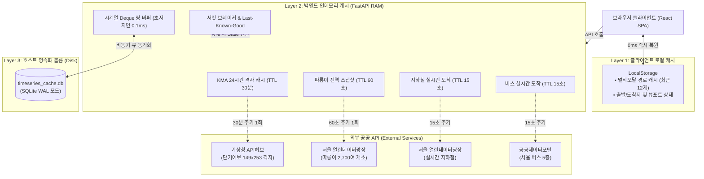

# ⚡ Weather & Transit Web 캐싱 정책 명세서 (`CACHING_POLICY.md`)

> **상위 프로젝트**: [Weather & Transit Web](../README.md)  
> **시스템 아키텍처**: [SYSTEM_ARCHITECTURE.md](./SYSTEM_ARCHITECTURE.md)  
> **백엔드 서버 명세**: [BACKEND_INFERENCE_SERVER.md](./BACKEND_INFERENCE_SERVER.md)  
> **최종 개정일**: `2026-11-03` | **문서 버전**: `v1.0`

---

## 1. 개요 및 목적 (Overview & Goals)

Weather & Transit Web 서비스는 기상청(KMA) 단기예보, 서울시 실시간 지하철, 공공데이터포털 버스 도착정보, 서울시 따릉이 실시간 거치 현황 등 다수의 공공 API와 32차원 ONNX AI 추론 엔진을 통합하여 제공합니다.

본 문서는 다음의 3대 핵심 목표를 달성하기 위한 **전사 캐싱 계층 구조, 데이터 종류별 유효 수명(TTL), 무중단 장애 격리(Graceful Degradation) 규칙**을 정의합니다:

1. **외부 공공 API 트래픽 한도(Quota) 보호**:
   - 일일 호출 허용량(`1,000~10,000회`) 초과로 인한 API 차단을 원천 차단하고, 다수 사용자의 동시 접속 요청을 백엔드 메모리에서 단일 요청으로 통합(Coalescing).
2. **초저지연 응답(SLA < 15ms) 보장**:
   - 왕복 네트워크 지연(`300~1,500ms`)이 발생하는 외부 원천 API 의존을 최소화하고, 서버 인메모리 및 SQLite WAL 영속 캐시를 통해 `1ms` 미만의 초고속 응답 달성.
3. **고가용성 장애 격리 (Circuit Breaker & Fallback)**:
   - 외부 서버 장애(503 Service Unavailable, 타임아웃 등) 발생 시 서킷 브레이커와 직전 정상 스냅샷(`Last Known Good`)을 연계하여 클라이언트에 중단 없는 서비스를 제공.

---

## 2. 3계층 다중 캐시 아키텍처 (Multi-Tier Architecture)

서비스는 **클라이언트 브라우저 ➔ 서버 인메모리 ➔ 호스트 SQLite WAL 영속화**로 이어지는 3계층 다중 캐시 파이프라인으로 구성됩니다.



---

## 3. 데이터 도메인별 캐시 정책 및 생명주기 (TTL)

| 데이터 도메인 | 캐시 계층 | 캐시 키 (Cache Key) | 유효 시간 (TTL) | 원천 API 및 갱신 방식 |
| :--- | :--- | :--- | :---: | :--- |
| **🌦️ 기상청 단기예보** | L2 (RAM) | `district` (25개 자치구) | **`30분`** (`1,800초`) | 기상청 API허브 `nph-dfs_shrt_grd` 149x253 격자(37,697개 좌표) 일괄 다운로드 후 서울 전역 `00~23시` 예보 동시 갱신 |
| **🚲 따릉이 실시간 거치** | L2 (RAM) | `_bike_snapshot_cache` (전역) | **`60초`** (`1분`) | 서울시 열린데이터광장 2,700여 개 대여소 전역 스냅샷 일괄 수집 (`1,000건/페이지 x 3~5회`) |
| **🚇 지하철 실시간 도착** | L2 (RAM) | `clean_station_name` | **`15초`** | 서울 열린데이터광장 `realtimeStationArrival`. 열차 이동 속도 감안 15초 보호 |
| **🚌 버스 실시간 도착** | L2 (RAM) | `{stId}_{busRouteId}` | **`15초`** | 공공데이터포털 서울 버스도착정보(`getLowArrInfoByStId`). 15초간 서버 보호 |
| **🧠 32차원 시계열 피처** | L2 + L3 | `{district}_{hour}` | **`영속 + 100μs`** | `timeseries_cache.py`: 인메모리 Deque + SQLite WAL 저장소 연동. 1시간 래그 및 3시간 이동평균 실시간 공급 |
| **🗺️ 멀티모달 경로 검색** | L1 (브라우저) | `{from}\|{to}\|{coords}\|{hour}\|{temp}\|{rain}` | **`최근 12개`** | `weather_transit_multimodal_cache_v5`: 동일 시간대·날씨 재검색 시 네트워크 트래픽 0 건 |

---

## 4. 장애 격리 및 무중단 서빙 전략 (Fault-Tolerance)

> [!IMPORTANT]
> 외부 공공 API는 네트워크 순단, 공공 서버 503 점검, 일일 트래픽 초과 등의 이유로 언제든 응답에 실패할 수 있습니다. 시스템은 어떠한 외부 장애 상황에서도 클라이언트 화면에 에러를 전파하지 않고 200 OK로 방어합니다.

### 4.1 서킷 브레이커 (Circuit Breaker) 연계
- **임계 조건**: 연속 `5회` 실패 시 서킷 상태가 `OPEN`으로 전환되어 외부 원천 호출을 즉각 차단.
- **복구 대기**: `60초` 동안 추가 호출을 차단하고 서버 부하 완화 후 `HALF-OPEN` 상태에서 단일 시험 호출로 정상화 검증.

### 4.2 직전 정상 스냅샷 (Last Known Good Fallback)
- 서킷이 `OPEN`되거나 타임아웃 발생 시, 캐시 메모리에 유지 중인 직전 최신 정상 데이터(`_*_last_good`)에 `source: "*_CIRCUIT_OPEN_STALE"` 메타데이터를 부여하여 응답.
- 사용자는 화면 중단 없이 서비스 이용 가능.

### 4.3 콜드 스타트 (Cold-Start) 지능형 통계 폴백
- 서버 최초 기동 시나 캐시가 전혀 없는 최악의 상황:
  - **지하철**: 서울교통공사 시간표 스케줄러 기반 도착 추정치 계산 (`SEOUL_SUBWAY_FALLBACK`).
  - **버스**: 배차간격(`7~12분`) 기반 도착 시간 추정치 제공 (`SEOUL_BUS_FALLBACK`).
  - **기상**: 과거 3개년 동월 동시간대 계절성 평균 기온(`16.5°C`) 및 강수 `0.0mm` 맑음 대체.
  - **시계열**: 서울시 20.9만 건 교통카드 빅데이터 기반 24시간 일주 곡선(`HOURLY_DIURNAL_FACTORS`) 감쇄율 적용.

---

## 5. 캐시 진단 및 운영 관리자 API (Admin & Observability)

운영자 및 개발자는 제공되는 관리자 엔드포인트를 통해 캐시의 실시간 적재 현황을 확인하고, 필요 시 수동으로 플러시(Flush)할 수 있습니다.

### 5.1 시계열 캐시 진단
- **요청**: `GET /api/v1/cache/timeseries-status?district=강남구`
- **응답 내용**:
  ```json
  {
    "status": "healthy",
    "district": "강남구",
    "cache_exists": true,
    "features_11d": {
      "bike_lag_1h": 22.0,
      "bus_lag_1h": 58.0,
      "subway_lag_1h": 52.0,
      "temp_diff_1h": 0.4,
      "rain_diff_1h": 0.0
    },
    "db_stats": {
      "total_records": 184,
      "size_kb": 128.0,
      "wal_enabled": true
    }
  }
  ```

### 5.2 인메모리 및 영속 캐시 수동 초기화 (Admin Flush)
- **요청**: `POST /api/v1/admin/cache/clear`
- **동작**:
  - `kma_forecast_manager` 24시간 격자 캐시 즉시 비우기.
  - `_bike_snapshot_cache`, `_subway_cache`, `_bus_cache` 단기 스냅샷 초기화.
  - 외부 공공 API 강제 실시간 재호출 및 최신 데이터 갱신 검증에 활용.

### 5.3 서버 헬스 체크 통합 관제
- **요청**: `GET /health`
- **확인 항목**:
  - `circuit_breakers`: 각 수단별 서킷 상태 (`CLOSED` 정상 확인).
  - `models_loaded`: 32차원 ONNX 세션 기동 여부.
  - `feature_schema`: 시계열 래그 및 32차원 스키마 정렬 상태 (`verified`).

---

## 6. 향후 고도화 로드맵 (Future Roadmap)

- **분산 캐시(Redis) 도입**: 단일 인스턴스 인메모리(`Python Dict`) 구조에서 복수 컨테이너(Scale-Out) 클러스터로 확장 시 분산 공유 캐시 레이어 증설.
- **실시간 확인 역 지도 동적 캐싱**: 사용자가 팝업을 열어 실시간 현황을 확인한 정류소/역에 대해 지도 상의 점(Dot) 마커 색상을 일정 시간(`15~60초`) 동안 동적으로 갱신 유지하는 인터랙션 탑재.
