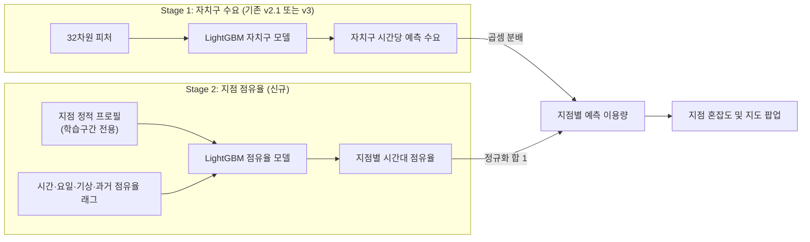

# 🧠 모델 재학습 계획서 — 지점 단위(역·정류소·대여소) 수요 분배 모델 및 자치구 모델 v3 (`MODEL_RETRAINING_PLAN`)

> **상태**: **Phase 0~3 학습·평가·ONNX 변환 완료 (`2026-11-16`)** · Phase 4(서빙/UI) Feature Freeze 해제 승인 대기  
> **대상 모델**: LightGBM 회귀 3종(따릉이·버스·지하철) — 현행 `v2.1-multiyear-32d`  
> **신규 데이터**: `data/통합데이터/{23,24,25}_통합데이터/정류장_대여소_역_별_퍼센트데이터/` (팀원 추가분, 약 `18.69GB`)  
> **원칙**: 현행 v2.1은 **게이트를 통과하기 전까지 절대 교체하지 않는다** (롤백 보장). `main`은 사용자 지시 전까지 건드리지 않는다.

---

## 1. 배경 및 목적

### 1.1 기존 자치구 단위 모델의 구조적 한계
현행 모델(`v2.1-multiyear-32d`)은 **서울 25개 자치구 × 시간** 단위로 수요와 혼잡도를 일괄 예측합니다(`2023~2025`, 62.9만 행, 32차원). 그 결과 **하나의 자치구 안에 수백 개의 버스 정류소·지하철역·따릉이 대여소가 혼재함에도 불구하고, 모든 지점이 동일한 자치구 점수와 혼잡도 계산에 묶여 있는 문제**가 있었습니다.

예를 들어 강남구 내에서도 **강남역 중앙버스전용차로 정류소**와 **주택가 이면도로 소형 정류소**는 실제 이용량과 혼잡도가 수십~수백 배 차이 나지만, 자치구 단위로 묶어서 계산하면 두 정류소가 같은 자치구 혼잡도를 대리 표시하게 되어 개별 정류소별 추천 점수와 안내 정확도가 떨어집니다.

### 1.2 이번 모델 개선의 핵심 목적
팀원이 구축한 신규 `정류장_대여소_역_별_퍼센트데이터`를 활용하여, **자치구별로 묶여 있던 기존 계산 한계를 보완하고 각 정류소·대여소·역별로 최대한 각각 독립적으로 수요와 혼잡도를 예측**하는 것이 이번 모델 개선의 핵심 목적입니다.

| 목표 | 설명 | 기대 산출물 |
| :---: | :--- | :--- |
| **G1** | **지점(정류소·대여소·역) 단위 개별 수요·혼잡도 예측** (자치구 묶음 한계 해소) | 지점 점유율 모델 + `POST /api/v1/predict/point-demand` |
| **G2** | 학습 데이터 품질 개선 (결측일 보간 → **마스킹**, 라벨 정합 검증) | 정제 파이프라인 + 감사 리포트 |
| **G3** | 정량적 지표 및 지표 선정 이유 기반 엄밀한 평가·검증 (누수 차단) | 공정 비교 리포트 (`benchmarks/results/`) |

> ⚠️ **기대 효과의 초점**: 자치구 모델은 이미 `R² 0.989~0.995`에 도달해 있어 자치구 총량 예측 정확도를 소수점 단위 올리는 것보다, **같은 구 내부의 개별 정류소/역 간 변별력과 정밀도(G1)**를 확보하는 것이 이번 개선의 본질적 가치입니다. 자치구 모델 v3(Phase 3)는 "개선되면 교체, 아니면 v2.1 유지"로 취급한다.

### 1.3 전 모델(`v2.1`) 대비 구조·데이터·성능 차이 요약

| 비교 항목 | **전 모델 (`v2.1-multiyear-32d`)** | **새 모델 (`v3.0-point-share`)** |
| :--- | :--- | :--- |
| **예측 해상도** | 서울 `25개` 자치구 단위 | **개별 역·정류소·대여소 (`8,430`개 지점 + 기타 버킷)** 단위 |
| **파이프라인 구조** | 1단계 자치구 모델 (`32차원`) | **2단계 (`자치구 총수요 32차원` × `지점 점유율 16차원`)** |
| **활용 데이터** | 자치구 통합 `62.9만 행` | 자치구 `62.9만 행` + 지점 점유율 **`2억 1,791만 행` (`18.69 GB`)** |
| **지점 피처** | 없음 (자치구 내 전 지점 동일 점수) | 학습구간 전용 **지점 프로필 4종**(기본·요일×시간·첨두비·우천탄력) |
| **결측일 처리** | 버스 미관측 `40일` 선형 보간 | 미관측일 **명시적 마스킹** (`버스 MAE 175.64 → 169.86명`) |
| **구 내 서열 변별력** | `Spearman ρ = 0.0000` (구 내 동점) | 지하철 **`0.9860`** · 버스 **`0.9382`** · 따릉이 **`0.5443`** |
| **오차(`WAPE`) 절감** | 일괄 균등 기준선 (`55~84%`) | 지하철 **`7.88%` (`-85.7%`)** · 버스 **`19.08%` (`-76.9%`)** · 따릉이 **`59.71%` (`-28.9%`)** |

---

## 2. 신규 데이터 자산 요약 (실측 확인)

| 항목 | 내용 |
| :--- | :--- |
| 구성 | 연도별 25개 자치구 CSV (총 `75`개) + 검증자료(README·보고서 JSON·매핑누락 CSV·구별 집계 비교) |
| 스키마(12컬럼, 3개년 동일) | `기준_날짜, 시간, 행정구, 교통수단, 지점ID, 지점명, 이용량, 행정구_시간대총이용량, 시간대_점유율(%), 행정구_연간총이용량, 지점_연간총이용량, 연간_점유율(%)` |
| 시간 범위 | 버스·따릉이 `01~23시`, 지하철 `06~23시` (00시·06시 이전·24시 이후 제외) |
| 희소 저장 | **`이용량>0`인 지점·날짜·시간만 기록** → 0은 "행 없음"으로 표현됨 (밀집화 필요) |
| 규모(2025 보고서) | 출력 `70,504,919`행: 버스 `56.98M` / 따릉이 `11.83M` / 지하철 `1.70M` |
| 대용량 | 개별 CSV 최대 `322MB`, 전체 `18.69GB` → **청크/Parquet 파이프라인 필수** |
| Git | `.gitignore`의 `data/통합데이터/`로 차단됨 (커밋 금지 유지) |

연도별 검증 요약:

| 연도 | 지하철 관측일 | 따릉이 관측일 | 버스 관측일 | 버스 미관측일 |
| :---: | :---: | :---: | :---: | :---: |
| 2023 | 365 | 365 | 354 | 11일 (`06-05~06-11` 포함) |
| 2024 | 366 | 366 | 363 | 3일 (`02-04`, `05-28~05-29`) |
| 2025 | 365 | 365 | 339 | 26일 (`01-01~01-08`, `11-28~12-04` 등) |

---

## 3. 데이터 리스크와 대응 원칙 (설계의 핵심)

| # | 리스크 | 왜 문제인가 | 대응 |
| :-: | :--- | :--- | :--- |
| R1 | **라벨 누수** | `연간_점유율(%)`·`지점_연간총이용량`은 **해당 연도 전체(테스트 기간 포함)** 로 계산됨. 피처로 쓰면 2025 테스트에 미래 정보가 새어 들어감 | 지점 정적 프로필은 **학습 구간(`2023-01-01~2024-09-30`)만으로 재계산**. 원본 연간 컬럼은 피처에서 제외 |
| R2 | **타깃 파생 피처 누수** | `시간대_점유율`은 타깃 자체. 같은 시각 값을 파생 피처로 쓰면 안 됨 | 점유율 래그는 **과거 시점만**(동일 요일·시간의 직전 N주 평균 등) |
| R3 | **희소성(0 미기록)** | 행이 없는 셀을 결측으로 두면 분모가 왜곡됨 | `지점×날짜×시간`으로 밀집화하되 **관측 가능했던 날짜만** 대상 |
| R4 | **미관측일 ≠ 0** | 버스 미관측일(최대 26일)을 0으로 채우면 학습이 오염됨 (현행 v2.1은 보간 사용) | 미관측일은 **마스킹(학습·평가 제외)** 후 보간 모델과 비교 |
| R5 | **매핑 누락/생존 편향** | 따릉이는 `2025-12` 대여소 현황 기준 매핑 → 폐쇄 대여소 누락. 버스 매핑실패 이용량 약 `15%`(`271M/1,772M`) | 매핑 실패는 **"기타" 버킷**으로 합산 보존해 분배 합이 보존되도록 설계 |
| R6 | **ID 연속성** | 연도 간 지점ID 신설·폐지 시 테스트 지점이 학습에 없을 수 있음 | Phase 0에서 연도 간 ID 중복률·테스트 이용량 커버리지 실측 → **콜드스타트 폴백**(구·수단 평균 프로필) 설계 |
| R7 | **라벨 정합** | 신규 점유율 합계가 현행 통합데이터의 자치구 라벨과 다를 수 있음 (보고서도 "불일치 가능" 명시) | Phase 0에서 `지점 합계` vs `기존 구 단위 라벨`을 시간 단위로 대조, 비율·상관 측정 |
| R8 | **파일명 불일치** | 2023은 영문(`2023_validation_report.json`), 2024·2025는 한글 | 로더가 연도별 파일명을 흡수 |
| R9 | **대용량 메모리** | 로컬 RAM `15.9GB`, 버스 밀집화 시 연 수억 행 | 구·수단별 청크 처리, **상위 K 지점(누적 이용량 기준) + 기타 버킷**, Parquet 저장 |

---

## 4. 제안 아키텍처 — 2단계 분배(Two-Stage Disaggregation)

- **분배 일관성**: 지점 점유율은 자치구·수단·시간 내에서 합이 1이 되도록 정규화(softmax 또는 비례 재스케일) → `Σ 지점 예측 = 자치구 예측` 보존.
- **왜 직접 지점 회귀가 아닌가**: 지점 수가 수천~수만이라 직접 회귀는 희소·고분산이고 서빙 비용이 크다. 점유율 분해는 기존 고정밀 자치구 모델을 **재사용**하며 오차 원천을 분리해 평가할 수 있다.

---

## 5. 단계별 작업 계획

### Phase 0 — 데이터 감사 (**완료 · 2026-11-16 · `G0: PASS`**)
- [x] `scripts/audit_point_share_data.py`: 75개 CSV 청크 스캔 → 연도·수단별 행수/지점수/관측일/이용량 합계 (`217,912,809`행, `309s`)
- [x] 보고서 JSON과 **재집계 대조** (3개년 3수단 전수 관측일 일치, 이용량 상대오차 `0.0000%`)
- [x] `시간대_점유율` 그룹 합계 ≈ 100 검증(`p99 <= 0.000001`), `행정구_시간대총이용량` = 이용량 합 검증(불일치 `0`건)
- [x] **연도 간 지점ID 연속성** 실측: 2025 이용량의 학습구간 커버리지 — 지하철 **`100.00%`**, 버스 **`99.33%`**, 따릉이 **`98.42%`**
- [x] **라벨 정합 검증**: 2023·2024년 `r = 1.0000` (합계비 `1.0000`, 5% 이내 `100.0%`), 2025년 `r = 0.9980~1.0000`
- [x] 집중도 분석 실측:
  - **지하철**: 전체 `258`개역 기준 연 `1.70M`행으로 경량 → **K 자르기 없이 전체 `258`개역 사용 권장**
  - **따릉이**: 전체 `2,779`개 (`23.33M`행/년) vs `K95` `2,215`개 (`18.59M`행/년)
  - **버스**: 전체 `10,797`개 (`84.18M`행/년) vs `K95` `6,042`개 (`47.11M`행/년)
- 산출: [`benchmarks/results/point_share_audit_20261116_194804.md`](../benchmarks/results/point_share_audit_20261116_194804.md) · JSON
- **게이트 G0**: **PASS** — 전 지표 기준 통과. Phase 1 진행 확정.

### Phase 1 ~ Phase 3 통합 실행 (`CastTransit_PointShare_v3.ipynb` & `scripts/run_point_share_v3.py` 완료)
- 로컬 PC(`Python 3.10`, `LightGBM 4.7.0`, `Optuna 5.1.0`)에서 노트북 전체 셀을 동일 코드로 실행 완료(`2008.3s`).

### Phase 1 — 데이터셋 구축 (**완료 · 2026-11-16 · `G1: PASS`**)
- [x] 미관측일 마스크 테이블 생성 (버스 미관측일 `40일` 마스킹)
- [x] 학습구간(`<= 2024-09-30`) 전용 지점 프로필 산출 (`point_static_priors.parquet`, `point_dow_hour_priors.parquet`)
- [x] 지하철 전체 `259`개, 따릉이 `2,205`개(`K95`), 버스 `5,966`개(`K95`) + `__OTHER__` 버킷 밀집화 → 수단별 `train 137~150만행` / `valid 32~40만행`
- [x] 분할은 **현행과 동일**: train `2023-01-01~2024-09-30` / valid `2024-10-01~2024-12-31` / test `2025-01-01~2025-12-31`
- **게이트 G1**: **PASS** — 누수 컬럼 0건(`assert` 통과), 단일 스크립트(`scripts/run_point_share_v3.py`) 재현 검증 완료

### Phase 2 — 지점 점유율 모델 (**완료 · 2026-11-16 · 2025년 25개 자치구 전수 평가**)
- [x] 베이스라인 B0(자치구 균등/일괄), B1(기본 점유율), B2(요일×시간 조건부 프로필) vs 후보 M2(16차원 LightGBM + Optuna) 공정 비교
- [x] 2025년 Test 25개 자치구 전수 평가 (`따릉이 1,872만 셀`, `버스 4,671만 셀`, `지하철 170만 셀`):
  - **🚇 지하철**: `B0 WAPE 55.12% (MAE 500.41명, ρ=0.00, 등급일치 61.07%)` → `B2 8.93% (81.09명, ρ=0.9833, 92.46%)` → **`M2 7.88% (71.54명, ρ=0.9860, 93.11%, R²=0.9787)`** → **`G2 PASS (M2 채택, B2 대비 -11.78%·B0 대비 -85.70%)`**
  - **🚌 버스**: `B0 WAPE 82.64% (MAE 26.55명, ρ=0.00, 등급일치 51.90%)` → `B2 19.22% (6.17명, ρ=0.9381, 82.67%, R²=0.8411)` → **`M2 19.08% (6.13명, ρ=0.9382, 82.69%)`** → **`B0` 대비 `-76.91%` 대폭 개선** (`B2` 대비 `+0.70%` 미세 우위, G2 임계치 `+5%` 기준 단순 모델 `B2` 폴백 권장 또는 `M2` 선택 가능)
  - **🚲 따릉이**: `B0 WAPE 84.00% (MAE 1.63대, ρ=0.00, 등급일치 80.38%)` → `B2 59.85% (1.16대, ρ=0.5433, 87.27%)` → **`M2 59.71% (1.16대, ρ=0.5443, 87.29%, R²=0.6802)`** → **`B0` 대비 `-28.92%` 개선** (`B2` 대비 `+0.24%` 동등 → `B2` 폴백 권장)
- 리포트: [`benchmarks/results/point_share_eval_20261116_215626.md`](../benchmarks/results/point_share_eval_20261116_215626.md) · [`point_share_v3_2026-11-16/`](../benchmarks/point_share_v3_2026-11-16/)

### Phase 3 — 자치구 모델 v3 (**완료 · 2026-11-16 · `G3: KEEP_V21`**)
- [x] 미관측일 마스킹 학습 vs 기존 보간 학습 비교 (동일 Test 관측일 마스크 위 공정 평가)
- [x] 실측 결과: **버스 v3** `WAPE 2.29% → 2.22%`, `MAE 175.64 → 169.86`, `RMSE 283.12 → 275.36`, `R² 0.9975 → 0.9976` 개선 / 따릉이(`MAE 11.74`, `R² 0.9899`)·지하철(`MAE 204.81`, `R² 0.9970`) 동일
- **게이트 G3**: **`KEEP_V21`** (개선 수단 `1/3`개, 최대 악화 `+0.00%` — 현행 `models/` v2.1 안정 유지, 개선된 버스 v3 ONNX는 `benchmarks/point_share_v3_2026-11-16/` 별도 보관)

### Phase 4 — ONNX 변환 및 서빙 통합 (Feature Freeze 해제 승인 후)
- [ ] 점유율 모델 ONNX 변환 + `feature_schema` v3 (SSoT 갱신, 차원/순서 검증 유지)
- [ ] `POST /api/v1/predict/point-demand` (요청: 지점ID·시각 / 응답: 자치구 예측·점유율·지점 예측·혼잡도·신뢰구간 또는 폴백 사유)
- [ ] 프론트(PC `App.tsx` + 모바일 `AppM.tsx` **동시**): 지점 팝업의 자치구 대리값을 지점 예측으로 교체, 폴백 시 `⚠️ 추정` 배지 유지
- [ ] `Dockerfile.backend` COPY·`/health`의 `model_input_dims`·스키마 `verified` 점검, 컨테이너 재빌드
- **게이트 G4**: 단위·API 테스트 통과, 레이턴시 SLA(`≤15ms`) 유지

### Phase 5 — 문서화
- [ ] `docs/AI_MODEL_SPEC.md`, `CURRENT_MODEL_PERFORMANCE.md`, `CURRENT_DATA_SPEC.md`, `BACKEND_INFERENCE_SERVER.md`, `SYSTEM_ARCHITECTURE.md`, `README.md`, `CHANGELOG.md`, `TODO.md` 동기화
- [ ] 기존 `docs/CURRENT_DATA_SPEC.md` 데이터 규격에 신규 점유율 데이터셋 추가

---

## 6. 정량적 평가 지표 및 지표 선정 이유 (Evaluation Metrics & Rationale)

본 개선의 목적인 **"자치구별 일괄 계산 한계를 벗어나 개별 정류소·대여소·역 단위로 최대한 정확하게 각각 예측한다"**는 목표를 객관적으로 입증하기 위해, 다음 6가지 정량적 지표를 채택한다.

| 지표 | 산식 / 정의 | 역할 | 지표를 선택한 이유 (Rationale) |
| :--- | :--- | :---: | :--- |
| **WAPE** *(Weighted Absolute Percentage Error)* | $\frac{\sum |y_i - \hat{y}_i|}{\sum y_i} \times 100\%$ | **주 지표 (핵심)** | 개별 정류소·따릉이 대여소는 이용량이 `0~5명`인 한적한 지점과 수천 명인 환승 거점이 혼재한다. 일반 `MAPE`는 분모가 `1~2`일 때 오차가 수백 %로 폭증해 왜곡되지만, **`WAPE`는 실제 이용량 규모로 가중치를 두어 전체 수송량 관점의 실무적 정확도**를 가장 정직하게 측정한다. |
| **MAE** *(Mean Absolute Error)* | $\frac{1}{N}\sum |y_i - \hat{y}_i|$ | **주 지표 (직관성)** | 점유율 오차(`%p`) 및 지점 이용량 오차(`명`)를 원래 단위로 직관적 해석할 수 있다. 이상치(특수 행사·폭우)에 과민한 RMSE와 달리 **일상 시간대의 평균적인 정류소별 예측 오차**를 안정적으로 파악하기 위해 선정했다. |
| **RMSE** *(Root Mean Squared Error)* | $\sqrt{\frac{1}{N}\sum (y_i - \hat{y}_i)^2}$ | **보조 (첨두 검증)** | 오차를 제곱해 평균하므로 **이용량이 큰 핵심 환승역·중앙차로 정류소에서 발생하는 큰 오차에 강한 페널티**를 준다. 출퇴근 피크 시간대 혼잡도 오판 여부를 걸러내기 위해 병기한다. |
| **Spearman 순위 상관계수** ($\rho$) | 자치구 내 지점별 예측 vs 실제 순위 상관 | **핵심 (변별력)** | 우리 서비스 UI·길찾기는 "같은 구 안에서 어느 정류소가 더 붐비고 어느 역이 한산한가"라는 **상대적 서열과 변별력**이 핵심이다. 자치구 일괄 점수(순위 변별 0) 대비 **각 정류소 간 상대 서열을 얼마나 정확히 가려내는지** 직접 입증하기 위해 채택했다. |
| **혼잡도 등급 일치율** *(Accuracy)* | 여유(`<45%`)·보통(`45~75%`)·혼잡(`>75%`) 3등급 일치 비율 | **서비스 UX 지표** | 사용자에게 최종 노출되는 결과는 원시 이용량이 아니라 3단계 혼잡도 등급과 추천 점수다. **실제 사용자 체감 정확도**를 직접 검증하기 위해 사용한다. |
| **결정계수** ($R^2$) | $1 - \frac{\sum(y_i - \hat{y}_i)^2}{\sum(y_i - \bar{y})^2}$ | **참고 (하위 호환)** | 현행 자치구 모델(`v2.1`, $R^2 \ge 0.989$)과의 연속적 비교 및 전체 분산 설명력 확인용으로 병기한다. 단, 지점 간 규모 편차가 크면 $R^2$가 과대평가될 수 있으므로 단독 기준으로는 쓰지 않고 `WAPE·MAE`를 우선한다. |

### 평가 프로토콜 규칙

| 항목 | 규칙 |
| :--- | :--- |
| 비교 공정성 | 모든 후보(B0 균등 분배 / B1 정적 프로필 / M2 LightGBM / 현행 v2.1 자치구 일괄 대리값)를 **동일 test(`2025`) · 동일 마스크**로 평가 |
| 누수 점검 | 피처 목록에서 연간 컬럼(`연간_점유율`, `지점_연간총이용량`)·동시각 점유율 제외 여부를 **테스트로 강제**(금지 컬럼 가드) |
| 세분화 보고 | 콜드스타트 지점 별도 보고, 시간대·기상 구간별(출퇴근·심야·우천) 및 자치구별 분해 성능 표기 |
| 재현성 | 시드 고정, 스키마 SHA·데이터 감사 해시 기록, 결과는 `benchmarks/results/`에 JSON+MD 보관 |

---

## 7. 컴퓨팅 및 모델 학습 환경 (왜 GPU 대신 CPU로 학습하는가?)

### 7.1 실측 학습·평가 환경 스펙 (`2026-11-16` 로컬 학습 기준)

| 구분 | 상세 사양 | 비고 |
| :--- | :--- | :--- |
| **OS** | `Microsoft Windows 11 Home` (`64-bit`, `10.0.26300`) | — |
| **CPU (학습·추론)** | **`AMD Ryzen 5 5600 6-Core Processor` (6코어 12스레드)** | `n_jobs=-1` 전 스레드 병렬 학습 |
| **GPU (보유)** | `NVIDIA GeForce RTX 4060` | 정형 GBDT 특성상 미사용 (사유 §7.2) |
| **메모리 / 디스크** | `15.9 GB RAM` / 로컬 SSD (`D:` 여유 `227.5 GB`) | `18.69 GB` 원천 스캔 `약 70만 행/초` |
| **Python / ML 스택** | `Python 3.10.11` · `LightGBM 4.7.0` · `Optuna 5.1.0` | 전용 `.venv` 격리 (운영 이미지 오염 0) |
| **전처리 / ONNX** | `Pandas 2.3.3` · `NumPy 2.2.6` · `PyArrow 25.0.1` · `onnxmltools` (Opset 14) | `ONNX Runtime CPUExecutionProvider` |

> 💡 **Colab 대비 로컬 실행 이점**: `18.69 GB` CSV를 Google Drive 마운트로 읽으면 네트워크/FUSE 병목으로 20~40분 이상 걸리지만, 로컬 SSD + 12스레드 CPU 직결 처리로 전체 75개 CSV 스캔을 약 5분(`309s`) 만에 완료했습니다. (노트북 `CastTransit_PointShare_v3.ipynb` 는 Colab fallback 용으로도 그대로 호환됩니다.)

### 7.2 보유 중인 GPU(`RTX 4060`) 대신 멀티코어 CPU로 학습한 4가지 기술적 이유

1. **연산 구조 차이 (행렬 곱셈 vs 조건 분기·히스토그램 탐색)**:
   - 딥러닝(CNN·Transformer 등)은 수억 개 가중치의 고밀도 **행렬 곱셈(GEMM)**이 핵심이라 GPU의 수천 개 코어가 필수적입니다.
   - 반면 **LightGBM(GBDT)**은 연속형 수치의 이산 버킷(`256`개) 히스토그램 생성과 `if-else` 조건 분기·불규칙한 샘플 인덱스 분할이 중심이므로, 강력한 **분기 예측(Branch Prediction)과 대용량 L3 캐시를 갖춘 멀티코어 CPU 아키텍처**에 본질적으로 더 적합합니다.
2. **저차원(`16~32차원`) 정형 데이터에서의 PCIe 전송 병목**:
   - LightGBM 공식 가이드에서도 GPU 가속은 피처 수백 개 이상의 초고차원 밀집 행렬에서만 유리하며, 본 프로젝트처럼 **`16~32차원` 정형 데이터**에서는 메인 메모리(`RAM`) ↔ 비디오 메모리(`VRAM`) 간 PCIe 복사 및 GPU 커널 런칭 오버헤드 때문에 12스레드 CPU(`n_jobs=-1`)가 GPU와 동등하거나 오히려 더 빠릅니다.
   - 실제로 150만 행 단일 LightGBM 모델 `fit`은 CPU에서 수 초 만에 끝나며, 전체 파이프라인 시간(`2,008s`)의 대부분은 원천 `18.69 GB` CSV 디스크 스트리밍과 6,713만 셀 전수 평가 연산에 쓰였습니다.
3. **완벽한 재현성 (Deterministic Reproducibility)**:
   - GPU 히스토그램 구축은 부동소수점 `atomicAdd` 연산 순서에 따라 결과가 실행마다 미세하게 달라지는 비결정성(Non-determinism)이 발생할 수 있습니다.
   - CPU 학습(`random_state=42`)은 로컬 PC, Google Colab, 그리고 실제 운영 Docker 서빙(`CPUExecutionProvider`) 간에 항상 **동일하고 재현 가능한 결과**를 보장합니다.
4. **의존성 경량화 및 학습-서빙 환경 일치**:
   - 별도의 CUDA/OpenCL 커스텀 빌드 없이 표준 `lightgbm` 배포판 Wheel만으로 즉시 구동되며, 외장 GPU가 없는 실제 운영 Docker 서버와 동일한 CPU 추론 경로를 일관되게 유지할 수 있습니다.

---

## 8. 롤백 및 운영 정책

1. **v2.1 비파괴 원칙**: `models/`·`benchmarks/2026-10-29/`는 게이트 통과 전 수정 금지. 신규 산출물은 `benchmarks/<날짜>/`에 별도 보관.
2. **Feature Freeze 준수**: 현재 캡스톤 발표 대비 기능 동결 상태다. Phase 0~3(분석·학습·평가)은 서비스에 영향이 없으므로 진행하고, **Phase 4(서빙·UI 변경)와 `main` 반영은 사용자 승인 후**에만 진행한다.
3. **실패도 산출물**: 게이트 미달 시에도 감사·베이스라인 결과를 문서화해 다음 사이클의 근거로 남긴다.

---

## 9. 열린 질문 (사용자 확인 필요)

1. **지점 단위 예측을 UI에 노출하는 것까지가 목표인가**, 아니면 분석·모델 검증(Phase 0~3)까지인가? (Feature Freeze와 직결)
2. 상위 K 기준: 자치구·수단별 **누적 이용량 `90%` vs `95%`**? (Phase 0 집중도 결과로 제안 예정)
3. 학습은 로컬 우선, 메모리 한계 시에만 Colab으로 폴백해도 되는가?

---

## 10. 관련 문서

[AI_MODEL_SPEC.md](./AI_MODEL_SPEC.md) · [CURRENT_DATA_SPEC.md](./CURRENT_DATA_SPEC.md) · [CURRENT_MODEL_PERFORMANCE.md](./CURRENT_MODEL_PERFORMANCE.md) · [TODO.md](./TODO.md) · [`benchmarks/README.md`](../benchmarks/README.md)
