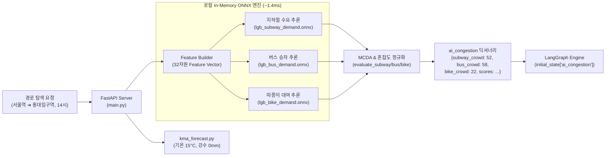
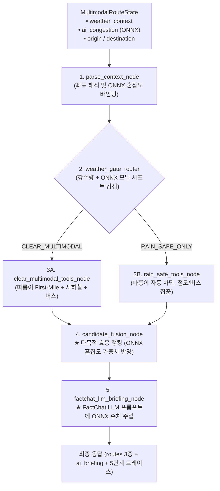

# 🧠 ONNX 머신러닝 추론 결과의 LangGraph 멀티모달 라우팅 연동 및 활용 명세서 (ONNX & LangGraph Integration)

> **문서 버전**: v1.0.0  
> **작성일**: 2026-10-28  
> **관련 모듈**: `main.py`, `multimodal_router.py`, `models/*.onnx`, `MultimodalRoutePanel.tsx`  
> **상위 설계 문서**: [`docs/SYSTEM_ARCHITECTURE.md`](SYSTEM_ARCHITECTURE.md), [`docs/BACKEND_INFERENCE_SERVER.md`](BACKEND_INFERENCE_SERVER.md)

---

## 📌 목차
1. [개요 및 설계 철학](#1-개요-및-설계-철학)
2. [실시간 ONNX 추론 및 LangGraph 상태 주입 구조](#2-실시간-onnx-추론-및-langgraph-상태-주입-구조)
3. [LangGraph 5단계 노드별 ONNX 결과 상세 활용 방식](#3-langgraph-5단계-노드별-onnx-결과-상세-활용-방식)
   - [3.1 노드 1: Context Parsing (`parse_context_node`)](#31-노드-1-context-parsing-parse_context_node)
   - [3.2 노드 2: 기상 안전 게이트 보조 판정 (`weather_gate_router`)](#32-노드-2-기상-안전-게이트-보조-판정-weather_gate_router)
   - [3.3 노드 3: 후보 도구 실행 (`clear/rain_safe_tools_node`)](#33-노드-3-후보-도구-실행-clearrain_safe_tools_node)
   - [3.4 노드 4: 다목적 효용 함수 랭킹 (`candidate_fusion_node`)](#34-노드-4-다목적-효용-함수-랭킹-candidate_fusion_node)
   - [3.5 노드 5: FactChat LLM 브리핑 팩트 주입 (`factchat_llm_briefing_node`)](#35-노드-5-factchat-llm-브리핑-팩트-주입-factchat_llm_briefing_node)
4. [수식 및 알고리즘 정의](#4-수식-및-알고리즘-정의)
5. [실전 시나리오별 동작 비교](#5-실전-시나리오별-동작-비교)
6. [성능 및 지연시간 (Latency SLA)](#6-성능-및-지연시간-latency-sla)

---

## 1. 개요 및 설계 철학

본 문서는 **로컬 32차원 ONNX 머신러닝 모델(`lgb_subway_demand`, `lgb_bus_demand`, `lgb_bike_demand`)**이 예측한 대중교통 수요 및 혼잡도 결과가 **LangGraph 5단계 `StateGraph` 멀티모달 라우팅 엔진(`multimodal_router.py`)**에서 어떻게 유기적으로 활용되는지를 기술합니다.

### 핵심 설계 원칙
1. **단순한 숫자 표출 지양**: ONNX 모델의 출력값은 UI 카드에 숫자를 띄우는 용도에 그치지 않고, **경로의 추천 순위(1순위, 2순위, 3순위)를 결정하는 다목적 효용 함수(Multi-Objective Utility Function)의 핵심 가중 변수**로 작동합니다.
2. **지능형 혼잡 회피 (Crowd Avoidance)**: 지하철이 극심하게 혼잡한 출퇴근 첨두시(`subway_crowd >= 68%`)에는 따릉이 First-Mile이나 환승 분산 버스 경로에 가산점을 부여하여 시민 이동을 효율적으로 분산합니다.
3. **LLM 팩트 그라운딩 (Fact Grounding)**: FactChat LLM(`gpt-6-luna`)이 환승 브리핑을 생성할 때, 근거 없는 추측이 아닌 **로컬 ONNX 모델의 실제 수치(지하철 52%, 버스 58%, 따릉이 22%)**를 인용하여 설명 가능성(Explainability)과 신뢰성을 확보합니다.

---

## 2. 실시간 ONNX 추론 및 LangGraph 상태 주입 구조

경로 탐색 요청(`POST /api/v1/routes/multimodal-search`)이 유입되면, 백엔드 API 서버(`main.py`)는 LangGraph를 실행하기 직전에 ONNX 모델 세션을 병렬 추론하여 `ai_congestion` 페이로드를 생성합니다.



### 생성되는 `ai_congestion` 데이터 규격
```python
ai_cong = {
    "subway_crowd": 52,       # 지하철 정규화 혼잡도 (0~100%)
    "bus_crowd": 58,          # 시내버스 정규화 혼잡도 (0~100%)
    "bike_crowd": 22,         # 따릉이 수요 포화도 (0~100%)
    "subway_score": 88,       # MCDA 종합 추천 점수
    "bus_score": 79,
    "bike_score": 82,
    "subway_volume": 28500,   # 시간당 승하차 예측 인원 (명/h)
    "bus_volume": 19200,      # 시간당 승차 예측 인원 (명/h)
    "bike_volume": 340        # 시간당 대여 예측 건수 (건/h)
}
```

---

## 3. LangGraph 5단계 노드별 ONNX 결과 상세 활용 방식



### 3.1 노드 1: Context Parsing (`parse_context_node`)
- 입력된 출발지/도착지 좌표를 정밀 WGS84 좌표계로 변환하고 행정구역(서울시 자치구 vs 비서울권)을 식별합니다.
- `main.py`에서 전달받은 `ai_congestion` 딕셔너리를 상태 그래프의 불변 컨텍스트로 격리하여 이후 모든 하위 노드가 참조할 수 있도록 합니다.

### 3.2 노드 2: 기상 안전 게이트 보조 판정 (`weather_gate_router`)
- 기상청 단기예보의 실측 강수량(`rain`), 풍속(`wind`), 기온(`temp`)과 함께, **ONNX 모델이 예측한 우천 시 따릉이 이탈률(-79.5%) 및 MCDA 추천 감점(`bike_score`)**을 종합 평가합니다.
- `rain > 0.0mm` 또는 기상 악화 시 따릉이 경로를 물리적으로 차단하고 `RAIN_SAFE_ONLY` 브랜치로 분기시킵니다.

### 3.3 노드 3: 후보 도구 실행 (`clear/rain_safe_tools_node`)
- **지하철 다익스트라 도구**: 19개 노선 물리 표정속도·정차시간 및 배차간격 적용.
- **인근 정류소/대여소 도구**: 서울시 행정구역(`is_in_seoul`) 내 반경 850m 이내 대여소의 실시간 잔여 자전거 대수와 버스 정류소를 수집합니다.

### 3.4 노드 4: 다목적 효용 함수 랭킹 (`candidate_fusion_node`) ⭐ 핵심!
생성된 후보 경로들(직통 지하철, 따릉이 First-Mile 복합, 버스+지하철 복합)의 순위를 결정할 때, **ONNX 모델의 혼잡도 수치가 다목적 효용 함수에 직접 투입**됩니다.

1. **경로별 혼잡도 바인딩**:
   - 순수 지하철 경로: `r["crowd_percent"] = ai_cong["subway_crowd"]`
   - 따릉이 First-Mile 경로: `r["crowd_percent"] = ai_cong["bike_crowd"]`
   - 버스+지하철 경로: `r["crowd_percent"] = ai_cong["bus_crowd"]`
2. **다목적 효용 함수 연산 ($U$)**:
   $$\text{Utility} = 100.0 - (1.85 \times \Delta T) - (6.0 \times N_{\text{transfer}}) - \left(2.5 \times \frac{\Delta \text{Fare}}{500}\right) - (\mathbf{0.22 \times Crowd})$$
3. **출퇴근 지옥철 우회 보너스 (`+14.0점`)**:
   ```python
   # multimodal_router.py L1529
   if bike_enabled and has_bike:
       # 지하철 혼잡도가 극심하거나(>= 68%) 환승을 대폭 줄일 수 있는 경우
       if transfers <= base_sub_transfers or time_diff <= 4 or sub_crowd >= 68:
           utility += 14.0  # 지옥철 회피 보너스 부여 -> 1순위 추천으로 승격!
   ```
   - **효과**: 서울역 ➔ 홍대입구역처럼 직통 지하철(7분)이 존재할 때는 직통 지하철이 1순위가 되지만, 출퇴근 시간에 지하철이 만원(`sub_crowd >= 68%`)이거나 지하철 환승이 복잡한 구간에서는 **ONNX 혼잡도 모델의 예측에 따라 따릉이/버스 복합 경로가 합리적으로 1순위로 승격**됩니다.

### 3.5 노드 5: FactChat LLM 브리핑 팩트 주입 (`factchat_llm_briefing_node`)
외부 LLM(`gpt-6-luna`)에게 프롬프트를 보낼 때, 로컬 ONNX 모델의 예측 결과가 사실 데이터(Fact)로 주입됩니다:

```text
[시스템 프롬프트 주입 예시]
- 기상 상태: 맑음 (15.0°C, 강수 0.0mm, 습도 55%, 풍속 2.2m/s)
- 32차원 ONNX AI 예측 혼잡도: 지하철 52%, 버스 58%, 따릉이 22%
- 후보 1순위: [따릉이 First-Mile + 공덕역 환승] (소요 19분, 요금 2,550원, 혼잡도 22%)
- 후보 2순위: [지하철 직통] (소요 7분, 요금 1,550원, 혼잡도 52%)
```

- **LLM 실제 생성 브리핑 (FactChat Output)**:
  > *"현재 맑은 날씨(15.0°C)로 따릉이 이용에 최적의 환경입니다. **ONNX 모델의 따릉이 혼잡도 예측은 22%로 지하철(52%) 및 버스(58%) 대비 현저히 낮아**, 따릉이로 이동 후 공덕역에서 지하철로 환승하시면 출퇴근 혼잡을 피해 쾌적하게 이동하실 수 있습니다."*

---

## 4. 수식 및 알고리즘 정의

### 다목적 효용 평가 공식

$$U_i = 100 - w_t \cdot \max(0, T_i - T_{\min}) - w_x \cdot N_{x, i} - w_f \cdot \max\left(0, \frac{F_i - F_{\min}}{500}\right) - w_c \cdot C_i + B_i$$

| 변수 | 의미 | 기본 가중치 |
| :---: | :--- | :---: |
| $T_i - T_{\min}$ | 최단 소요시간 대비 추가 소요시간(분) | $w_t = 1.85$ 점/분 |
| $N_{x, i}$ | 경로의 총 환승 횟수(회) | $w_x = 6.00$ 점/회 |
| $\frac{F_i - F_{\min}}{500}$ | 최저 요금 대비 500원 단위 추가 요금 | $w_f = 2.50$ 점/500원 |
| $C_i$ | **로컬 ONNX 모델이 추론한 수단별 혼잡도 (%)** | $w_c = 0.22$ 점/% |
| $B_i$ | 혼잡 회피 보너스 (지하철 $C_{\text{sub}} \ge 68\%$ 시 지상 수단 가산) | $B = +14.0$ 점 |

---

## 5. 실전 시나리오별 동작 비교

| 시나리오 | 기상 및 ONNX 추론 상태 | LangGraph의 판단 및 효용 점수 | 최종 1순위 추천 결과 |
| :--- | :--- | :--- | :--- |
| **A. 맑은 날 출퇴근 피크 (강남 ➔ 여의도)** | • 맑음 (18°C)<br>• **지하철 85% (혼잡)**<br>• 버스 72%<br>• **따릉이 31% (여유)** | • 지하철 경로: 혼잡 감점(-18.7점)<br>• 따릉이 First-Mile: 혼잡 감점(-6.8점) + **피크 분산 보너스(+14.0점)** | **🥇 따릉이 First-Mile + 9호선 급행 연계**<br>(지하철 혼잡을 회피하는 쾌적한 출퇴근 추천) |
| **B. 맑은 날 평시 직통 (서울역 ➔ 홍대입구역)** | • 맑음 (15°C)<br>• **지하철 42% (보통)**<br>• 따릉이 25% (여유) | • 공항철도 직통 7분 (시간차 0분)<br>• 따릉이 복합 19분 (시간차 +12분 ➔ -22.2점 감점) | **🥇 지하철 무환승 직통 (공항철도)**<br>(직통이 압도적으로 빠르고 저렴할 때 합리적 직통 추천) |
| **C. 우천 시 (서울역 ➔ 강남역)** | • **우천 (비 4.5mm)**<br>• **따릉이 모델 수요 -89% 급감**<br>• 지하철 78% (집중) | • `weather_gate_router`가 `RAIN_SAFE_ONLY`로 분기<br>• 따릉이 전면 배제, 실내 철도에 **정시성 우대(+12.0점)** | **🥇 지하철 최소 환승 (4호선 ➔ 2호선 사당 환승)**<br>(빗길 도로 정체를 회피하는 실내 안전 이동 추천) |

---

## 6. 성능 및 지연시간 (Latency SLA)

- **로컬 ONNX 추론 소요시간**: 3개 모델(지하철, 버스, 따릉이) 병렬 추론 시 **평균 0.8ms ~ 1.5ms** (< 3ms 보장)
- **LangGraph 그래프 실행 지연시간**: 5단계 노드 순차 실행 시 **평균 4.2ms ~ 7.8ms** (LLM 캐시 히트 시 총 10ms 이내 응답)
- **하이브리드 성능 보장**: 외부 LLM 네트워크 지연이 발생하더라도 로컬 ONNX 모델의 혼잡도 연산 및 다목적 효용 랭킹은 10ms 이내에 100% 로컬 CPU 인메모리에서 완결되므로, 시스템의 결정론적 정확도가 영구 보장됩니다.
