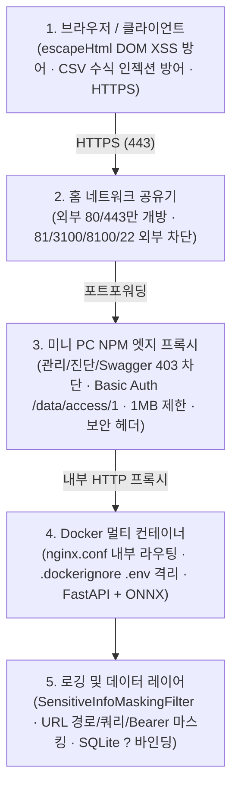

# 🔒 전사 보안 정책 및 감사 현황 통합 가이드 (`SECURITY_POLICY.md`)

- **문서 기준일**: `2026-11-25`
- **추적 이슈 / 작업 브랜치**: [GitHub Issue `#144`](https://github.com/14EE4/weather-transit-web/issues/144) · `144-security-phase1-hardening`
- **대상 운영 환경**: 로컬 Docker Compose (`3100` / `8100`) + 미니 PC(Ubuntu) Nginx Proxy Manager(NPM) HTTPS 리버스 프록시

> **문서 목적**: 본 문서는 프로젝트 전체의 다계층 보안 아키텍처, 현재 적용 완료된 방어 통제, 미니 PC NPM 엣지 하드닝 표준, 전사 보안 감사(`SEC-01~SEC-14`) 현황, 개발자 체크리스트 및 향후 `Phase 2~3` 로드맵을 한곳에서 확인할 수 있는 **단일 보안 기준 문서(SSoT)**입니다.

---

## 📌 1. 다계층 보안 아키텍처 (Defense-in-Depth)

본 서비스는 **브라우저/클라이언트 ➔ 공유기 게이트웨이 ➔ NPM 엣지 프록시 ➔ Docker 컨테이너 ➔ 백엔드 로깅·데이터 레이어**의 5단계 계층으로 위협을 방어합니다.



---

## 🛡️ 2. 현재 적용 완료된 보안 통제 요약 (Implemented Controls)

| 영역 | 적용된 보안 통제 | 관련 파일 / 모듈 |
| :--- | :--- | :--- |
| **비밀정보 · 빌드 격리** | `.env` Git 추적 제외 및 커밋 이력 무결성 유지, 루트·프론트 Docker 빌드 컨텍스트에서 `.env`/`**/.env`/`.env.*` 완전 제외(`!.env.example` 유지) | [`.gitignore`](../.gitignore), [`.dockerignore`](../.dockerignore), [`Weather-Transport Recommendation UI/.dockerignore`](../Weather-Transport%20Recommendation%20UI/.dockerignore) |
| **로깅 · 출력 마스킹** | 쿼리/키-값(`serviceKey`, `authKey`, `Bearer`)뿐 아니라 서울 지하철(`/api/subway/{KEY}/`)·따릉이(`:8088/{KEY}/json\|xml/`) URL 경로 키 마스킹, `SensitiveInfoMaskingFilter`로 콘솔·Docker stdout(`httpx` 로그 포함) 및 인메모리 링 버퍼 일괄 마스킹, `sanitize_exception()` 예외 정제 | [`logging_utils.py`](../logging_utils.py), [`in_memory_log_handler.py`](../in_memory_log_handler.py), [`main.py`](../main.py), [`services/factchat_briefing.py`](../services/factchat_briefing.py) |
| **프론트엔드 XSS · 링크** | `escapeHtml()` 공통 유틸 도입 및 MapLibre 팝업·마커·경로 핀 `innerHTML`/`setHTML()` 전수 이스케이프, 관리자 대시보드 `escapeHtml()` 따옴표(`"`, `'`) 보강 및 외부 링크 `rel="noopener noreferrer"` 적용 | [`htmlEscape.ts`](../Weather-Transport%20Recommendation%20UI/src/utils/htmlEscape.ts), [`TransitMap.tsx`](../Weather-Transport%20Recommendation%20UI/src/TransitMap.tsx), [`admin_dashboard.py`](../admin_dashboard.py), [`App.tsx`](../Weather-Transport%20Recommendation%20UI/src/App.tsx), [`AppM.tsx`](../Weather-Transport%20Recommendation%20UI/src/AppM.tsx) |
| **CSV 수식 인젝션 방어** | `=`, `+`, `-`, `@`, 탭/CR 시작 셀에 `'` 접두사 무력화, RFC 4180 따옴표/줄바꿈 이스케이프, `Blob` + `URL.revokeObjectURL()` 다운로드 적용 | [`csvExport.ts`](../Weather-Transport%20Recommendation%20UI/src/utils/csvExport.ts), [`EnterpriseView.tsx`](../Weather-Transport%20Recommendation%20UI/src/EnterpriseView.tsx) |
| **백엔드 DB · 파싱 안전** | 모든 SQLite 쿼리 `?` 파라미터 바인딩 사용(SQL Injection 방어), 외부 공공 API JSON 기반 처리로 XML 파서(`xml.etree`/`lxml`) 미사용(XXE 위험 없음) | [`timeseries_cache.py`](../timeseries_cache.py), [`main.py`](../main.py) |
| **공급망(SCA) 위생** | `requirements.txt` 중복 패키지 제거, `npm audit fix` 패치 적용(`npm audit` `0` 취약점, 프로덕션 런타임 취약점 `0`건) | [`requirements.txt`](../requirements.txt), [`package-lock.json`](../Weather-Transport%20Recommendation%20UI/package-lock.json) |
| **미니 PC NPM 엣지 통제** | 시연 불필요·진단·Swagger 경로 `403` 차단, 대시보드·로그/상태 API Basic Auth(`/data/access/1`) 보호, `1MB` 요청 바디 상한 및 타임아웃 적용 | [`SERVER_DEPLOYMENT_GUIDE.md`](SERVER_DEPLOYMENT_GUIDE.md) §4.2 |

---

## 🌐 3. 미니 PC + Nginx Proxy Manager(NPM) 운영 보안 표준

NPM에서 HTTPS(SSL)를 활성화하면 브라우저 ↔ 미니 PC 구간 암호화가 제공되지만, 관리자 경로 차단·요청 크기 제한·포트 노출 통제는 별도로 유지해야 합니다.

### 3.1 공유기 포트포워딩 원칙

| 포트 | 용도 | 외부(WAN) 개방 여부 | 비고 |
| :---: | :--- | :---: | :--- |
| **`443`** | HTTPS 서비스 트래픽 (NPM 종단) | **허용** | 필수 공개 포트 |
| **`80`** | HTTP ➔ HTTPS 리다이렉트 & Let's Encrypt 갱신 | **허용** | NPM `Force SSL` 활성화 필수 |
| **`81`** | NPM 관리 웹 콘솔 | **차단** | 내부 LAN(`192.168.x.x`)에서만 접속 |
| **`3100` / `8100`** | Docker 프론트엔드 / 백엔드 직접 포트 | **차단** | 외부에서 NPM 우회 직접 접속 방지 |
| **`22`** | SSH 서버 접속 | **차단 (권장)** | 외부 접속 필요 시 VPN/Tailscale 또는 키 인증 전용 |

### 3.2 경로별 접근 통제 매트릭스

| 구분 | 대상 경로 | 처리 방식 | 사유 |
| :--- | :--- | :---: | :--- |
| **즉시 차단 (시연·일반 서비스 불필요)** | `/api/v1/system/circuit-breakers`<br>`/api/v1/cache/timeseries-status` | **`403 Forbidden`** | 내부 서킷브레이커 상태 및 시계열 캐시 진단 JSON 노출 원천 차단 |
| **인증 보호 (운영·시연 시 선택 조회)** | `/health/dashboard`<br>`/api/v1/admin/logs`<br>`/api/v1/admin/status`<br>`/api/v1/admin/cache/clear`<br>`/docs`, `/openapi.json` | **Basic Auth (`Access List`)** | 발표자·운영자만 ID/PW 인증 후 실시간 로그·상태 대시보드, 대시보드 내 `Swagger API Docs`(`/docs`) 및 `캐시 비우기` 사용 허용; 외부 스캐너·봇은 `401` 차단 |
| **서비스 API (공개 허용)** | `/api/v1/{weather,predict,districts,transit,routes,b2b}/*` | **허용 (`1MB` 요청 제한)** | 웹/모바일 정상 서비스 및 시연 기능 무영향 |

### 3.3 NPM `Advanced` 탭 표준 설정 스니펫

1. NPM **`Access Lists`** ➔ **`Add Access List`**에서 관리자 ID/PW를 등록해 `/data/access/<ID>`(최초 생성 시 `/data/access/1`)를 생성합니다.
2. 대상 **Proxy Host** ➔ **`Edit` ➔ `Advanced` 탭**에 아래 설정을 적용합니다 (`~ ^...(/|$)` 정규식 우선 매칭):

```nginx
# 1. 초대형 요청 바디 및 느린 요청 차단 (정상 map-crowds 요청 ~100~200KB 대비 1MB 넉넉)
client_max_body_size 1m;
client_body_timeout 10s;
client_header_timeout 10s;

# 2. 기본 보안 HTTP 응답 헤더 (클릭재킹 · MIME 스니핑 방어)
add_header X-Content-Type-Options "nosniff" always;
add_header X-Frame-Options "SAMEORIGIN" always;
add_header Referrer-Policy "strict-origin-when-cross-origin" always;

# 3. 즉시 403 차단 (내부 진단 API)
location ~ ^/api/v1/system/circuit-breakers(/|$) {
    return 403;
}

location ~ ^/api/v1/cache/timeseries-status(/|$) {
    return 403;
}

# 4. ID/PW(Basic Auth) 보호 (대시보드, 로그/상태/캐시 초기화 API 및 Swagger 문서)
location ~ ^/(health/dashboard|api/v1/admin/logs|api/v1/admin/status|docs|openapi\.json|api/v1/admin/cache/clear)(/|$) {
    auth_basic "Demo Admin Restricted";
    auth_basic_user_file /data/access/1;

    proxy_pass $forward_scheme://$server:$port;
    proxy_set_header Host $host;
    proxy_set_header X-Real-IP $remote_addr;
    proxy_set_header X-Forwarded-For $proxy_add_x_forwarded_for;
    proxy_set_header X-Forwarded-Proto $scheme;
}
```

> ⚠️ **NPM 운영 주의사항**:
> - **`limit_req_zone` 금지**: NPM `Advanced` 탭은 Nginx `server { ... }` 블록 내부이므로 `http` 컨텍스트 전용 지시어(`limit_req_zone`)를 넣으면 프록시가 `Offline` 상태가 됩니다. Rate Limiting은 Cloudflare WAF 또는 NPM `/data/nginx/custom/http_top.conf`에서 별도 설정하세요.
> - **Access List 번호 확인**: Access List를 삭제 후 재생성하면 `/data/access/1`의 숫자가 바뀔 수 있으므로 저장 후 Proxy Host 상태가 **`Online`**인지 반드시 확인하세요.
> - **시크릿 창 10초 검증**: `/api/v1/system/circuit-breakers` ➔ `403`, `/health/dashboard`·`/docs`·`/api/v1/admin/cache/clear` ➔ 로그인 팝업(`401`) 확인 및 대시보드 로그인 후 `📖 Swagger API Docs` 버튼 정상 열람 확인.

---

## 📋 4. 전사 보안 감사 결과 및 조치 현황 (`SEC-01~SEC-14`, 이슈 `#144`)

`2026-11-24` 읽기 전용(Read-Only) 6단계 감사 결과 및 `2026-11-25` 기준 조치 상태입니다.

| ID | 심각도 | 항목 요약 | 상태 | 근거 및 조치 내역 |
| :---: | :---: | :--- | :---: | :--- |
| **`SEC-01`** | 🔴 High | 무인증 Admin·대시보드·캐시 삭제·Swagger 노출 | 🛡️ **NPM 엣지 완화** *(앱 인증은 Phase 2-B)* | 미니 PC NPM에서 내부 진단 API `403` 차단 및 대시보드·로그/상태/캐시 초기화·Swagger(`/docs`, `/openapi.json`) Basic Auth 적용 (`nginx.conf`·FastAPI 앱 레벨 인증은 `Phase 2-B`) |
| **`SEC-02`** | 🔴 High | `CORSMiddleware` 전체 오리진(`*`) + Credentials 허용 | ⏳ **Phase 2 대기** | `main.py:654-660` (`CORS_ALLOW_ORIGINS` 환경변수 화이트리스트화 및 `allow_credentials=False` 전환 예정) |
| **`SEC-03`** | 🔴 High | `TransitMap.tsx` 다수 `innerHTML`/`setHTML()` DOM XSS | ✅ **코드 패치 완료** | `htmlEscape.ts` 신설 및 팝업·마커·경로 핀 HTML 템플릿 전수 이스케이프, `admin_dashboard.py` `escapeHtml()` 보강 |
| **`SEC-04`** | 🔴 High | `.dockerignore` `.env` 누락으로 이미지 빌드 컨텍스트 포함 위험 | ✅ **코드 패치 완료** | 루트 및 프론트 `.dockerignore`에 `.env`, `**/.env`, `.env.*` 제외 추가 (`!.env.example` 유지) |
| **`SEC-05`** | 🔴 High | URL 경로(Path) API 키 로그 마스킹 사각지대 및 HTTP 평문 호출 | ✅ **코드 마스킹 완료** *(HTTPS 전환 검토)* | `logging_utils.py` 지하철·따릉이 경로 마스킹 + 콘솔/stdout `SensitiveInfoMaskingFilter` + `factchat_briefing.py` `sanitize_exception` 적용. 외부 HTTP(`ws.bus.go.kr`, `swopenAPI`, `:8088`) HTTPS 지원 여부는 제공처별 후속 확인 |
| **`SEC-06`** | 🟠 Medium | 입력 상한·Rate Limit·인메모리 캐시 크기 제한 부재 (DoS/OOM) | ✅ **앱 상한 패치** *(Rate Limit은 Phase 2-B)* | NPM `client_max_body_size 1m` + Pydantic `Field(max_length)`/`items<=3000` + `main._bounded_cache_set(500)`/`FactChat(300)` 적용 완료 (`Phase 2-B`에서 Rate Limiting 보강) |
| **`SEC-07`** | 🟠 Medium | FactChat/BAZE LLM 프롬프트 인젝션 위험 | ✅ **코드 패치 완료** | `services/factchat_briefing.py` 사용자 입력 길이·제어문자·구분자(`<>`, `` ``` ``) 정제 및 `<route_data>` 데이터 경계 격리 적용 |
| **`SEC-08`** | 🟠 Medium | 컨테이너 `root` 실행 및 백엔드 포트(`8100`) 호스트 개방 | 🛡️ **리소스·바인딩 적용** *(비루트 USER는 Phase 2-B)* | `docker-compose.yml` `mem_limit`(`2g`/`256m`)·`cpus` 제한 및 `BACKEND_BIND_HOST` 환경변수화 적용 (비루트 컨테이너 `USER`는 SQLite 볼륨 UID 호환성 고려 `Phase 2-B`) |
| **`SEC-09`** | 🟠 Medium | Nginx 보안 HTTP 응답 헤더 및 서버 정보 은닉 미설정 | ✅ **코드 패치 완료** | 컨테이너 `nginx.conf`에 `server_tokens off;`, `client_max_body_size 1m;`, `X-Content-Type-Options`/`X-Frame-Options`/`Referrer-Policy` 적용 완료 |
| **`SEC-10`** | 🟠 Medium | 외부 CDN 스크립트 버전 미고정 및 SRI(`integrity`) 누락 | ⏳ **Phase 3 대기** | `index.html`(`maplibre-gl@^4.7.1`), `admin_dashboard.py`(`cdn.tailwindcss.com`) 버전 고정/번들화 및 SRI 적용 예정 |
| **`SEC-11`** | 🟠 Medium | 프론트 개발 의존성 High CVE 2건(`vite`, `source-map-js`) 및 `requirements.txt` 미고정 | ✅ **패치 완료** *(상한 고정 선택)* | `npm audit fix` 완료(`npm audit` `0` 취약점), `requirements.txt` 중복 `langgraph` 제거 (운영 버전 상한 핀닝은 `Phase 3` 검토) |
| **`SEC-12`** | 🟡 Low | 내부 예외 메시지·DB 경로 API 응답 노출 (`main.py`, `timeseries_cache.py`) | ✅ **코드 패치 완료** | `main.py` `500` 오류 응답 일반화(`sanitize_exception` 서버 로그 유지) 및 `timeseries_cache.py` 오류 문자열 일반화 완료 |
| **`SEC-13`** | 🟡 Low | CSV 다운로드 수식 인젝션 및 RFC 4180 이스케이프 미처리 | ✅ **코드 패치 완료** | `csvExport.ts` `=`, `+`, `-`, `@`, 탭/CR 시작 셀 무력화 및 `Blob` + RFC 4180 이스케이프 적용 |
| **`SEC-14`** | ⚪ Info | `admin_dashboard.py` `rel="noopener noreferrer"` 누락 및 부가 파일 정리 | ✅ **링크 패치 완료** *(파일 정리 선택)* | `admin_dashboard.py` 외부 링크 `rel="noopener noreferrer"` 추가 완료 (`package-lock.json`/`pnpm-lock.yaml` 단일화 및 `map.html` 정리는 선택 과제) |

> **검증된 양호 사항 (Baseline Pass)**:
> - `.env`·비밀키 Git 추적/히스토리 유출 `0`건, 소스 코드 내 하드코딩된 API 키 `0`건.
> - `timeseries_cache.py` SQLite 쿼리 전수 파라미터 바인딩 (`?`).
> - 프론트엔드 프로덕션 런타임 의존성 취약점 `0`건 (`npm audit --omit=dev` & `npm audit` 모두 `0`건).

---

## ✅ 5. 개발 · 배포 시 필수 보안 체크리스트

신규 기능 추가나 배포 전 아래 항목을 반드시 확인합니다.

1. **비밀정보 및 Docker 컨텍스트**
   - API 키·토큰은 루트 `.env`에만 두고 절대 Git에 커밋하지 않으며, 신규 키 추가 시 [`.env.example`](../.env.example)만 갱신합니다.
   - `VITE_*` 환경변수는 프론트엔드 JS 번들에 그대로 노출되므로 비밀 키를 절대 `VITE_` 접두사로 두지 않습니다.
2. **백엔드 API · 로깅**
   - 새 예외 로그에는 반드시 `sanitize_exception(exc)`를 사용합니다([`LOGGING_POLICY.md`](LOGGING_POLICY.md) §7).
   - 새 외부 API URL 패턴이 추가되면 [`logging_utils.py`](../logging_utils.py)의 마스킹 정규식에 포함되는지 점검합니다.
   - 관리자·캐시 제어 등 상태 변경 엔드포인트는 무인증으로 외부 프록시에 노출하지 않습니다.
3. **프론트엔드 · 파일 내보내기**
   - `innerHTML`, MapLibre `setHTML()`, `dangerouslySetInnerHTML` 사용 시 모든 동적 문자열을 [`htmlEscape.ts`](../Weather-Transport%20Recommendation%20UI/src/utils/htmlEscape.ts)의 `escapeHtml()`로 감싸거나 `textContent`를 사용합니다.
   - `target="_blank"` 링크에는 항상 `rel="noopener noreferrer"`를 명시합니다.
   - CSV 내보내기는 반드시 [`csvExport.ts`](../Weather-Transport%20Recommendation%20UI/src/utils/csvExport.ts)의 `downloadCsv()`를 사용합니다.
4. **의존성 및 컨테이너**
   - 패키지 변경 시 `npm audit` 및 `docker compose build`를 통해 빌드·취약점 상태를 재확인합니다.

---

## 🗺️ 6. 향후 보안 고도화 로드맵 (`Phase 2~3`) 및 관련 문서

캡스톤 발표 기능 동결 이후 외부 상시 공개 또는 상용 클라우드 확장 시 순차 적용할 백로그입니다.

- **Phase 2-A (적용 완료 · 브랜치 `144-security-phase2a-hardening`)**
  - `[SEC-06]` Pydantic 입력 상한(`Field(max_length=...)`, `items<=3000`) 및 인메모리 캐시 최대 엔트리(`500`/`300`) 제한
  - `[SEC-07]` [`services/factchat_briefing.py`](../services/factchat_briefing.py) 사용자 입력 정제 및 `<route_data>` 프롬프트 경계 격리
  - `[SEC-08]` [`docker-compose.yml`](../docker-compose.yml) `mem_limit`(`2g`/`256m`)·`cpus` 제한 및 `BACKEND_BIND_HOST` 환경변수화
  - `[SEC-09]` [`nginx.conf`](../nginx.conf) `server_tokens off;`, `client_max_body_size 1m;` 및 보안 응답 헤더 3종
  - `[SEC-12]` `main.py` `500` 오류 응답 및 `timeseries_cache.py` 오류 문자열 일반화
- **Phase 2-B / Phase 3 — 발표 이후 또는 상시 공개 시 추가 하드닝**
  - `[SEC-01]` [`main.py`](../main.py) 관리자/대시보드 앱 레벨 인증 및 컨테이너 [`nginx.conf`](../nginx.conf) `location = /health` 제한·`/docs` 외부 비활성화 옵션
  - `[SEC-02]` [`main.py`](../main.py) `CORSMiddleware` 허용 도메인 화이트리스트(`CORS_ALLOW_ORIGINS`) 전환
  - `[SEC-06]` Rate Limiting(Cloudflare WAF 또는 Nginx `limit_req`)
  - `[SEC-08]` `Dockerfile.backend` 비루트 `USER` 전환 (호스트 `./data` 볼륨 UID 정렬 포함)
  - `[SEC-10]` `maplibre-gl` npm 로컬 번들 전환 또는 버전 고정 + SRI(`integrity`) 적용
  - `[SEC-14]` 락파일(`package-lock.json` vs `pnpm-lock.yaml`) 단일화, 프로토타입 `map.html` 정리
  - *(인프라 권장)* 도메인 DNS에 **Cloudflare Proxy** 적용으로 홈서버 공인 IP 은닉 및 엣지 봇/Rate Limit 방어

### 관련 문서 바로가기
- **서버 배포 및 NPM 가이드**: [`docs/SERVER_DEPLOYMENT_GUIDE.md`](SERVER_DEPLOYMENT_GUIDE.md) (§4.2 NPM 보안 하드닝)
- **전역 로깅 정책**: [`docs/LOGGING_POLICY.md`](LOGGING_POLICY.md) (§7 민감정보 마스킹 · §8 장애 진단)
- **전사 캐싱 정책**: [`docs/CACHING_POLICY.md`](CACHING_POLICY.md)
- **작업 백로그 및 변경 이력**: [`docs/TODO.md`](TODO.md) · [`docs/CHANGELOG.md`](CHANGELOG.md)
- **GitHub 보안 감사 이슈**: [Issue `#144`](https://github.com/14EE4/weather-transit-web/issues/144)
