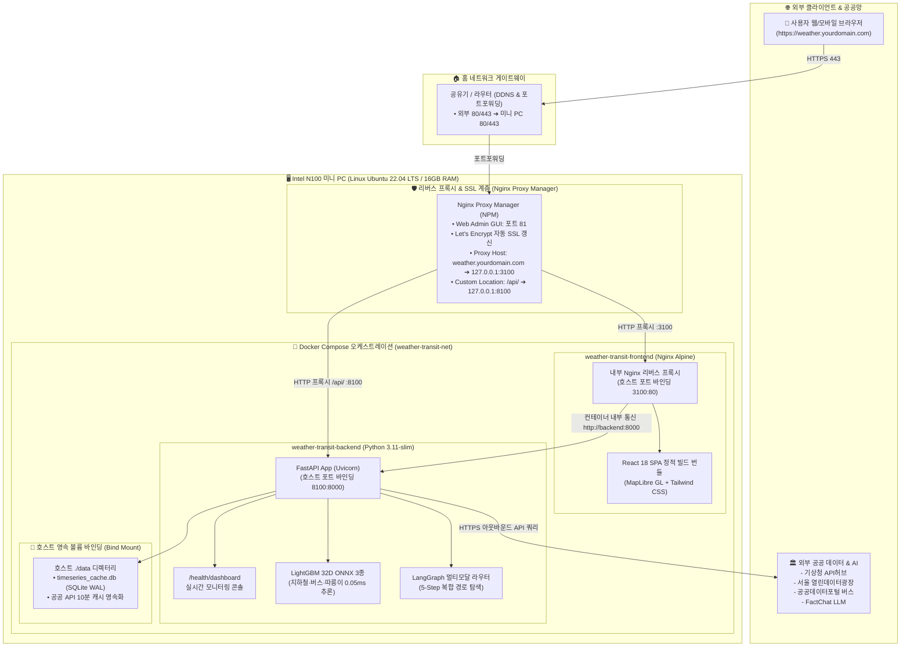

# 🚀 리눅스 홈서버 / 미니 PC 배포 가이드 (Docker Compose 표준)

본 문서는 Intel N100 등의 리눅스(Ubuntu/Debian) 미니 PC 및 홈서버 환경에서 **Weather & Transit Web** 서비스를 안정적으로 배포하고 상시 운영(24/7)하기 위한 가이드입니다.

본 프로젝트의 공식 표준 배포 방식은 **Docker Compose 멀티 컨테이너**입니다. 복잡한 파이썬 가상환경(venv)이나 Node.js 번들 환경을 호스트 OS에 직접 설치하지 않고, 완전히 격리된 컨테이너 환경에서 무중단 자동 재기동(`restart: unless-stopped`)을 보장합니다.

기존에 다른 웹 서비스(포트 3000, 8000 등)가 이미 구동 중인 환경에서도 **포트 충돌 없이 공존**할 수 있도록 기본 포트가 분리(`3100`/`8100`)되어 있습니다.

---

## 📌 1. 서비스 아키텍처 및 포트 구성

### 1.1 하드웨어 & Docker + NPM 통합 인프라 다이어그램



### 1.2 서비스 포트 요약 명세

| 구성 요소 | 구동 기술 | 호스트 서빙 포트 | 역할 및 비고 |
|---|---|:---:|---|
| **Frontend** | React SPA (Vite / Nginx Alpine) | **`3100`** | 대화형 MapLibre GL 지도, 날씨/교통 대시보드 서빙 |
| **Backend** | FastAPI + Uvicorn + ONNX (Py 3.11) | **`8100`** | 실시간 공공 API 중계, AI 추론, `/health/dashboard` 관제 |
| **NPM Admin** | Nginx Proxy Manager Web UI | **`81`** | 도메인 프록시 호스트, Let's Encrypt SSL 인증서 발급 관리 |

> 💡 **포트 충돌 회피**:
> 기존 홈서버에서 널리 쓰이는 `3000`(Next.js/React 등), `8000`(FastAPI/Django 등)과의 충돌을 피하기 위해 **`3100`**과 **`8100`**을 기본 포트로 사용합니다.

---

## 🛠️ 2. 사전 필수 환경 준비 (Docker)

미니 PC(리눅스) 환경에 **Docker Engine** 및 **Docker Compose**가 설치되어 있어야 합니다.

```bash
# Docker 및 Docker Compose 버전 확인
docker -v
docker compose version

# 미설치 시 공식 자동 설치 스크립트 실행
# curl -fsSL https://get.docker.com -o get-docker.sh && sudo sh get-docker.sh
# sudo usermod -aG docker $USER
```

> 💡 **의존성 격리의 이점**:
> 백엔드 LightGBM ONNX 런타임에 필요한 C 라이브러리(`libgomp1`)와 프론트엔드 Nginx 빌드 도구는 이미 컨테이너 이미지(`Dockerfile.backend`, `Dockerfile.frontend`) 내부에 완벽히 포함되어 있으므로, 미니 PC 호스트에 별도의 Python 라이브러리나 Node.js를 설치할 필요가 없습니다.

---

## 🐳 3. Docker Compose 기반 배포 (공식 표준)

### Step 1. 저장소 클론 및 환경 변수(`.env`) 설정

```bash
# 저장소 클론 (최초 1회)
git clone https://github.com/14EE4/weather-transit-web.git ~/workspace/weather-transit-web
cd ~/workspace/weather-transit-web

# 환경 변수 파일 생성
cp .env.example .env
nano .env   # 또는 vim .env
```

```env
# 기상청 API허브 초단기실황 API 키
KMA_APIHUB_KEY=발급받은_키

# 서울 열린데이터광장 지하철 실시간 도착 API 키
SEOUL_SUBWAY_API_KEY=발급받은_키

# 공공데이터포털 버스 실시간 도착 API 키 (5종 활용신청)
BUS_API_KEY=발급받은_키
DATA_GO_KR_API_KEY=발급받은_키
```
> ※ 키가 없거나 미설정 상태여도 백엔드는 내장된 스마트 Mock 데이터로 안전하게 자동 fallback 작동합니다.

### Step 2. 컨테이너 빌드 및 백그라운드 구동

```bash
# 멀티 컨테이너 일괄 빌드 및 백그라운드 실행
docker compose up --build -d
```

### Step 3. 상태 확인 및 헬스체크 검증

```bash
# 컨테이너 상태 (Up, healthy) 확인
docker compose ps

# 백엔드 AI 모델 로딩 완료 여부 검증
curl -s http://localhost:8100/health | grep '"models_loaded":true'

# 실시간 컨테이너 로그 모니터링
docker compose logs -f --tail=30
```

---

## 🌐 4. Nginx Proxy Manager (NPM) 연동 (도메인 & SSL)

미니 PC에 **Nginx Proxy Manager(NPM)**를 실행 중인 경우, 외부 도메인 및 HTTPS(SSL)를 간편하게 연동할 수 있습니다.

### 도메인 프록시 호스트 등록 가이드
도메인 예시: `weather.yourdomain.com`

1. **NPM 웹 대시보드(포트 81)**에 접속하여 로그인합니다 (`http://<미니PC_IP>:81`).
2. **Proxy Hosts** ➔ **Add Proxy Host** 클릭:
   - **Details 탭**:
     - **Domain Names**: `weather.yourdomain.com`
     - **Scheme**: `http`
     - **Forward Hostname / IP**: `127.0.0.1` (또는 미니 PC 사설 IP)
     - **Forward Port**: `3100` (프론트엔드 포트)
     - **Block Common Exploits**: 체크 (ON)
     - **Websockets Support**: 체크 (ON)
   - **Custom Locations 탭** (백엔드 API 및 대시보드 포워딩):
     - **Location**: `/api/`
     - **Scheme**: `http`
     - **Forward Hostname / IP**: `127.0.0.1`
     - **Forward Port**: `8100`
   - **SSL 탭**:
     - **SSL Certificate**: `Request a new SSL Certificate`
     - **Force SSL**: 체크 (ON)
     - **HTTP/2 Support**: 체크 (ON)
     - 이용약관 동의 후 **Save** 클릭

---

## 🔒 5. 방화벽(UFW) 포트 개방

홈 네트워크(공유기 대역)나 사설망에서 미니 PC의 포트로 직접 접근하려면 UFW 방화벽 규칙을 적용합니다.

```bash
# 프론트엔드 포트 개방
sudo ufw allow 3100/tcp

# 백엔드 API 포트 개방 (NPM 없이 직접 접근할 경우)
sudo ufw allow 8100/tcp

# 방화벽 상태 확인
sudo ufw status
```

---

## 🔄 6. 코드 업데이트 및 재배포 루틴 (Update Routine)

새로운 기능이 원격 저장소(`main` 또는 `dev`)에 푸시되었을 때 미니 PC에서 서비스를 중단 없이 최신 상태로 반영하는 표준 명령어입니다.

### 6.1 원클릭 업데이트 명령어 (표준)

```bash
# 최신 코드 수신 ➔ 도커 이미지 재빌드 ➔ 컨테이너 무중단 롤링 교체 ➔ 상태 확인
cd ~/workspace/weather-transit-web && \
git pull origin main && \
docker compose build && \
docker compose up -d --remove-orphans && \
docker compose ps
```

### 6.2 코드 변경사항 강제 반영 (캐시 무시 빌드)
Docker 빌드 캐시로 인해 수정사항이 즉시 반영되지 않는 경우 사용합니다:
```bash
docker compose build --no-cache && \
docker compose up -d --force-recreate
```

### 6.3 배포 후 즉시 검증
```bash
# 1. 백엔드 AI 모델 로딩 및 32차원 스키마 검증
curl -s http://localhost:8100/health | grep '"models_loaded":true'

# 2. 브라우저 기반 관리자 대시보드 접속
# http://<미니PC_IP>:3100/health/dashboard
```

### 6.4 미니 PC 디스크 용량 관리 (주기적 실행)
빌드가 반복되며 누적된 이전 버전의 댕글링(Dangling) 이미지를 정리합니다:
```bash
docker image prune -f
```

---

## 🩺 7. 트러블슈팅 및 점검 (FAQ)

### Q1. 도커 컨테이너 상태와 실시간 로그는 어떻게 확인하나요?
```bash
# 전체 컨테이너 상태 확인
docker compose ps

# 백엔드 컨테이너 실시간 로그 확인
docker compose logs -f backend --tail=50

# 프론트엔드 컨테이너 실시간 로그 확인
docker compose logs -f frontend --tail=50
```

### Q2. 특정 컨테이너만 개별 제어(재시작/정지)하고 싶습니다.
```bash
# 백엔드 컨테이너만 재시작
docker compose restart backend

# 프론트엔드 컨테이너만 재시작
docker compose restart frontend

# 전체 컨테이너 정지 및 기동
docker compose down
docker compose up -d
```

### Q3. 포트가 이미 사용 중인지 어떻게 확인하나요?
```bash
ss -tulpn | grep -E '3100|8100'
```
출력 결과에 Docker 외의 다른 프로세스가 나타난다면, `docker-compose.yml`의 호스트 바인딩 포트(예: `"3100:80"` ➔ `"3200:80"`, `"8100:8000"` ➔ `"8200:8000"`) 및 NPM 프록시 포트 설정을 변경하시면 됩니다.

### Q4. 브라우저에서 지도는 뜨는데 날씨/도착 정보가 "데이터 없음"으로 나옵니다.
1. **백엔드 헬스체크 확인**: 브라우저에서 `http://<미니PC_IP>:8100/health` 접속 시 `{"status":"ok", ...}` 및 `models_loaded: true`가 나오는지 확인합니다.
2. **도커 백엔드 로그 확인**:
   ```bash
   docker compose logs backend --tail=50
   ```
3. **API 키 점검**: 프로젝트 루트의 `.env` 파일에 공공데이터 키(`KMA_APIHUB_KEY`, `SEOUL_SUBWAY_API_KEY`, `BUS_API_KEY`)가 올바르게 설정되어 있는지 점검합니다.

---

## 📎 부록. (참고용) 호스트 OS 직접 실행 (PM2)

> ⚠️ **주의**: 호스트 직접 실행은 `python3-venv`, `libgomp1`, `Node.js 20` 등을 호스트에 직접 설치해야 하므로, 라이브러리 충돌 위험이 없는 Docker Compose 사용을 공식 권장합니다.

```bash
# 1. 패키지 설치
sudo apt update && sudo apt install -y python3-venv python3-pip libgomp1 curl git

# 2. 백엔드 가상환경
python3 -m venv venv && ./venv/bin/pip install -r requirements.txt

# 3. 프론트엔드 빌드
cd "Weather-Transport Recommendation UI" && npm ci && npm run build && cd ..

# 4. PM2 실행
pm2 start ecosystem.config.cjs && pm2 save
```
