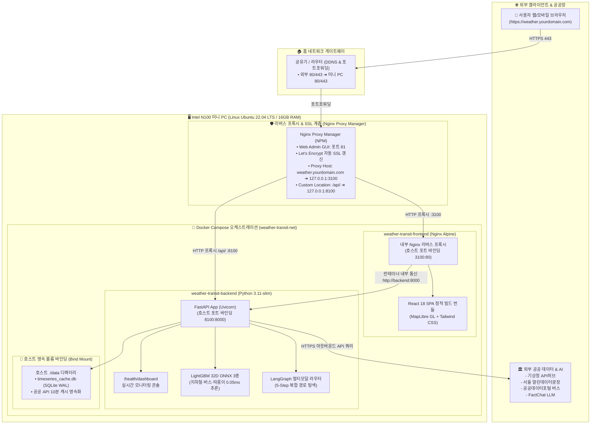

# 🚀 리눅스 홈서버 / 미니 PC 배포 가이드 (Server Deployment Guide)

본 문서는 Intel N100 등의 리눅스(Ubuntu/Debian) 미니 PC 및 홈서버 환경에서 **Weather & Transit Web** 서비스를 안정적으로 배포하고 상시 운영(24/7)하기 위한 가이드입니다.

기존에 다른 웹 서비스(포트 3000, 8000 등)가 이미 구동 중인 환경에서도 **포트 충돌 없이 공존**할 수 있도록 기본 포트가 분리되어 있습니다.

---

## 📌 1. 서비스 아키텍처 및 포트 구성

### 1.1 하드웨어 & Docker + NPM 통합 인프라 다이어그램



### 1.2 서비스 포트 요약 명세

| 구성 요소 | 구동 기술 | 서빙 포트 | 역할 및 비고 |
|---|---|---|---|
| **Frontend** | React SPA (Vite / Nginx) | **`3100`** | 대화형 MapLibre GL 지도, 날씨/교통 대시보드 |
| **Backend** | FastAPI + Uvicorn + ONNX | **`8100`** | 실시간 공공 API 중계, AI 수요 예측 추론, 헬스 대시보드 |
| **NPM Admin** | Nginx Proxy Manager Web UI | **`81`** | 도메인 프록시 호스트, Let's Encrypt SSL 인증서 발급 관리 |

> 💡 **포트 충돌 회피**:
> 기존 홈서버에서 널리 쓰이는 `3000`(Next.js/React 등), `8000`(FastAPI/Django 등)과의 충돌을 피하기 위해 **`3100`**과 **`8100`**을 기본 포트로 사용합니다.

---

## 🛠️ 2. 사전 필수 시스템 패키지 설치

Ubuntu / Debian 리눅스 환경에서 다음 패키지가 설치되어 있어야 합니다.

```bash
# 시스템 패키지 목록 갱신
sudo apt update

# Python 가상환경 및 ONNX Runtime 필수 라이브러리(libgomp1) 설치
sudo apt install -y python3-venv python3-pip libgomp1 curl git

# Node.js (v20 이상) 및 PM2 확인 (미설치 시)
# node -v
# npm -v
# sudo npm install -g pm2
```

> ⚠️ **중요 (`libgomp1`)**:
> `libgomp1`은 백엔드에서 **LightGBM ONNX 머신러닝 추론**을 실행할 때 필요한 OpenMP 런타임 라이브러리입니다. 누락 시 백엔드 구동 시점에 `ImportError: libgomp.so.1: cannot open shared object file` 에러가 발생하므로 반드시 설치해야 합니다.

---

## 🚀 3. [방법 A] PM2 기반 호스트 배포 (강력 권장)

기존에 Node.js / PM2로 다른 서비스를 운영 중인 미니 PC 환경에 가장 리소스 효율적이며 적합한 배포 방식입니다.

### Step 1. 저장소 최신 코드 동기화
```bash
cd ~/workspace/weather-transit-web
git pull origin main
```

### Step 2. 백엔드 Python 가상환경(venv) 및 패키지 설치
```bash
# 가상환경 생성 (최초 1회)
python3 -m venv venv

# 패키지 설치 (FastAPI, ONNX Runtime, requests 등)
./venv/bin/pip install --upgrade pip
./venv/bin/pip install -r requirements.txt
```

### Step 3. 환경 변수(`.env`) 설정
저장소의 `.env.example`을 복사하여 공공데이터 API 키를 입력합니다.
```bash
cp .env.example .env
nano .env   # 또는 vim .env
```
```env
# 기상청 API허브 초단기실황 API 키
KMA_APIHUB_KEY=발급받은_키

# 서울 열린데이터광장 지하철 실시간 도착 API 키
SEOUL_SUBWAY_API_KEY=발급받은_키

# 공공데이터포털 버스 실시간 도착 API 키
DATA_GO_KR_API_KEY=발급받은_키
```
> ※ 키가 없거나 미설정 상태여도 백엔드는 내장된 스마트 Mock 데이터로 안전하게 자동 fallback 작동합니다.

### Step 4. 프론트엔드 의존성 설치 및 프로덕션 빌드
```bash
cd "Weather-Transport Recommendation UI"

# 의존성 설치 및 프로덕션 번들 빌드
npm ci
npm run build

# 루트 디렉터리로 복귀
cd ..
```
빌드가 완료되면 `Weather-Transport Recommendation UI/dist` 디렉터리에 정적 웹 파일들이 생성됩니다.

### Step 5. PM2 프로세스 등록 및 실행
프로젝트 루트에 준비된 `ecosystem.config.cjs`를 통해 백엔드(8100)와 프론트엔드(3100)를 한 번에 기동합니다.

```bash
# 루트 디렉터리에서 실행
pm2 start ecosystem.config.cjs
```

정상 실행 시 다음과 같이 리스트에 등록됩니다:
```bash
pm2 list
```
```text
┌────┬────────────────────────┬──────────┬──────┬───────────┬──────────┬──────────┐
│ id │ name                   │ mode     │ ↺    │ status    │ cpu      │ memory   │
├────┼────────────────────────┼──────────┼──────┼───────────┼──────────┼──────────┤
│ 0  │ leaderboard-api        │ fork     │ 0    │ online    │ 0%       │ 48.9mb   │
│ 1  │ map-board              │ fork     │ 0    │ online    │ 0%       │ 52.1mb   │
│ 2  │ weather-backend        │ fork     │ 0    │ online    │ 0%       │ 85.0mb   │
│ 3  │ weather-frontend       │ fork     │ 0    │ online    │ 0%       │ 22.0mb   │
└────┴────────────────────────┴──────────┴──────┴───────────┴──────────┴──────────┘
```

### Step 6. 서버 재부팅 시 자동 기동(영속화) 설정
```bash
# 현재 구동 중인 PM2 프로세스 목록 영구 저장
pm2 save

# 부팅 스크립트 등록 (안내 문구가 출력되면 그대로 복사하여 실행)
pm2 startup
```

---

## 🐳 4. [방법 B] Docker Compose 기반 배포

도커 컨테이너 격리 환경을 선호하는 경우 `docker-compose.yml`을 사용하여 즉시 실행할 수 있습니다.

### Step 1. 빌드 및 백그라운드 구동
```bash
cd ~/workspace/weather-transit-web

# 컨테이너 빌드 및 실행
docker compose up --build -d
```

### Step 2. 상태 확인 및 로그 모니터링
```bash
# 컨테이너 상태 확인
docker compose ps

# 실시간 로그 확인
docker compose logs -f
```

### Step 3. 컨테이너 중지
```bash
docker compose down
```

---

## 🌐 5. Nginx Proxy Manager (NPM) 또는 Nginx 연동

미니 PC에 **Nginx Proxy Manager(NPM)**를 이미 사용 중이거나 외부 도메인 및 SSL(HTTPS)을 적용하려는 경우 다음과 같이 연동합니다.

### 시나리오 1: 단일 도메인 사용 (권장)
도메인 예: `weather.yourdomain.com`

1. **NPM 웹 대시보드(보통 포트 81)**에 접속합니다.
2. **Proxy Hosts** -> **Add Proxy Host** 클릭:
   - **Domain Names**: `weather.yourdomain.com`
   - **Scheme**: `http`
   - **Forward Hostname / IP**: `127.0.0.1` (또는 로컬 미니 PC 내부 IP)
   - **Forward Port**: `3100` (프론트엔드 포트)
   - **Block Common Exploits**: 체크
   - **Websockets Support**: 체크
3. **Custom Locations** 탭 설정:
   - API 요청을 백엔드로 전달하기 위해 새 로케이션 추가:
     - **Location**: `/api/`
     - **Scheme**: `http`
     - **Forward Hostname / IP**: `127.0.0.1`
     - **Forward Port**: `8100`
4. **SSL** 탭:
   - **Request a new SSL Certificate** 선택 후 **Force SSL** 활성화.

---

## 🔒 6. 방화벽(UFW) 포트 개방

홈 네트워크(공유기 대역)나 사설망에서 미니 PC의 IP(`http://<미니PC_IP>:3100`)로 직접 접근하려면 포트를 개방해야 합니다.

```bash
# 프론트엔드 포트 개방
sudo ufw allow 3100/tcp

# 백엔드 API 포트 개방 (NPM 없이 직접 접근할 경우)
sudo ufw allow 8100/tcp

# 방화벽 상태 확인
sudo ufw status
```

---

## 🔄 7. 코드 업데이트 및 재배포 루틴 (Update Routine)

새로운 기능이 푸시되었을 때 미니 PC에서 서비스를 중단 없이 최신 상태로 반영하는 원클릭 업데이트 명령어입니다.

### 7.1 Docker Compose 기준 원클릭 업데이트 (기본 권장)

현재 Docker 환경으로 미니 PC를 운영 중인 경우 다음 원클릭 명령어로 최신 코드 반영부터 재빌드, 헬스체크까지 완결합니다.

```bash
# 최신 코드 수신 및 Docker 이미지 재빌드 & 컨테이너 롤링 교체
cd ~/workspace/weather-transit-web && \
git pull origin main && \
docker compose build && \
docker compose up -d --remove-orphans && \
docker compose ps
```

> 💡 **코드 수정사항이 반영되지 않는 경우 (강제 재빌드)**:
> Docker 빌드 캐시로 인해 이전 코드가 실행된다고 판단될 경우 캐시를 무시하고 강제 재생성합니다.
> ```bash
> docker compose build --no-cache && \
> docker compose up -d --force-recreate
> ```

#### 배포 후 즉시 검증
```bash
# 1. 백엔드 AI 모델 로딩 및 32차원 스키마 검증
curl -s http://localhost:8100/health | grep '"models_loaded":true'

# 2. 실시간 컨테이너 로그 스트리밍 확인
docker compose logs -f --tail=30
```

#### 디스크 용량 관리 (주기적 실행)
빌드 과정에서 누적된 이전 버전의 댕글링(Dangling) 이미지를 정리하여 미니 PC의 디스크 용량을 확보합니다.
```bash
docker image prune -f
```

---

### 7.2 PM2 호스트 기준 업데이트 루틴 (대체 옵션)

Node.js / PM2 호스트 환경으로 구동 중인 경우의 업데이트 명령어입니다.

```bash
cd ~/workspace/weather-transit-web && \
git pull origin main && \
./venv/bin/pip install -r requirements.txt && \
cd "Weather-Transport Recommendation UI" && \
npm ci && npm run build && \
cd .. && \
pm2 restart weather-backend weather-frontend
```

---

## 🩺 8. 트러블슈팅 및 점검 (FAQ)

### Q1. 도커 컨테이너 상태와 실시간 로그는 어떻게 확인하나요?
```bash
# 전체 컨테이너 상태 (Up, healthy 여부) 확인
docker compose ps

# 백엔드 컨테이너 실시간 로그 확인
docker compose logs -f backend --tail=50

# 프론트엔드 컨테이너 실시간 로그 확인
docker compose logs -f frontend --tail=50

# 브라우저 기반 관리자 대시보드
# http://<미니PC_IP>:3100/health/dashboard 또는 http://<미니PC_IP>:8100/health/dashboard
```

### Q2. 특정 컨테이너만 개별 제어(재시작/정지)하고 싶습니다.
```bash
# 백엔드 컨테이너만 재시작
docker compose restart backend

# 프론트엔드 컨테이너만 재시작
docker compose restart frontend

# 전체 컨테이너 정지 및 기동
docker compose down
docker compose up -d
```

### Q3. 백엔드 구동 시 `libgomp.so.1` 누락 에러가 발생합니다.
```bash
ImportError: libgomp.so.1: cannot open shared object file: No such file or directory
```
- **도커 환경**: `Dockerfile.backend`에 `apt-get install -y libgomp1`이 기본 포함되어 있으므로 컨테이너를 정상 빌드했다면 발생하지 않습니다.
- **호스트(PM2) 환경**: 호스트 OS에 `libgomp1`이 필요합니다:
  ```bash
  sudo apt update && sudo apt install -y libgomp1
  pm2 restart weather-backend
  ```

### Q4. 포트가 이미 사용 중인지 어떻게 확인하나요?
```bash
ss -tulpn | grep -E '3100|8100'
```
출력 결과에 Docker 외의 다른 프로세스가 나타난다면, `docker-compose.yml`의 호스트 바인딩 포트(예: `"3100:80"` ➔ `"3200:80"`, `"8100:8000"` ➔ `"8200:8000"`) 및 NPM 프록시 포트 설정을 변경하시면 됩니다.

### Q5. 브라우저에서 지도는 뜨는데 날씨/도착 정보가 "데이터 없음"으로 나옵니다.
1. **백엔드 헬스체크 확인**: 브라우저에서 `http://<미니PC_IP>:8100/health` 접속 시 `{"status":"ok", ...}` 및 `models_loaded: true`가 나오는지 확인합니다.
2. **도커 백엔드 로그 확인**:
   ```bash
   docker compose logs backend --tail=50
   ```
3. **API 키 점검**: 프로젝트 루트의 `.env` 파일에 공공데이터 키(`KMA_APIHUB_KEY`, `SEOUL_SUBWAY_API_KEY`, `BUS_API_KEY`)가 설정되어 있는지 점검합니다.
