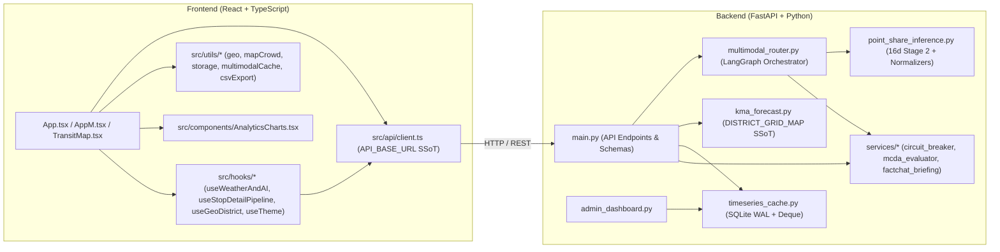

# 🧱 SOLID 아키텍처 & 코드 설계 가이드 (`SOLID_ARCHITECTURE_GUIDE.md`)

> **관련 이슈/PR**: Issue #138 · PR #139  
> **연관 문서**: [SYSTEM_ARCHITECTURE.md](SYSTEM_ARCHITECTURE.md) · [LOGGING_POLICY.md](LOGGING_POLICY.md) · [CACHING_POLICY.md](CACHING_POLICY.md)

이 문서는 **Weather & Transit Web** 프로젝트(백엔드 Python/FastAPI + 프론트엔드 React/TypeScript)가 **SOLID 5대 객체지향/모듈 설계 원칙**과 **단일 진실 공급원(SSoT)**을 일관되게 유지하기 위한 공식 아키텍처 가이드입니다.

---

## 1. SOLID 원칙별 프로젝트 적용 규격

| 원칙 | 핵심 정의 | 백엔드 (`*.py`, `services/`) 적용 기준 | 프론트엔드 (`src/`) 적용 기준 |
|---|---|---|---|
| **S**RP (단일 책임) | 한 모듈·클래스·함수는 하나의 변경 이유만 가진다 | 라우팅(`main.py`), 서킷브레이커(`services/circuit_breaker.py`), MCDA 평가(`services/mcda_evaluator.py`), LLM 브리핑(`services/factchat_briefing.py`) 분리 | 레이아웃 셸(`App.tsx`/`AppM.tsx`)과 상태/API(`src/hooks/*`), 차트(`src/components/AnalyticsCharts.tsx`), 순수 유틸(`src/utils/*`) 분리 |
| **O**CP (개방-폐쇄) | 기존 핵심 분기문 수정 없이 신규 기능을 확장한다 | `ModeEvaluator` 추상 인터페이스 + `MODE_EVALUATORS` 레지스트리 및 `SCORE_META_THRESHOLDS` 테이블 기반 확장 | 공통 상수(`src/constants/districts.ts`), 제네릭 캐시(`multimodalCache.ts`), 범용 CSV 유틸(`csvExport.ts`) 활용 |
| **L**SP (리스코프 치환) | 하위 구현체는 상위 계약을 깨지 않고 대체 가능해야 한다 | `InMemoryLogHandler`(`logging.Handler` 계약), `_CompiledFallbackGraph`(LangGraph 계약), `ModeEvaluator` 구현체 계약 준수 | PC(`App.tsx`) ↔ 모바일(`AppM.tsx`) 간 공통 훅(`useWeatherAndAI`, `useStopDetailPipeline`, `useGeoDistrict`, `useTheme`)의 동일 타입 계약 유지 |
| **I**SP (인터페이스 분리) | 클라이언트가 사용하지 않는 의존성을 강제하지 않는다 | 엔드포인트/서비스별 최소 입력 스키마 및 필요한 컨텍스트만 주입(`configure_mcda_context`) | 컴포넌트 `Props`와 유틸 함수를 도메인 단위로 최소화 (`geo.ts`, `mapCrowd.ts`, `storage.ts`) |
| **D**IP & SSoT (의존성 역전) | 고수준 로직이 저수준 구체 구현(DB/HTTP/Storage)에 직접 결합되지 않는다 | `timeseries_cache.get_cache_stats()`/`clear_cache()`, `kma_forecast.DISTRICT_GRID_MAP`, `point_share_inference` 정규화 함수만 사용; `FactChatBriefingService`에 `http_post` 콜백 주입 가능 | `src/api/client.ts::API_BASE_URL` 단일 소스 사용; `src/utils/storage.ts` 안전한 스토리지 래퍼 경유 |

---

## 2. 모듈 계층 및 의존성 구조

---

## 3. Issue #138 (Phase `1~4`) 주요 리팩토링 내역

### Phase 1 — 캐시 DIP 복원 및 백엔드 SSoT 통합
- **`timeseries_cache.py`**: `get_cache_stats()`, `clear_cache()` 메서드를 신설해 실제 SQLite 테이블(`weather_observations`, `transit_snapshots`) 제어 책임을 단일화했습니다.
- **`admin_dashboard.py` · `main.py`**: 존재하지 않는 `timeseries_cache` 테이블을 직접 SQL 조회·삭제하던 결합 버그를 제거하고 `timeseries_cache` 메서드 위임으로 교체했습니다.
- **SSoT 단일화**: `main.py`의 중복 `DISTRICT_KMA_GRID`를 제거하고 `kma_forecast.DISTRICT_GRID_MAP`으로 통합했으며, `scripts/export_point_share_serving_bundle.py`가 `point_share_inference`의 정규화 함수(`normalize_subway_name`, `normalize_bike_name`)를 직접 임포트하도록 정리했습니다.

### Phase 2 — 프론트엔드 API 단일화 및 PC·모바일 공통화
- **`src/api/client.ts`**: 6개 파일(`App.tsx`, `AppM.tsx`, `TransitMap.tsx`, `UnifiedStationSearch.tsx`, `BusStationSearch.tsx`, `BikeStationSearch.tsx`)에 중복되었던 `getApiBaseUrl()`을 단일 모듈로 통합했습니다.
- **공통 훅·컴포넌트 추출**: `App.tsx`와 `AppM.tsx` 상단에 95% 이상 복제되어 있던 상수(`districts.ts`), 스토리지(`storage.ts`), 차트 4종(`AnalyticsCharts.tsx`), 커스텀 훅 4종(`useTheme`, `useGeoDistrict`, `useWeatherAndAI`, `useStopDetailPipeline`)을 분리했습니다.

### Phase 3 — 백엔드 서비스 분리 & 지도 순수 유틸리티 추출
- **`services/circuit_breaker.py`**: `CircuitBreaker`를 독립 서비스로 분리하고 `Dockerfile.backend`에 `COPY services/ ./services/`를 추가했습니다.
- **`services/mcda_evaluator.py`**: `ModeEvaluator` 추상 인터페이스와 `MODE_EVALUATORS` 레지스트리, `SCORE_META_THRESHOLDS` 테이블을 도입해 수단별 분기 중복을 제거했습니다.
- **`services/factchat_briefing.py`**: FactChat LLM 게이트웨이 호출 및 XAI 규칙 엔진 폴백을 `FactChatBriefingService`로 분리하고 `http_post` 콜백 주입을 지원해 네트워크 없는 단위 테스트(`tests/test_solid_phase3.py`)가 가능하도록 개선했습니다.
- **`src/utils/geo.ts` · `src/utils/mapCrowd.ts`**: `TransitMap.tsx`의 Haversine 거리 계산, 최근접역 탐색, GPS 오차 반경 폴리곤, 마커 혼잡도 스타일링 순수 함수를 분리했습니다.

### Phase 4 — 패널/뷰 유틸리티 분리
- **`src/utils/multimodalCache.ts`**: `MultimodalRoutePanel.tsx`의 메모리/`localStorage` 제네릭 캐시를 분리했습니다.
- **`src/utils/csvExport.ts`**: `EnterpriseView.tsx`의 UTF-8 BOM CSV 직렬화 및 브라우저 다운로드를 분리했습니다.

---

## 4. 신규 개발 시 금지 패턴 (Anti-Patterns) & 체크리스트

### ❌ 금지 패턴
1. **DB·스토리지 우회 접근**: `admin_dashboard.py`나 `main.py`에서 `sqlite3.connect()`로 시계열 테이블을 직접 조회/삭제하는 행위.
2. **API Base URL 재구현**: 컴포넌트마다 `import.meta.env.VITE_API_BASE_URL`을 새로 파싱하는 행위 (`src/api/client.ts` 사용 필수).
3. **PC-모바일 코드 복제**: `App.tsx`에 새 상태/API 훅을 작성한 뒤 `AppM.tsx`에 그대로 복사하는 행위 (`src/hooks/` 또는 `src/components/`로 추출 필수).
4. **수단별 `if/elif` 복제**: `subway`·`bus`·`bike` 확장 시 기존 분기문을 복사해 누적하는 행위 (`MODE_EVALUATORS` 같은 레지스트리/매핑 테이블 사용).

### ✅ PR 전 자가 점검 체크리스트
- [ ] 새로 추가한 모듈·함수·컴포넌트가 단일 책임(SRP)을 가지는가?
- [ ] 기존 테스트(`tests.test_solid_phase1`, `tests.test_solid_phase3` 등)와 `npx tsc --noEmit`, `npm run build`를 통과하는가?
- [ ] 백엔드에 새 디렉터리/모듈 추가 시 `Dockerfile.backend`의 `COPY` 대상에 포함되었는가?
- [ ] PC(`App.tsx`)와 모바일(`AppM.tsx`)이 동일한 공통 훅·타입 계약을 공유하는가?
