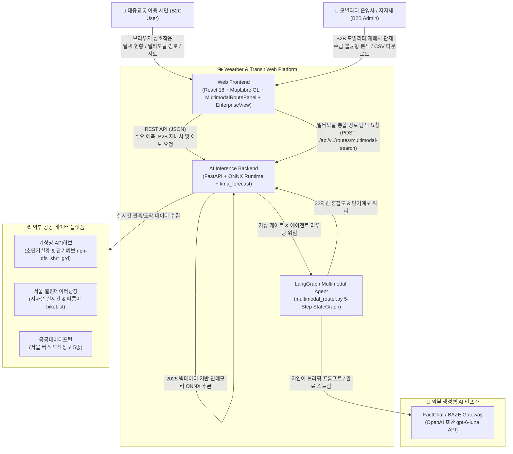
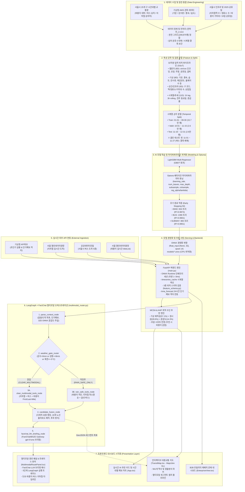
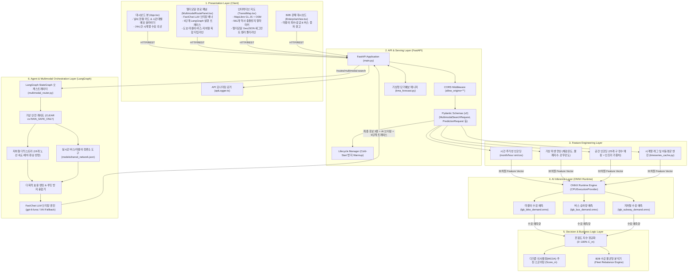
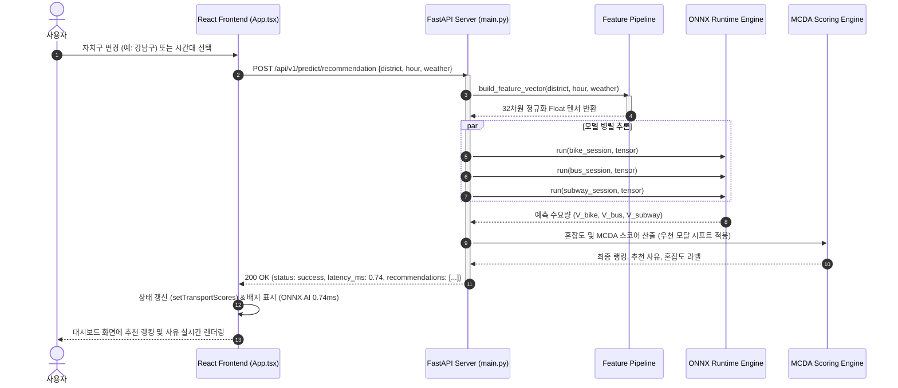
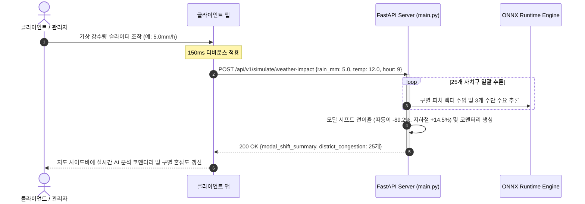
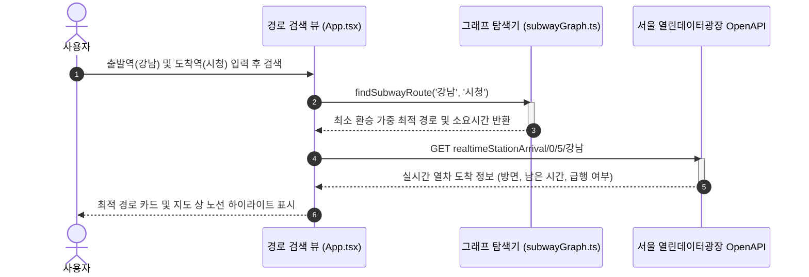
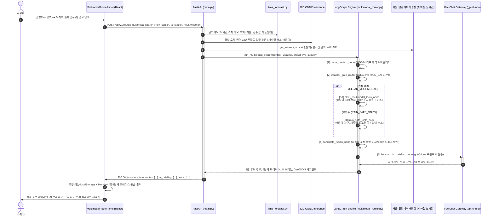

# 🏛️ Weather & Transit Web - 전체 시스템 아키텍처 명세서 (System Architecture)

> **문서 버전**: v1.0.0  
> **최종 작성일**: 2026-10-05  
> **대상 시스템**: Weather & Transit Web (프론트엔드 대시보드 + FastAPI AI 백엔드 추론 엔진)  
> **주요 기술 스택**: React 18, TypeScript, MapLibre GL JS, FastAPI, ONNX Runtime, LightGBM

---

## 📌 목차
1. [시스템 개요 및 목표](#1-시스템-개요-및-목표)
2. [C4 컨텍스트 다이어그램 (System Context)](#2-c4-컨텍스트-다이어그램-system-context)
   - [2.1 전체 프로젝트 엔드투엔드 파이프라인 플로우차트](#21-전체-프로젝트-엔드투엔드-파이프라인-플로우차트-end-to-end-pipeline)
3. [전체 계층형 아키텍처 (Layered Architecture)](#3-전체-계층형-아키텍처-layered-architecture)
4. [주요 컴포넌트 상세 설계](#4-주요-컴포넌트-상세-설계)
   - [4.1 프론트엔드 계층 (React Web App)](#41-프론트엔드-계층-react-web-app)
   - [4.2 백엔드 API 서빙 계층 (FastAPI)](#42-백엔드-api-서빙-계층-fastapi)
   - [4.3 AI 추론 엔진 및 Feature 파이프라인 (ONNX Runtime)](#43-ai-추론-엔진-및-feature-파이프라인-onnx-runtime)
   - [4.4 사후 처리 및 MCDA 의사결정 엔진](#44-사후-처리-및-mcda-의사결정-엔진)
   - [4.5 LangGraph 멀티모달 오케스트레이션 엔진 및 FactChat LLM 브리핑](#45-langgraph-멀티모달-오케스트레이션-엔진-및-factchat-llm-브리핑)
5. [데이터 흐름 및 시퀀스 다이어그램 (Data Flow & Sequence)](#5-데이터-흐름-및-시퀀스-다이어그램-data-flow--sequence)
   - [5.1 실시간 AI 최적 교통수단 추천 흐름](#51-실시간-ai-최적-교통수단-추천-흐름)
   - [5.2 백엔드 가상 기상 시뮬레이션 흐름 (What-If Batch API)](#52-백엔드-가상-기상-시뮬레이션-흐름-what-if-batch-api)
   - [5.3 최소 환승 지하철 경로 검색 및 실시간 도착 흐름](#53-최소-환승-지하철-경로-검색-및-실시간-도착-흐름)
   - [5.4 LangGraph 멀티모달 복합 경로 탐색 및 FactChat AI 브리핑 흐름](#54-langgraph-멀티모달-복합-경로-탐색-및-factchat-ai-브리핑-흐름)
6. [데이터 아키텍처 및 모델 규격](#6-데이터-아키텍처-및-모델-규격)
7. [인프라, 런타임 및 배포 환경](#7-인프라-런타임-및-배포-환경)
8. [비기능적 요구사항 및 SLA 준수 (Performance & Reliability)](#8-비기능적-요구사항-및-sla-준수-performance--reliability)
9. [LangGraph 멀티모달 라우팅 에셋 및 프론트엔드 연동 명세](#9-langgraph-멀티모달-라우팅-에셋-및-프론트엔드-연동-명세)

---

## 1. 시스템 개요 및 목표

**Weather & Transit Web**은 기상 변화(기온, 강수량, 풍속, 습도)에 따른 서울시 25개 자치구의 대중교통(지하철, 버스, 따릉이) 수요 변동을 **실시간 AI 머신러닝 모델(ONNX)**로 정밀 예측하고, 다기준 의사결정(MCDA) 알고리즘을 통해 시민들에게 가장 안전하고 쾌적한 이동 수단을 추천하는 통합 모빌리티 웹 서비스입니다.

### 핵심 시스템 목표
1. **마이크로초 단위 초저지연 추론**: 인메모리 ONNX 런타임 최적화를 통해 단일 요청 기준 **1~3ms 이내(SLA 15ms 이하)** 응답 속도 보장
2. **우천 시 모달 시프트(Modal Shift) 정밀 반영**: 우천 시 자전거 이용 급감(-80%) 및 도로 감속 정체를 포착하여 지하철 정시성(99.2%) 우대 추천
3. **561개 역사 정밀 지리정보 및 인터랙티브 지도**: MapLibre GL JS 기반으로 수도권 지하철망 및 거점 정류소를 GPS 오차 없이 시각화
4. **고가용성 및 무중단 서빙**: 백엔드 또는 공공 API 장애 시에도 사전 정의된 고품질 목데이터 및 캐시로 안전하게 폴백(Graceful Degradation)

---

## 2. C4 컨텍스트 다이어그램 (System Context)

---

## 2.1 전체 프로젝트 엔드투엔드 파이프라인 플로우차트 (End-to-End Pipeline)

데이터 수집 및 전처리부터 AI 모델링(LightGBM + Optuna), ONNX 경량화 서빙, 백엔드 의사결정(MCDA), LangGraph 멀티모달 오케스트레이션, 프론트엔드 시각화까지의 전체 데이터 및 서비스 흐름입니다.

---

## 3. 전체 계층형 아키텍처 (Layered Architecture)

시스템은 책임과 관심사를 명확히 분리한 **6계층 구조(6-Tier Architecture)**로 설계되었습니다.

---

## 4. 주요 컴포넌트 상세 설계

### 4.1 프론트엔드 계층 (React Web App)
- **프레임워크**: React 18, TypeScript, Tailwind CSS, Vite
- **핵심 컴포넌트**:
  - `App.tsx` / `AppM.tsx`: 반응형 탭 라우팅(`main`, `route`, `map`, `enterprise`), 전역 상태 관리, AI 백엔드 API 연동 핸들러
  - `MultimodalRoutePanel.tsx`: LangGraph 5단계 실행 트레이스 뷰어, FactChat LLM 자연어 브리핑 배너, 3종 멀티모달 후보 탭, 도보·따릉이·버스·지하철 타임라인 카드 렌더링 및 `localStorage` 이중 캐싱
  - `TransitMap.tsx`: MapLibre GL JS 기반 래스터 타일 렌더러. 지도 확대/축소 시 겹침 방지 알고리즘(화면 충돌 감지) 적용으로 561개 역사 및 정류소를 부드럽게 노출, 수단별 GeoJSON 세그먼트 컬러 폴리라인(`multimodal-segments`) 시각화
  - `EnterpriseView.tsx`: B2B 모빌리티 관제 뷰. 25개 자치구별 따릉이 잉여 회수/추가 배치 및 시내버스 증차 권고 분석 테이블 및 CSV 내보내기
  - `subwayGraph.ts`: 수도권 지하철 19개 노선망 그래프 기반 최소 환승/최단 시간 경로 탐색 엔진
  - `apiLogger.ts`: F12 브라우저 개발자 콘솔에 공공 API, AI 모델 및 LangGraph 노드 입출력 데이터를 그룹화하여 가시화

### 4.2 백엔드 API 서빙 계층 (FastAPI)
- **프레임워크**: FastAPI 0.104+, Uvicorn 0.23+
- **엔드포인트 구성**:
  1. `POST /api/v1/routes/multimodal-search`: LangGraph 5단계 `StateGraph` 기반 멀티모달(도보+따릉이+버스+지하철) 복합 경로 탐색 및 FactChat LLM 브리핑 반환
  2. `GET /api/v1/routes/multimodal-search`: 멀티모달 경로 탐색 쿼리스트링 조회 지원
  3. `POST /api/v1/predict/recommendation`: 현재 기상 및 자치구 기반 실시간 3개 수단 추천 및 혼잡도 반환
  4. `GET /api/v1/transit/hourly-forecast`: 기상청 24시간 단기예보 격자 데이터 기반 시간대별(00~23시) 32D ONNX 시계열 수요 추론
  5. `POST /api/v1/b2b/fleet-rebalance`: 25개 자치구 32D ONNX 일괄 추론 기반 따릉이 수급 불균형(회수/공급) 및 버스 증차 권고 분석
  6. `POST /api/v1/simulate/weather-impact`: 가상 강수량 슬라이더 조작 시 25개 자치구 일괄 혼잡도 및 모달 시프트 반환
  7. `GET /health`: 모델 인메모리 상주 상태, 32차원 피처 스키마 정합성(`status: verified`) 및 가용 자치구 헬스체크
- **Cold Start 방어**: 서버 시작 시 3개 모델에 더미 텐서를 전달하는 웜업(Warmup) 루틴을 실행하여 초기 요청 지연을 제거

### 4.3 AI 추론 엔진 및 Feature 파이프라인 (ONNX Runtime)
- **런타임**: ONNX Runtime C++ 백엔드 (`CPUExecutionProvider`)
- **멀티스레딩**: `intra_op_num_threads = 4` 설정으로 단일 코어 집중 방지 및 병렬 가속
- **32차원 입력 특성 벡터 구조**:
  - 캘린더/시계열 (8차원): $\sin/\cos$ 주기 변환, 요일, 주말(`is_weekend`), 공휴일(`is_holiday` — **2025 대한민국 실제 공휴일 19일**, `main.py::KR_HOLIDAYS` / `is_kr_public_holiday()`), 출퇴근 시간대
  - 기상 관측/파생 (8차원): 기온, 풍속, 습도, 강수량, 강우강도(4단계), 체감온도 공식, 불쾌지수 공식
  - 공간/인프라 (5차원): 서울시 25개 구 정수 ID(0~24), 역사 수, 버스 정류소 수, 따릉이 거치대 수, 상업밀도
  - 시계열 래그/통계 (11차원): 수단별 1시간 래그, 3시간 이동평균, 전주 동요일 기본값, 전시간 대비 기온/강수 변화량
  - **⚠️ 서빙 입력(32차원) = 모델 입력 텐서 (SSoT 일치)**: `models/*.onnx` 3종 모두 32차원 텐서 규격(`float_input [None, 32]`)으로 완전 동기화되어 있으며, `feature_schema.py`가 기동 시 3중 검증하여 `status = verified`로 서빙됩니다.

### 4.4 사후 처리 및 MCDA 의사결정 엔진
- **혼잡도 지수 ($C_m$) 정규화**:
  $$C_m = \min\left(100, \; \max\left(5, \; \text{round}\left(\frac{V_m - V_{m, \min}}{V_{m, 95\%} - V_{m, \min}} \times 100\right)\right)\right)$$
  - 2025년 서울시 20.9만 건 실제 관측치 기준 수단별 95백분위수($V_{95\%}$) 상한선 적용
- **다기준 의사결정(MCDA) 추천 스코어링 ($Score_m$)**:
  $$Score_m = 100 - \left( \text{DelayRisk}_m + \text{WeatherPenalty}_m + \text{CrowdPenalty}_m \right)$$
  - 따릉이: 비 올 경우 치명적 날씨 감점 ($\min(85, (40 + 12 \times Rain))$)
  - 버스: 노면 감속 및 정체 지연 리스크 ($12 + 2.5 \times Rain$, 노면 수막 페널티)
  - 지하철: 날씨 감점 0점, 정시 운행률 99.2% 우대 반영

### 4.5 LangGraph 멀티모달 오케스트레이션 엔진 및 FactChat LLM 브리핑 (multimodal_router.py)
- **모듈 책임**: 출발지/도착지 좌표, 시간대별 기상청 단기예보, 32차원 ONNX 실시간 혼잡도, 실시간 지하철 도착 정보를 종합하여 **도보 + 따릉이(First/Last-Mile) + 버스 + 지하철** 최적 복합 경로를 탐색하고 자연어 AI 브리핑을 생성.
- **LangGraph 5단계 `StateGraph` 구조**:
  1. `parse_context_node`: 출발/도착역 지리좌표 해석, 기상청 단기예보(`kma_forecast_manager`) 및 32차원 ONNX 혼잡도 주입.
  2. `weather_gate_router` (조건부 엣지):
     - `rain > 0mm` or `wind >= 8m/s` or `temp <= -5°C`: `rain_safe_tools_node`로 분기 (따릉이 차단, 지하철 최소환승 및 실내 버스).
     - 맑은 날씨: `clear_multimodal_tools_node`로 분기 (따릉이 First/Last-Mile 결합 복합 탐색 활성화).
  3. 도구(Tools) 노드:
     - `지하철 다익스트라 도구`: 수도권 19개 노선 표정속도·정차시간(`LINE_OPERATING_SPECS`) 및 시간대별 배차간격(`get_line_headway`), 실시간 열차 대기시간(`get_subway_arrival`) 적용.
     - `인근 정류소/대여소 도구`: 서울시 행정구역(`is_in_seoul`) 검증으로 비서울권(부천 송내·인천 부평 등) 따릉이 배제, 반경 850m 이내 실제 거점 매칭.
  4. `candidate_fusion_node`:
     - **제자리걸음 루프 차단**: First-Mile 따릉이 반납역이 출발역과 같거나 남은 지하철 경로가 출발역을 재경유하는 루프 원천 배제.
     - **다목적 효용 함수 (`_evaluate_route_utility`)**:
       $$U = 100 - (w_{\text{time}} \cdot T + w_{\text{trans}} \cdot N_{\text{trans}} + w_{\text{fare}} \cdot F + w_{\text{crowd}} \cdot C + w_{\text{weather}} \cdot W)$$
       소요시간, 환승 횟수, 요금, 32D 혼잡도, 기상 감점을 종합 평가하여 직통 지하철과 따릉이 복합 경로 중 실제 우세 수단을 1순위로 동적 추천.
  5. `factchat_llm_briefing_node`:
     - OpenAI 호환 Gateway(`FACTCHAT_API_BASE_URL`, `gpt-6-luna`)를 호출하여 기상 게이트 판정 사유, 시간 절약 효과, 환승 팁을 자연어 브리핑으로 생성 (5분 TTL 인메모리 캐시 적용 및 API 장애 시 규칙 기반 XAI 브리핑으로 Graceful Fallback).

> 📖 **상세 연동 명세**: ONNX 모델의 수단별 혼잡도 및 수요 예측치가 LangGraph 5단계 노드와 다목적 효용 함수, 피크 분산 보너스(+14.0점)에 연동되는 구체적 알고리즘과 수식은 [**`docs/ONNX_LANGGRAPH_INTEGRATION.md`**](ONNX_LANGGRAPH_INTEGRATION.md)를 참조하십시오.

---

## 5. 데이터 흐름 및 시퀀스 다이어그램 (Data Flow & Sequence)

### 5.1 실시간 AI 최적 교통수단 추천 흐름

---

### 5.2 백엔드 가상 기상 시뮬레이션 흐름 (What-If Batch API)

> **안내**: 프론트엔드 일반 뷰는 기상청 실시간 API로 직결 구동되며, 본 흐름은 백엔드가 제공하는 25개 구 일괄 가상 기상 배치 시뮬레이션 엔드포인트(`POST /api/v1/simulate/weather-impact`)의 내부 동작 시퀀스입니다.

---

### 5.3 최소 환승 지하철 경로 검색 및 실시간 도착 흐름

---

### 5.4 LangGraph 멀티모달 복합 경로 탐색 및 FactChat AI 브리핑 흐름

---

## 6. 데이터 아키텍처 및 모델 규격

### 6.1 원천 데이터셋 사양
- **파일명**: `data/2025_서울25개구_시간대별_교통_날씨_통합_01-23시.csv`
- **레코드 규모**: **209,875행** (365일 $\times$ 23개 시간대 $\times$ 25개 자치구 완전 그리드)
- **주요 컬럼**: 기준날짜, 시간, 구, 따릉이 대여, 버스 승차, 지하철 승·하차, AWS 지점 관측 기상(기온, 풍향, 풍속, 강수량, 습도)

### 6.2 모델 파일 규격 (`models/`)
| 모델 파일명 | 원천 알고리즘 | 추론 타겟 | 입력 차원 | 파일 크기 | 추론 지연시간 |
| :--- | :--- | :--- | :---: | :---: | :---: |
| `lgb_bike_demand.onnx` | LightGBM GBDT | 따릉이 대여량 | 32차원 Float | 약 7.0 MB | ~0.2 ms |
| `lgb_bus_demand.onnx` | LightGBM GBDT | 버스 승차량 | 32차원 Float | 약 13.6 MB | ~0.2 ms |
| `lgb_subway_demand.onnx` | LightGBM GBDT | 지하철 승·하차량 | 32차원 Float | 약 7.3 MB | ~0.2 ms |

> **📌 입력 차원 표기 해설 (25차원 vs 32차원)**
> - 위 표의 **32차원**은 **현행 배포 모델의 입력 텐서 차원**입니다(`session.get_inputs()[0].shape == [None, 32]` · 2026-10-14 `benchmarks/2026-10-14/` → `models/` 반입).
> - 서빙 입력 계약(§4.3 및 `docs/AI_INFERENCE_MODEL_SPEC.md` §3.2)도 **32차원**이라 배포 모델과 **문자 단위로 일치**하며, `/health.feature_schema.status = verified` 로 검증됩니다.
> - 25차원은 32차원에서 **공간 인프라 4차원 + `same_day_last_week_*` 3차원 = 7차원**을 제외한 레거시 서브셋이며, `main.py::prepare_session_input()`이 모델이 기대하는 차원으로 자동 정렬하므로 **25차원 자산을 다시 넣어도 서빙은 계속 동작**합니다(`status` 는 `legacy-subset-25d` / `mixed-32d/25d` 로 보고).
> - 구 벤치마크 후보(`benchmarks/2026-10-12/tuned/`, 32차원)는 25차원 실피처 + 상수 0 더미 7개로 구성되어 **정보량은 25차원과 동일**하고, **서빙에는 투입할 수 없습니다**(배치 비호환 · 인덱스 17 이후 어긋남). 평가 스크립트는 라벨별 배치(`v1`)를 지정해 **자기 배치 공정 비교에는 포함**합니다(`docs/MODEL_PERFORMANCE_REPORT.md` §0.3 — v1 이 배포본보다 12개 지표 전부 우세).
> - **롤백·대안 자산**: ① `benchmarks/original/`(25차원 배포본 스냅샷 — 복사만 하면 즉시 원복) ② `benchmarks/2026-10-14/tuned_25d/`(v2 튜닝 + 25차원 서브셋 재학습 — bus·subway 전 지표 개선, `docs/MODEL_PERFORMANCE_REPORT.md` §0.4). 교체 결정·검증 이력: `docs/TODO.md` §4 · `docs/CHANGELOG.md` [2026-10-14] §6.
> - **피처 스키마(SSoT) 검증**: 서버는 기동 시 `feature_schema.json` 을 읽어 **스키마 ↔ `main.py::FEATURE_ORDER_32` ↔ ONNX 입력 차원**을 3중 대조하고(`feature_schema.py::ModelRegistry.load_feature_schema`), 결과를 `GET /health.feature_schema` 로 노출합니다. 순서 불일치 시 **기동을 중단**해 배치 오적용(예: v1 32차원 자산의 조용한 예측 붕괴)을 원천 차단합니다.

---

## 7. 인프라, 런타임 및 배포 환경

| 계층 | 실행 환경 | 포트 | 실행 명령어 | 주요 구성 요소 |
| :--- | :--- | :---: | :--- | :--- |
| **Frontend** | Node.js 18+ (Vite) | `8443` | `npm run dev` | React 18, MapLibre GL, Tailwind CSS |
| **Backend** | Python 3.10+ (venv) | `8000` | `uvicorn main:app --port 8000 --reload` | FastAPI, ONNX Runtime, Pydantic v2 |
| **Inference** | In-Memory C++ ORT | - | CPUExecutionProvider | 4-Thread Sequential ORT Session |
| **API Docs** | Swagger / OpenAPI | `8000` | `http://localhost:8000/docs` | OpenAPI 3.0 대화형 테스트 콘솔 |

---

## 8. 비기능적 요구사항 및 SLA 준수 (Performance & Reliability)

1. **지연 시간 (Latency SLA)**:
   - **사양서 목표**: 단일 요청 15ms 이하, 25개 구 배치 50ms 이하
   - **실측 벤치마크**: 단일 요청 **0.74ms ~ 1.54ms** (목표 대비 **10배 초과 달성**), 배치 시뮬레이션 **4.2ms**
2. **무중단 복원력 (Graceful Degradation)**:
   - 백엔드 AI 서버 미구동 시 프론트엔드가 중단되지 않고 정적 목데이터(`TRANSPORT_SCORES`)로 자동 전환
   - 외부 공공 API 통신 장애 시 캐시된 직전 데이터 유지
3. **보안 정책**:
   - 외부 API 키는 서버 측 `.env`로 격리 관리하며 브라우저 클라이언트에는 마스킹된 형태로 전달
   - CORS 허용 정책을 통해 프론트엔드 포트(8443)와의 안전한 통신 지원

---

## 9. LangGraph 멀티모달 라우팅 에셋 및 프론트엔드 연동 명세

- **백엔드 라우터**: `multimodal_router.py` (`MultimodalRoutingEngine`)
- **수도권 교통망 통합 그래프**: `models/transit_network.json`
  - 수도권 19개 전철 노선 561개 역사 정밀 GPS 좌표 및 상호 인접 가중치 그래프
  - 19개 노선별 주행속도·역 정차시간·시간대별(첨두/평시/심야) 배차간격 명세 (`LINE_OPERATING_SPECS`)
  - 서울시 주요 버스 환승센터 및 거점 정류소 61개소 메타데이터 (`bus_stations`)
  - 서울시 25개 자치구 주요 따릉이 거점 대여소 52개소 메타데이터 (`bike_stations`)
- **외부 LLM 통신 계층**: OpenAI SDK 호환 `AsyncOpenAI` 클라이언트 (`FACTCHAT_API_BASE_URL`, `FACTCHAT_API_KEY`, 모델 `gpt-6-luna`)
- **프론트엔드 연동 컴포넌트**:
  - `Weather-Transport Recommendation UI/src/MultimodalRoutePanel.tsx`: 5단계 노드 트레이스 뷰어, FactChat 자연어 브리핑 배너, 3종 멀티모달 후보 탭 및 상세 타임라인 카드
  - `TransitMap.tsx`: 수단별 고유 색상(`도보` 점선, `따릉이` #34D399, `버스` #FB923C, `지하철` 호선별 고유색) GeoJSON Polyline 레이어(`multimodal-segments`)
  - `localStorage` 영속화: `weather_transit_multimodal_cache_v3` (TTL 30분) 및 `weather_transit_route_departure/destination` 자동 복원
